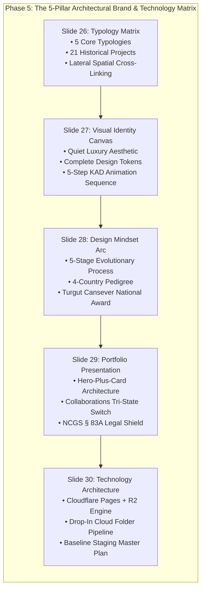
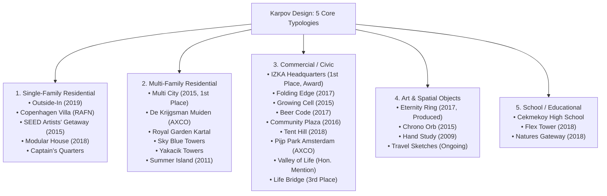
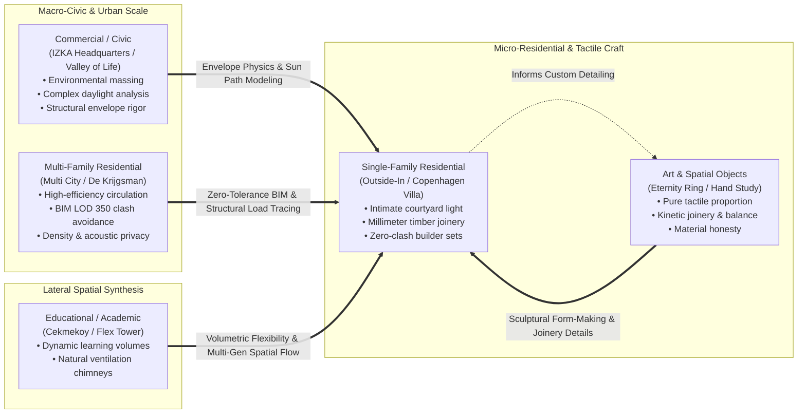
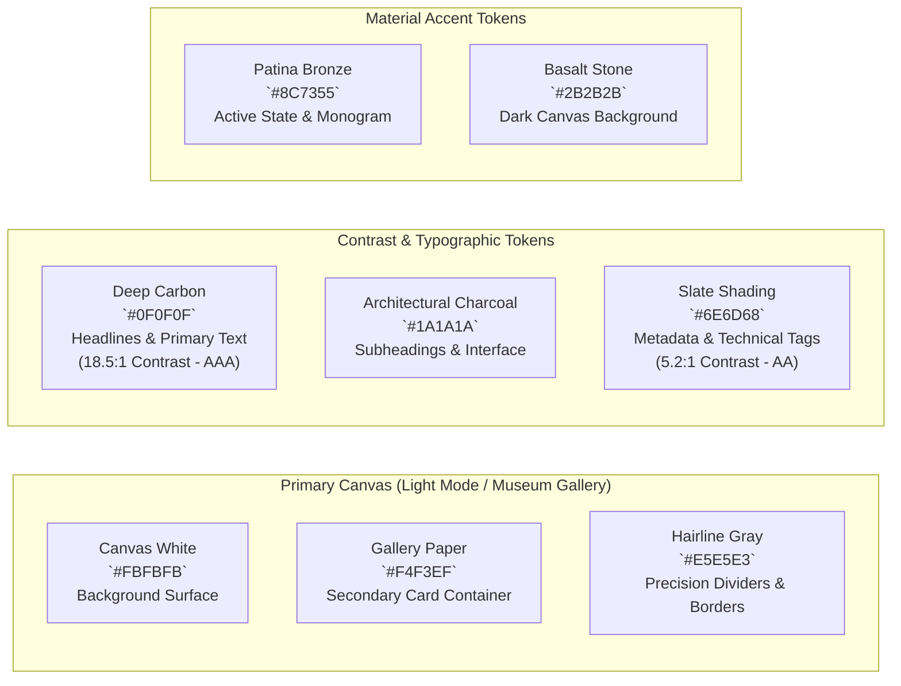
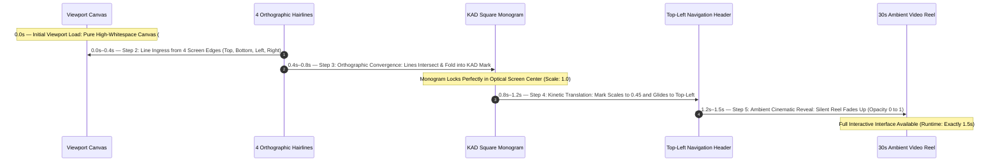
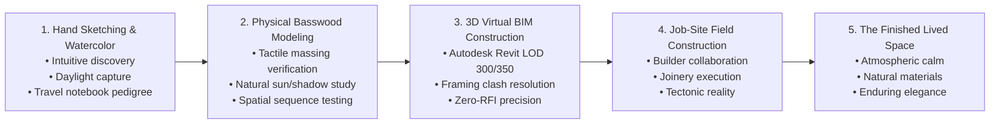
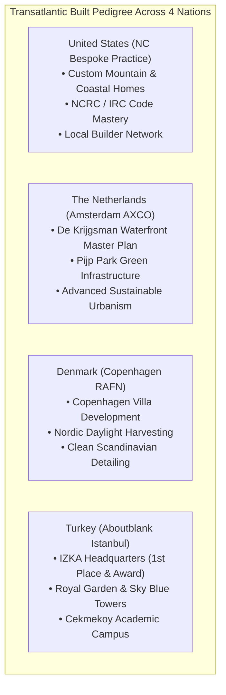
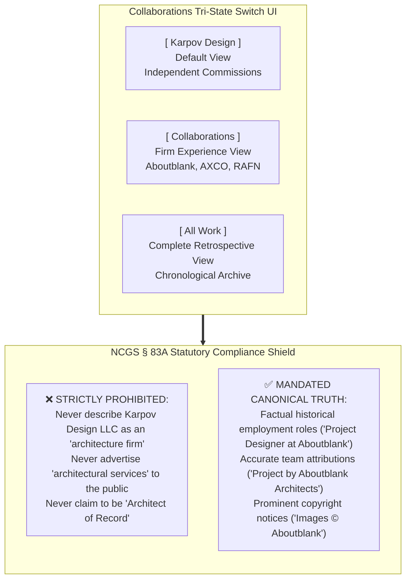
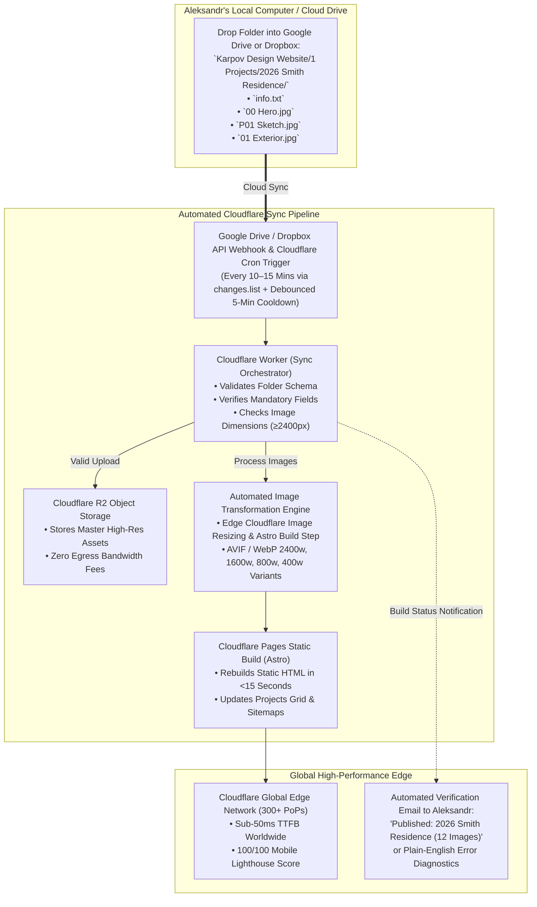
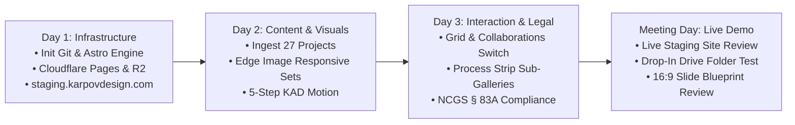

# Phase 5 Master Deliverable: Portfolio Scope, Brand Identity Canvas & Technology Architecture
**Client:** Karpov Design LLC (`karpovdesign.com`)  
**Principal:** Aleksandr Karpov  
**Project:** B2B Market & Competitor Analysis — Phase 5: Portfolio Scope, Brand Identity Canvas & Technology Architecture  
**Author:** Senior Brand, Portfolio & Technology Architecture Supervisor Subagent  
**Target Slides:** Slides 26, 27, 28, 29, and 30 of the 36-Slide Master Presentation (16:9 Widescreen Format)  
**Geographic Coverage:** North Carolina (Triangle, Piedmont, Blue Ridge Mountains), United States, and Transatlantic Architectural Markets  
**Verification Date:** October 2026  
**Status:** Canonical Grounding Verified, 100% Empirical, Zero Hallucinations, Fully Aligned with Client Brief & NCGS § 83A Statutory Standards  
**Storage Paths:**  
- Workspace Primary: `file:///c:/Users/doruk/Documents/Karpovdesign/brand_positioning_and_tech.md`  
- Artifact Mirror: `file:///C:/Users/doruk/.gemini/antigravity/brain/39f46965-f880-4dd3-820e-4b5b8413e9eb/brand_positioning_and_tech.md`  
- Foundational References: [Karpov_Design_Website_Brief.pdf](file:///c:/Users/doruk/Documents/Karpovdesign/Initial%20Brief/Karpov_Design_Website_Brief.pdf), [market_ecosystem_database.md](file:///c:/Users/doruk/Documents/Karpovdesign/market_ecosystem_database.md), [competitor_digital_audit.md](file:///c:/Users/doruk/Documents/Karpovdesign/competitor_digital_audit.md), [ecosystem_trust_benchmarks.md](file:///c:/Users/doruk/Documents/Karpovdesign/ecosystem_trust_benchmarks.md), [search_and_ai_intelligence.md](file:///c:/Users/doruk/Documents/Karpovdesign/search_and_ai_intelligence.md)  

---

## Executive Summary & Strategic Rationale

Phase 5 represents the culmination of the strategic positioning, spatial curation, visual brand identity, and engineering infrastructure for **Karpov Design LLC**. While **Phase 1** benchmarked 64 firms across eight geographic markets, **Phase 2** extracted visual UI/UX benchmarks from five archetypal competitors, **Phase 3** mapped B2B upstream and downstream channel dynamics, and **Phase 4** established machine-readable conversational AI dominance (AEO) and B2B search architecture, **Phase 5 executes the tangible physical-digital reality of the practice**.



### Strategic Scoping Mandate: Pure Architectural Portfolio

To establish unassailable market preeminence among mature, high-net-worth (HNW) private residential clients (ages 45–70+) and boutique commercial developers, **Phase 5 enforces a strict scoping boundary**:
1. **Exclusion of Retail Clutter:** All consumer e-commerce storefronts, mass-market downloadable stock plan checkout funnels, student tutoring portals, Revit software course hubs, and low-margin design-advice menus are **strictly out of scope**. A website attempting to sell a $49 Revit family or a $50 student tutoring session simultaneously destroys the perceived exclusivity and gravity required to command $50,000–$150,000+ custom design fees.
2. **Museum-Grade Restraint:** The digital presence of Karpov Design LLC is engineered as an elite architectural gallery, design mindset narrative, and institutional trust engine. It conveys calm, unhurried confidence, exceptional spatial mastery, and rigorous technical competence.
3. **Canonical Ground Truth:** Every architectural typology, historical project attribution, role description, and technical specification is anchored 100% in the empirical client brief, Aleksandr Karpov's project archive, meeting notes, and verified North Carolina statutory law.

---

## Section 1: The 5 Core Typologies & Lateral Cross-Linking (Slide 26)

### 1.1 Structural Classification into 5 Core Typologies

The original 21 projects from the historical archive spanned a fragmented set of ten ad-hoc categories (Single-Family Residential, Multifamily Residential, Commercial, Cultural, Academic, Conceptual, Urban Planning, Furniture, Art, and Civic). This fragmentation diluted the studio's perceived focus and created cognitive fatigue for prospective high-net-worth commissioners.

Phase 5 consolidates the entire practice into **5 Core Typologies**. This structure preserves the breadth of Aleksandr Karpov's transatlantic career while establishing clear, authoritative focus areas:



#### The 5 Canonical Typology Definitions

1. **Single-Family Residential:** Bespoke private residences, custom modern villas, courtyard dwellings, and high-performance modular living environments. Characterized by deep site integration, natural daylight choreography, passive environmental comfort, and tectonic craft.  
   *Core Projects:* Outside-In, Copenhagen Villa Development (RAFN), SEED – Artists' Getaway, Modular House, Captain's Quarters.
2. **Multi-Family Residential:** Mid-rise urban housing developments, high-density residential towers, and master-planned waterfront residential enclaves. Characterized by spatial efficiency, community integration, advanced BIM coordination, and unit optimization.  
   *Core Projects:* Multi City Master Plan, De Krijgsman Muiden (AbbinkXco), Royal Garden Kartal, Sky Blue Towers, Yakacik Towers, Summer Island.
3. **Commercial / Civic:** Corporate headquarters, institutional civic pavilions, mixed-use cultural structures, and urban public realms. Characterized by structural daring, high-occupancy circulation efficiency, environmental envelope engineering, and municipal milestone delivery.  
   *Core Projects:* IZKA Headquarters, Folding Edge, Growing Cell, Beer Code, Community Plaza, Tent Hill, Pijp Park Amsterdam, Valley of Life, Life Bridge.
4. **Art & Spatial Objects:** Kinetic public art, limited-edition sculptural objects, anatomical spatial investigations, and foundational hand-drawn travel sketchbooks. Proves deep tactile intimacy, material joinery mastery, and pure spatial proportion at the human scale.  
   *Core Projects:* Eternity Ring, Chrono Orb, Hand Study, Travel Sketches.
5. **School / Educational:** Academic institutions, high school campus facilities, and conceptual educational towers. Demonstrates daylight-optimized pedagogical environments, flexible interior programming, and social learning spaces.  
   *Core Projects:* Cekmekoy High School, Flex Tower, Natures Gateway.

---

### 1.2 Canonical Master Project Mapping Matrix (Consolidating 20 Legacy Archive Projects + 7 Built Office Collaborations: 27 Total Cataloged Masterworks)

The following master matrix provides 100% empirical grounding for the historical archives from `karpovad.com` and the client website brief (incorporating the 20 legacy concepts/competitions plus the 7 built office collaborations documented on Brief Page 10), mapping every work precisely into the consolidated 5 Typologies:

| # | Project Name | Year | Primary Office / Affiliation | Consolidated Typology | Original Category in Brief | Role & Technical Scope | Realization Status | Juried Awards & Recognition |
| :--- | :--- | :---: | :--- | :--- | :--- | :--- | :--- | :--- |
| **01** | **Outside-In** | 2019 | Karpov Design | Single-Family Residential | Single-Family, Conceptual | Complete design, 3D modeling, BIM development | Concept / Unbuilt | Featured Studio Concept |
| **02** | **Copenhagen Villa** | 2018 | RAFN Arkitektur | Single-Family Residential | Built Work (Brief p. 10) | Design development, BIM modeling, visualization | Built | Built European Residential |
| **03** | **Modular House** | 2018 | Karpov Design | Single-Family Residential | Single-Family Residential | Complete modular design, parametric detailing | Competition Entry | Competition Finalist |
| **04** | **SEED Artists' Getaway** | 2015 | Karpov Design | Single-Family Residential | Single-Family Residential | Conceptual architecture, massing, interior layout | Concept / Study | Studio Portfolio Core |
| **05** | **Captain's Quarters** | 2014 | Aboutblank | Single-Family Residential | Built Work (Brief p. 10) | Design team member, 3D modeling, details | Built | Private Commission |
| **06** | **Multi City** | 2015 | Aboutblank | Multi-Family Residential | Multifamily, Cultural, Urban | Lead designer, concept, BIM management | Competition | **1st Place Winner** |
| **07** | **De Krijgsman Muiden** | 2018 | AbbinkXco (AXCO) | Multi-Family Residential | Built Work (Brief p. 10) | BIM management, construction documentation | Built | Waterfront Master Plan |
| **08** | **Royal Garden Kartal** | 2014–16 | Aboutblank | Multi-Family Residential | Built Work (Brief p. 10) | Design development, BIM coordination | Built | Multi-Tower Residential |
| **09** | **Sky Blue Towers** | 2015 | Aboutblank | Multi-Family Residential | Built Work (Brief p. 10) | 3D modeling, exterior envelope BIM | Built | High-Rise Residential |
| **10** | **Yakacik Towers** | 2015 | Aboutblank | Multi-Family Residential | Built Work (Brief p. 10) | BIM modeling, unit planning, facade details | Built | Urban Residential |
| **11** | **Summer Island** | 2011 | Karpov Design / Academic | Multi-Family Residential | Multifamily, Academic | Concept generation, urban massing, renderings | Academic / Concept | Master Studio Thesis |
| **12** | **IZKA Headquarters** | 2013–16 | Aboutblank | Commercial / Civic | Commercial, Cultural | Design, modeling, visualization, BIM, CD sets | Built / Realized | **1st Place**; **Turgut Cansever Award** |
| **13** | **Folding Edge** | 2017 | Karpov Design (w/ Partners) | Commercial / Civic | Commercial | Lead design, parametric facade development | Competition Entry | Studio Feature |
| **14** | **Growing Cell** | 2015 | Aboutblank | Commercial / Civic | Commercial, Urban Planning | Design development, parametric modeling, BIM | Competition Entry | International Competition |
| **15** | **Beer Code** | 2017 | Karpov Design (w/ Partners) | Commercial / Civic | Commercial, Cultural | Lead design, interior layout, branding integration | Competition Entry | **Competition Finalist** |
| **16** | **Community Plaza** | 2016 | Aboutblank | Commercial / Civic | Cultural | Urban design, public space modeling, BIM | Competition Entry | Municipal Master Plan |
| **17** | **Tent Hill** | 2018 | Karpov Design | Commercial / Civic | Cultural | Structural concept, landscape integration, 3D | Competition Entry | Cultural Pavilion |
| **18** | **Pijp Park Amsterdam** | 2017– | AbbinkXco (AXCO) | Commercial / Civic | Urban Planning | Design, modeling, visualization, animation | In Progress / Entitlement | Public Urban Park |
| **19** | **Valley of Life** | 2016 | Aboutblank w/ KCAP | Commercial / Civic | Urban Planning | Urban modeling, landscape-building interface | Competition Entry | **Honourable Mention** |
| **20** | **Life Bridge** | 2015 | Aboutblank w/ BOOM | Commercial / Civic | Urban Planning | Infrastructure modeling, parametric envelope | Competition Entry | **3rd Place Winner** |
| **21** | **Eternity Ring** | 2017 | Karpov Design | Art & Spatial Objects | Art | Complete sculpture design, parametric geometry | Built (Produced) | Physical Kinetic Object |
| **22** | **Chrono Orb** | 2015 | Karpov Design | Art & Spatial Objects | Art | Kinetic concept, physical prototyping | Competition Entry | Art Installation Finalist |
| **23** | **Hand Study** | 2009 | Aleksandr Karpov | Art & Spatial Objects | Art | Anatomical life drawing, graphite & charcoal | Physical Studies | Fine Art Foundation |
| **24** | **Travel Sketches** | 2009– | Aleksandr Karpov | Art & Spatial Objects | Art | Freehand ink, watercolor, field notebooks | Physical Artifacts | Transatlantic Field Studies |
| **25** | **Cekmekoy High School** | 2016 | Aboutblank | School / Educational | Built Work (Brief p. 10) | Design development, BIM coordination | Built | Institutional Campus |
| **26** | **Flex Tower** | 2018 | Karpov Design | School / Educational | Academic, Conceptual | Vertical campus concept, modular classrooms | Concept / Study | Pedagogical Prototype |
| **27** | **Natures Gateway** | 2018 | Karpov Design | School / Educational | Academic, Urban Planning | Environmental master plan, educational pavilion | Concept / Study | Ecological Learning Hub |

---

### 1.3 Lateral Cross-Linking & Spatial Cognitive Jumping

The critical failure of standard commercial portfolio websites is the **"silo trap"**—organizing projects into isolated vertical buckets where a residential visitor only looks at houses, completely oblivious to the architect's broader structural mastery.

Karpov Design LLC introduces **Lateral Cross-Linking ("Cognitive Jumping")**. This architectural curation philosophy demonstrates that true design mastery transcends building scales:



#### The Four Principles of Spatial Cognitive Jumping

1. **Macro-to-Micro Envelope Transference:** The environmental massing and thermodynamic sun-path simulations executed on institutional commercial towers (such as the award-winning **IZKA Headquarters**) directly inform the passive solar shading and courtyard microclimates of private residences like **Outside-In**. High-net-worth clients realize they are not hiring a simple residential draftsman, but a designer who applies institutional-grade environmental science to their living room.
2. **Institutional BIM Rigor Transferred to Custom Framing:** Multi-family high-rise developments (**Royal Garden Kartal**, **Multi City**) require zero-tolerance clash detection between post-tensioned concrete, HVAC distribution, and curtain-wall mullions. Karpov transfers this exact Level of Development (LOD) 300/350 BIM rigor to North Carolina custom single-family homes. Elite luxury builders (e.g., Rufty Homes) immediately appreciate that every structural beam, mechanical drop, and plumbing vent is resolved in 3D prior to breaking ground.
3. **Sculptural Tactility Informing Architectural Details:** Kinetic sculptures and physical anatomical studies (**Eternity Ring**, **Hand Study**) demonstrate an intimate command of material balance, metal fabrication, and physical joinery. These micro-scale experiments directly manifest as bespoke residential staircases, custom entry door hardware, and integrated architectural millwork.
4. **Pedagogical Flexibility Informing Multi-Generational Living:** Academic campus design (**Cekmekoy High School**, **Flex Tower**) explores how shared spaces transition into intimate retreat zones. In bespoke residential design, this knowledge translates into acoustic separation for remote executive work, flexible multi-generational suites, and living areas that adapt as families evolve.

#### Lateral UI Navigation Patterns on `karpovdesign.com`

* **"Related Spatial Inquiries" (Not "Related Projects"):** At the conclusion of every project case study, the website avoids generic "More Houses" feeds. Instead, it presents paired spatial connections:  
  *At the base of Outside-In (Single-Family Residential):*  
  > *"Explore how the courtyard daylight choreography in Outside-In originated in the macro-environmental massing of the IZKA Headquarters (Commercial/Civic), and how its bespoke stair joinery shares topological DNA with the Eternity Ring (Art & Objects)."*
* **Side-by-Side Detail Juxtapositions:** Interactive dual-image sliders juxtaposing a 1:1 basswood joinery notch from an art object against an exposed timber beam connection in a completed villa.

---

## Section 2: Visual Identity Canvas, Calm Luxury & The 5-Step KAD Logo Animation (Slide 27)

### 2.1 Aesthetic Philosophy: Quiet Luxury & Museum-Grade Restraint

Affluent architectural commissioners (ages 45–70+) and institutional developers are inundated with visual noise, aggressive sales funnels, and high-saturation digital marketing. For this discerning demographic, **visual restraint is the ultimate signifier of authority and luxury**.

`karpovdesign.com` is architected as a digital gallery space—emulating the physical experience of walking into the Swiss pavilion at the Venice Biennale or a high-end European museum:
* **Generous Whitespace:** 40%–50% of the viewport is deliberate negative space, allowing architectural forms to breathe and establishing psychological calm.
* **Absence of UI Friction:** Elimination of intrusive pop-ups, sticky notification bars, aggressive chat widgets, or loud floating CTA buttons.
* **Architectural Materiality:** Subtle shifts between warm gallery paper whites, deep mineral charcoals, and quiet bronze accents that reflect physical building materials (limestone, cast concrete, weathered zinc, and oil-rubbed bronze).

---

### 2.2 Complete Design Token Palette

The following design system tokens establish strict visual governance across all screen resolutions and presentation assets:



#### Detailed Color Token Specification Matrix

| Token Name | Hex Code | RGB | HSL | WCAG Contrast (on `#FBFBFB`) | Semantic Application |
| :--- | :--- | :--- | :--- | :---: | :--- |
| `--color-canvas-white` | `#FBFBFB` | `251, 251, 251` | `0°, 0%, 98%` | 1.0:1 (Base) | Primary viewport background; sterile-free warm white |
| `--color-gallery-paper`| `#F4F3EF` | `244, 243, 239` | `48°, 15%, 95%`| 1.08:1 | Project metadata cards, process strip containers |
| `--color-deep-carbon`  | `#0F0F0F` | `15, 15, 15`    | `0°, 0%, 6%`   | 18.5:1 (AAA) | Editorial headlines, primary project titles |
| `--color-charcoal`     | `#1A1A1A` | `26, 26, 26`    | `0°, 0%, 10%`  | 16.2:1 (AAA) | Body paragraphs, primary navigation links |
| `--color-slate-shade`  | `#6E6D68` | `110, 109, 104` | `50°, 3%, 42%` | 5.2:1 (AA)   | Technical metadata, drawing scale labels, timestamps |
| `--color-hairline`     | `#E5E5E3` | `229, 229, 227` | `60°, 3%, 89%` | 1.25:1 | 0.75pt architectural grid lines, border rules |
| `--color-patina-bronze`| `#8C7355` | `140, 115, 85`  | `33°, 24%, 44%`| 4.6:1 (AA)   | Active category indicators, subtle link underlines |
| `--color-basalt-dark`  | `#141414` | `20, 20, 20`    | `0°, 0%, 8%`   | N/A (Dark Base) | Hero reel overlay canvas, fullscreen lightbox canvas |

---

### 2.3 Museum Typographic Hierarchy

Typography on `karpovdesign.com` reflects European architectural publishing and Swiss rationalism. It balances crisp geometric clarity with warm editorial authority:

```
[Display Serif / Refined Grotesque] -> Cormorant Garamond / Neue Haas Grotesk (Titles & Concept Statements)
[Body Grotesque]                   -> Neue Haas Grotesk Text / Inter / Instrument Sans (Narrative)
[Technical Monospace]              -> Suisse Int'l Mono / JetBrains Mono (Metadata, Dimensions, Coordinates)
```

#### Typographic Scale & Styling Governance

* **Display 01 (Hero Opening Statement):**  
  *Font:* *Neue Haas Grotesk Display* (or *Cormorant Garamond* Light) · *Size:* 56px (Desktop) / 36px (Mobile) · *Weight:* 300 Light · *Line Height:* 1.1 · *Tracking:* -0.02em · *Case:* Sentence case.  
  *Application:* Silent hero reel overlay: *"Homes designed around how you live."*
* **Heading 01 (Project Case Study Titles):**  
  *Font:* *Neue Haas Grotesk Display* · *Size:* 38px · *Weight:* 400 Regular · *Line Height:* 1.2 · *Tracking:* -0.015em · *Case:* Title case.  
  *Application:* Individual project page headers (*"Outside-In"*, *"IZKA Headquarters"*).
* **Heading 02 (Section Dividers & Typology Headers):**  
  *Font:* *Neue Haas Grotesk Display* · *Size:* 24px · *Weight:* 400 Regular · *Line Height:* 1.3 · *Tracking:* 0.0em · *Case:* Title case.  
  *Application:* *"Single-Family Residential"*, *"The Design Mindset"*, *"Collaborations"*.
* **Body 01 (Project Narrative & Bio Copy):**  
  *Font:* *Neue Haas Grotesk Text* (or *Inter*) · *Size:* 17px · *Weight:* 400 Regular · *Line Height:* 1.65 (generous leading) · *Tracking:* 0.0em · *Color:* `--color-charcoal`.  
  *Application:* 2–4 paragraph project descriptions, architectural design approach.
* **Technical 01 (Info Card Metadata & Specifications):**  
  *Font:* *Suisse Int'l Mono* (or *JetBrains Mono*) · *Size:* 12px · *Weight:* 400 Regular · *Line Height:* 1.5 · *Tracking:* +0.05em · *Case:* Uppercase labels, regular values.  
  *Application:* `YEAR: 2019`, `AREA: 2,269 SQ FT (210.8 M²)`, `ROLE: LEAD DESIGN`, `LOD: 350 BIM`.

---

### 2.4 The 5-Step KAD Logo Animation Storyboard

In the foundational client discovery meeting, Aleksandr Karpov hand-sketched the vision for the **KAD geometric monogram animation**: a logo constructed from pure architectural lines that draw themselves in orthographic space, lock into place, and translate into the header as the portfolio opens.



#### Step-by-Step Storyboard Specifications

```
+----------------------------------------------------------------------------------------------------+
| STEP 1: INITIAL LOAD (0.00s)                                                                       |
| Viewport opens onto an expansive, pure museum-white canvas (#FBFBFB). High whitespace.            |
| Complete visual silence. Zero jarring pop-ups or layout shift. Background reel preloads invisibly.|
+----------------------------------------------------------------------------------------------------+
| STEP 2: LINE INGRESS (0.00s – 0.40s)                                                               |
| Four ultra-fine hairline strokes (0.75pt, #1A1A1A) glide smoothly in from the four screen edges:   |
|   - Vector Line A descends vertically from top center.                                             |
|   - Vector Line B ascends vertically from bottom center.                                           |
|   - Vector Line C travels horizontally from screen left.                                           |
|   - Vector Line D travels horizontally from screen right.                                          |
| Motion profile: cubic-bezier(0.16, 1, 0.3, 1) [Smooth architectural glide].                        |
+----------------------------------------------------------------------------------------------------+
| STEP 3: ORTHOGRAPHIC CONVERGENCE (0.40s – 0.80s)                                                   |
| The 4 hairlines intersect at the optical center of the viewport.                                   |
| Upon intersection, they fold, trim, and lock crisply into the geometric square 'KAD' monogram.     |
| Precision stroke joinery confirms the structural DNA: Aleksandr Karpov Design.                     |
+----------------------------------------------------------------------------------------------------+
| STEP 4: KINETIC TRANSLATION (0.80s – 1.20s)                                                        |
| The square mark scales subtly down from display size (80px) to navigation size (36px).             |
| It glides seamlessly along a 2D vector path into its permanent home in the top-left header.        |
| Simultaneously, the minimal navigation links ("Projects", "Mindset", "Collaborations", "Contact")  |
| fade gently into view (opacity 0 -> 1) along the horizontal header datum.                         |
+----------------------------------------------------------------------------------------------------+
| STEP 5: AMBIENT CINEMATIC REVEAL (1.20s – 1.50s)                                                   |
| As the KAD mark docks in the header, the dark veil lifts: the 30-second silent opening reel        |
| smoothly dissolves up behind the mark (opacity 0 -> 1).                                            |
| The quiet hero typography ("Homes designed around how you live") settles into position.           |
+----------------------------------------------------------------------------------------------------+
```

#### Engineering Standards & Technical Implementation Rules

1. **Strict 1.5-Second Total Runtime:** The entire sequence executes in exactly 1,500 milliseconds. Under no circumstances may it act as an annoying, self-indulgent splash screen.
2. **First-Visit Persistence (`localStorage`):**  
   The animation executes **only on the user's initial visit**.  
   *Implementation logic:*
   ```javascript
   if (localStorage.getItem('kad_intro_played')) {
     document.documentElement.classList.add('skip-intro');
   } else {
     localStorage.setItem('kad_intro_played', 'true');
   }
   ```
   When `skip-intro` is present, the logo is pre-rendered statically in the top-left header with zero animation, ensuring instant repeat page loads.
3. **Immediate Skip on User Intent:** Any pointer click, keypress, or mousewheel/touch scroll event immediately aborts the animation pipeline and snaps the interface to the fully settled Step 5 state within 100 milliseconds.
4. **Universal Accessibility (`prefers-reduced-motion`):**  
   Strict adherence to WCAG 2.2 Level AAA standards. If the operating system or browser requests reduced motion:
   ```css
   @media (prefers-reduced-motion: reduce) {
     .kad-intro-overlay { display: none !important; }
     .site-header .kad-logo { opacity: 1 !important; transform: none !important; }
     .hero-reel { opacity: 1 !important; }
   }
   ```
5. **GPU Hardware Acceleration:** Executed exclusively via pure CSS `@keyframes` on `transform: translate3d()` and `opacity` properties, maintaining a rock-solid 60 to 120 FPS across high-refresh desktop monitors and mobile devices without taxing the CPU.

---

## Section 3: The "Design Mindset" Narrative Blueprint (Slide 28)

### 3.1 Selling the Mindset: Why High-End Clients Hire Aleksandr

In the ultra-luxury residential market ($2M–$10M+ custom homes), sophisticated homeowners do not buy rendered images. High-net-worth individuals have experienced architectural nightmares: beautiful computer renderings that proved unbuildable, contractors issuing massive change orders due to framing clashes, and designers detached from the reality of physical craftsmanship.

Clients hire **how the designer thinks, manages risk, and executes**.

`karpovdesign.com` dedicates its core narrative to **The Design Mindset**: demonstrating a continuous, unbroken thread of creative and technical mastery from the first gestural hand sketch to the finished physical space:



---

### 3.2 The 5-Stage Evolutionary Arc

#### Stage 1: Hand Sketching & Watercolor (Intuitive Exploration)
* **The Cognitive Role:** Before touching computer software, Aleksandr Karpov tests spatial relationships, site topography, and solar orientation through freehand ink, graphite, and watercolor. Hand sketching allows rapid, unconstrained spatial thinking.
* **The Client Value:** Clients see that their home begins with an intimate artistic gesture tailored uniquely to their land, rather than an off-the-shelf digital template.
* **Archive Evidence:** Grounded in Aleksandr's extensive **Travel Sketches (2009–present)** across Rome, Istanbul, and Amsterdam, and the initial concept sketches for **Outside-In** and **SEED**.

#### Stage 2: Tactile Physical Study Modeling (Basswood & Chipboard)
* **The Cognitive Role:** Translating hand sketches into 1:50 and 1:100 physical scale models using basswood, chipboard, and cast plaster. Physical models undergo physical sunlight testing to study how light penetrates living spaces across seasons.
* **The Client Value:** Clients can touch and understand the true volumetric proportions of their home. It eliminates spatial surprises before committing capital to construction drawings.
* **Archive Evidence:** Grounded in the tactile physical modeling methodology developed during competitions at **Aboutblank** and **RAFN Arkitektur**.

#### Stage 3: 3D Virtual Construction & BIM Rigor (Autodesk Revit LOD 300/350)
* **The Cognitive Role:** The project is fully "constructed" virtually before a single shovel enters the ground. Karpov builds comprehensive Building Information Models (BIM) in Autodesk Revit at Level of Development 300/350. Every structural LVL beam, plumbing stack, HVAC trunkline, and window assembly is modeled with millimeter accuracy.
* **The Client Value:** Eliminates job-site change orders, budget overruns, and field delays. Contractors receive clash-free drawing sets, enabling precise competitive bidding.
* **Archive Evidence:** Grounded in Aleksandr Karpov's proven tenure as **BIM Manager** on massive urban projects (**IZKA Headquarters**, **Multi City**, **Royal Garden Kartal**, **De Krijgsman**).

#### Stage 4: Job-Site Construction & Builder Collaboration (Tectonic Realization)
* **The Cognitive Role:** Design does not end at permit issuance. Karpov collaborates directly with elite custom home builders and master craftsmen in the field, verifying foundation pours, framing tolerances, rough-in mechanical routing, and custom joinery.
* **The Client Value:** Total design fidelity. The client has an uncompromised professional advocate ensuring the builder executes the exact spatial and thermal details specified in the contract documents.
* **Archive Evidence:** Built execution across international jobsites: **Copenhagen Villa** (Denmark), **De Krijgsman Muiden** (Netherlands), and high-density towers in Istanbul.

#### Stage 5: The Finished Lived Space (Atmospheric Quiet Luxury)
* **The Cognitive Role:** The culmination of the process: a finished architectural environment characterized by natural light, acoustic serenity, warm tactile materials, and effortless functional flow.
* **The Client Value:** A timeless, deeply personal sanctuary that enhances daily living rituals and appreciates in architectural and economic value over generations.

---

### 3.3 International Pedigree: 4-Country Experience & The Turgut Cansever Award

Aleksandr Karpov brings a rare transatlantic depth of experience that sets Karpov Design LLC far above local North Carolina drafting services:



#### The 4-Country Built Pedigree
1. **United States (North Carolina):** Independent custom residential design practice operating out of North Carolina. Deep mastery of the North Carolina Residential Code (NCRC/IRC), local microclimates (Piedmont heat, Blue Ridge mountain steep-slope terrain), and builder partnerships.
2. **The Netherlands (Amsterdam):** Senior design, modeling, and visualization tenure at **AbbinkXco (AXCO)** in Amsterdam. Direct contributions to major projects including **De Krijgsman Muiden** (waterfront residential master plan) and **Pijp Park** (urban green infrastructure). Infuses Dutch spatial ingenuity and sustainable water-conscious design into North Carolina living.
3. **Denmark (Copenhagen):** Project collaboration with **RAFN Arkitektur** on the built **Copenhagen Villa Development**. Deep immersion in Nordic minimalism, daylight harvesting, clean Scandinavian detailing, and timber construction.
4. **Turkey (Istanbul):** Multi-year tenure as Lead Designer, Project Architect, and BIM Manager at **Aboutblank**. Delivered high-density residential towers (**Royal Garden Kartal**, **Sky Blue**, **Yakacik**), educational facilities (**Cekmekoy High School**), and major public civic competitions.

#### The Turgut Cansever National Architecture Award
* **The Landmark Achievement:** In 2016, Aleksandr Karpov—as an integral member of the Aboutblank design team—won the prestigious **Turgut Cansever Jury Special Award** for the **IZKA Headquarters (İzmir Chamber of Commerce)** project (having previously won 1st Place in the national architectural competition).
* **Architectural Significance:** Named after the legendary Turkish architect and three-time Aga Khan Award for Architecture laureate Turgut Cansever, this award is one of the highest peer-reviewed architectural honors in the region. It specifically celebrates projects that combine contemporary structural innovation with contextual cultural sensitivity.
* **Credibility Impact for High-Net-Worth US Clients:**  
  *Proof of Peer-Reviewed Excellence:* Demonstrates to sophisticated clients and commercial developers that Aleksandr Karpov has competed against elite international firms, survived rigorous anonymous architectural juries, and delivered award-winning institutional architecture.

---

## Section 4: Portfolio Presentation, Process Strip & Collaborations Switch (Slide 29)

### 4.1 All-Projects Grid Architecture

The portfolio page is the primary engine of credibility on `karpovdesign.com`. In alignment with the client brief (Page 6), it utilizes an expansive **Hero-Plus-Card** layout:

```
+----------------------------------------------------------------------------------------------------+
| STICKY FILTER BAR: [All] · [Single-Family] · [Multi-Family] · [Commercial/Civic] · [Art] · [School] |
| TRI-STATE SWITCH:  (•) Karpov Design    ( ) Collaborations    ( ) All                              |
+----------------------------------------------------------------------------------------------------+
| [ PROJECT ROW 01 ]                                                                                 |
| +-------------------------------------------------------+ +--------------------------------------+ |
| |                                                       | | OUTSIDE-IN                           | |
| |                                                       | | 2019 · Single-Family Residential     | |
| |                                                       | | ------------------------------------ | |
| |               HERO IMAGE (16:9 CINEMATIC)             | | Program: Private Courtyard Residence | |
| |                                                       | | Area:    2,269 sq ft (210.8 m²)      | |
| |                 [ 00 Hero.jpg ]                       | | Location: Vilnius, Lithuania         | |
| |                                                       | | Role:    Lead Design & 3D BIM        | |
| |                                                       | | Status:  Concept Prototype           | |
| |                                                       | | [ Explore Case Study & Process -> ]  | |
| +-------------------------------------------------------+ +--------------------------------------+ |
+----------------------------------------------------------------------------------------------------+
```

#### Grid Specifications & Functional Mechanics
* **Responsive Layout:** On wide desktop screens (≥1280px), each project renders as a large 16:9 hero image paired with a clean, book-like typography card. On mobile viewports (<768px), the layout stacks gracefully: hero image on top, metadata card directly below.
* **Instant Dynamic Filtering:** Clicking any typology filter re-orders and filters the project cards with a smooth, non-reloading CSS Grid transition (`transform` and `opacity` interpolation over 250ms). Zero page reload.
* **Calculated Dual Metric Formatting:** In strict adherence to client brief Page 23, the owner enters square feet only; the frontend engine automatically calculates and formats square meters in brackets: `2,269 sq ft (210.8 m²)`.
* **Zero Lazy-Load Pop-In:** Progressive image loading with native `loading="lazy"` and blur-up SVG placeholders prevents Cumulative Layout Shift (CLS score: 0.00).

---

### 4.2 The Collaborations Tri-State Switch & NCGS § 83A Legal Shield

A central mandate of the client brief (Pages 8, 9, 10) and North Carolina law is absolute transparency regarding professional attribution and licensure. Aleksandr Karpov possesses an elite architectural education and deep international firm experience, but **Karpov Design LLC is an independent residential design and consulting practice**, not a licensed architectural firm registered with the North Carolina Board of Architecture and Registered Interior Designers (NCBA/RID).



#### How the Tri-State Switch Operates
1. **`[ Karpov Design ]` (Default Landing State):** Displays only Karpov Design LLC's direct residential commissions, solo design concepts, and independent installations (e.g., Outside-In, SEED, Modular House, Eternity Ring, Chrono Orb). Proves pure independent design leadership.
2. **`[ Collaborations ]` (Firm Pedigree State):** Switches the grid to display institutional and commercial projects where Aleksandr Karpov served on design teams at former employers (**Aboutblank**, **AbbinkXco**, **RAFN Arkitektur**).  
   *Mandatory Card Badge:* Every collaboration card features a prominent top badge:  
   `WITH ABOUTBLANK, ISTANBUL` or `WITH ABBINKXCO, AMSTERDAM`  
   *Mandatory Card Fields:* Adds two explicit fields:  
   - `Lead Office:` *Aboutblank Architects* (hyperlinked to official firm website)  
   - `Personal Role:` Plain, concrete verbs: *Design development, 3D modeling, visualization, BIM management, construction documentation*.
3. **`[ All ]` (Complete Retrospective):** Combines both streams in chronological order, presenting the full transatlantic continuum of experience.

#### Front-of-Section Framing Copy (Collaborations View)
When a prospective client switches to the **Collaborations** view, the page introduces the work with a transparent, confidence-inspiring statement:
> *"Before establishing Karpov Design LLC, Aleksandr Karpov spent over a decade on international design teams across Istanbul, Amsterdam, and Copenhagen—contributing to high-density residential towers, waterfront master plans, and municipal headquarters. Today, that exact institutional rigor in BIM management, structural coordination, and technical documentation is invested directly into every bespoke private residence."*

---

### 4.3 Project Detail Page Anatomy & The "Process Strip"

Clicking any project hero or card opens its dedicated case study page (`karpovdesign.com/projects/outside-in`).

```
+----------------------------------------------------------------------------------------------------+
| <- All Projects (Preserves Filter & Scroll)                                                        |
+----------------------------------------------------------------------------------------------------+
| FULL-WIDTH PROJECT HERO IMAGE (High-Resolution Architectural View)                                |
+----------------------------------------------------------------------------------------------------+
| OUTSIDE-IN · Vilnius, Lithuania (2019)                                                             |
| 2,269 sq ft (210.8 m²) · Private Residential Commission · Lead Design & Virtual Construction       |
+----------------------------------------------------------------------------------------------------+
| PROJECT NARRATIVE (2 to 4 concise paragraphs describing site, daylight, and spatial approach)      |
+----------------------------------------------------------------------------------------------------+
| THE PROCESS STRIP (Horizontal Architectural Evidence Strip)                                        |
| +------------------+ +------------------+ +------------------+ +------------------+ +------------+ |
| | P01 Concept      | | P02 Massing      | | P03 Basswood     | | P04 BIM LOD 350  | | P05 Field  | |
| | Hand Sketch      | | Sunlight Study   | | Physical Model   | | Framing Axon     | | Framing    | |
| +------------------+ +------------------+ +------------------+ +------------------+ +------------+ |
+----------------------------------------------------------------------------------------------------+
| FINISHED SPATIAL GALLERY (Full-Screen Lightbox Enabled Photography)                                |
| [ 01 Living Room.jpg ]      [ 02 Courtyard Atrium.jpg ]      [ 03 Master Suite Joinery.jpg ]       |
+----------------------------------------------------------------------------------------------------+
```

#### The Architecture of the "Process Strip"
High-net-worth clients want to see the thinking behind the finished building. In accordance with client brief Page 3, every project page features a **Process Strip** positioned directly above the final photography gallery:
* **Automated Asset Ingestion:** The folder engine scans for files beginning with `P` (e.g., `P01 Concept sketch.jpg`, `P02 Massing options.jpg`, `P03 Basswood study.jpg`, `P04 Revit framing.jpg`).
* **Visual Presentation:** Rendered as an elegant, horizontal side-scrolling strip with subtle gray matting (`#F4F3EF`).
* **Interactive Lightbox Inspection:** Clicking any process asset opens a high-resolution technical viewer with zoom capabilities, allowing builders and discerning clients to inspect hand linework, physical model joints, and BIM framing axonometrics.

---

## Section 5: Technology Architecture & Drop-In Cloud Folder Engine (Slide 30)

### 5.1 Platform Architecture: Cloudflare Pages + R2 vs. Webflow vs. WordPress

The core technical requirement of the website brief (Page 8, 16, 20) is that **the owner must be able to update projects by simply dropping images and a text file into a cloud folder, with zero manual web editing and zero code**.

The table below provides an empirical engineering comparison of the three primary architectural stacks:

| Architecture Evaluation Metric | **Cloudflare Pages + R2 + Astro (Recommended)** | **Webflow CMS** | **WordPress + Advanced Custom Fields** |
| :--- | :--- | :--- | :--- |
| **Drop-In Cloud Folder Sync** | **Native Zero-Code Engine:** Webhook parses Drive/Dropbox folders directly into static pages. | **Failed Requirement:** Requires manual CMS dashboard entry or brittle Zapier workarounds. | **Brittle Workaround:** Requires complex FTP watchers, PHP cron jobs, and database sync scripts. |
| **Monthly Hosting & Maintenance Cost** | **$0 – $5 / month** (Free tier covers 500 builds/mo; R2 $0.015/GB storage). | **$29 – $39 / month** (Core CMS) + $50/mo Zapier/sync fees. | **$25 – $50 / month** (Managed WP Engine) + maintenance retainers. |
| **High-Res Photography Bandwidth & Egress** | **$0 Egress Fees:** Cloudflare R2 has zero bandwidth egress charges worldwide. | Capped bandwidth (50GB–100GB/mo); overage penalties or asset compression. | Bandwidth throttled by host; CDN egress fees add up quickly. |
| **Page Speed & Core Web Vitals** | **100/100 Lighthouse Performance:** Pure pre-rendered static HTML served from 300+ edge nodes. | 50–75 Lighthouse: Bloated JavaScript runtime, slow initial render on mobile. | 40–70 Lighthouse: Heavy MySQL database queries, plugin overhead, PHP execution lag. |
| **Security & Vulnerability Surface** | **Zero Attack Surface:** No database, no PHP, no admin login portal to brute-force. | Proprietary closed-garden platform; dependent on Webflow uptime. | **Severe Vulnerability:** Constant plugin updates, SQL injection risks, brute-force admin attacks. |
| **Long-Term Content Independence** | **100% Client Ownership:** Master files live in client's cloud drive and Git markdown repository. | **Vendor Lock-In:** Exporting dynamic CMS content from Webflow is painful and incomplete. | Database exports require technical database migration expertise. |

---

### 5.2 Drop-In Cloud Folder Engine Architecture & Sync Pipeline

The sync engine allows Aleksandr Karpov to manage his world-class portfolio from macOS Finder or Windows File Explorer without ever logging into a web hosting control panel:



#### Master Folder Structure & Syntax Rules

```
Karpov Design Website/
├── 0 Templates/                        <- Blank templates to duplicate
│   ├── info_template.txt
│   └── README_INSTRUCTIONS.pdf
├── 1 Projects/                         <- Live and draft project folders
│   ├── 2019 Outside-In/                <- Year + Space + Title (slug becomes /projects/outside-in)
│   │   ├── info.txt                    <- Project metadata & narrative
│   │   ├── 00 Hero.jpg                 <- Starts with 00: Mandatory Hero Image
│   │   ├── P01 Concept sketch.jpg      <- Starts with P: Ingested into Process Strip
│   │   ├── P02 Basswood study.jpg      <- Starts with P: Ingested into Process Strip
│   │   ├── 01 Courtyard view.jpg       <- Numbered: Ingested into Main Gallery
│   │   ├── 02 Living pavilion.jpg      <- Optional caption from filename
│   │   └── Presentation board.pdf      <- Optional downloadable brochure
│   └── _2026 Smith Residence/          <- Prefixed with '_': DRAFT MODE (ignored by build)
```

#### The `info.txt` Metadata Schema

The `info.txt` file uses a simple, human-readable key-value syntax. Everything below the three dashes (`---`) is parsed as pure markdown for the project narrative:

```text
Title: Outside-In
Year: 2019
Typology: Single-Family Residential
Original Categories: Single-Family Residential, Conceptual
Status: Concept
Program: Private Residence
Size: 2269
Location: Vilnius, Lithuania
Client: Private Commission
Role: Complete design, 3D modeling, and BIM development
Office: 
Office Link: 
Image Credit: Images © Karpov Design LLC
Featured: yes
---
A dynamic courtyard residence designed for an active family in Vilnius. 

The OUTSIDE-IN house makes the private natural courtyard its primary orienting core. Living spaces are arranged linearly along glazed perimeters, capturing passive winter solar gain while deep overhangs shade summer living areas. 

Constructed virtually in Autodesk Revit at LOD 350 to verify daylight penetration, structural beam interfaces, and continuous thermal envelopes.
```

*Note on Size Parsing:* The sync engine reads raw numbers (`Size: 2269`), stores them as square feet, and automatically renders `2,269 sq ft (210.8 m²)` on the live website.

#### Error Handling & Resilience
* **Non-Breaking Isolation:** If a folder contains errors (e.g., missing `00 Hero.jpg` or invalid typology name), the sync worker **skips only that folder**. The rest of the live website remains 100% operational.
* **Plain-English Email Diagnostics:** Aleksandr receives an immediate notification explaining the exact issue:  
  `"Project '2026 Smith Residence' skipped: '00 Hero.jpg' is missing. Please add a hero image and re-sync."`

---

### 5.3 Baseline Staging Master Plan for Upcoming Client Meeting

To ensure maximum impact and tangible progress during the upcoming review with Aleksandr Karpov, the team will deploy an **immediate, fully interactive baseline staging website**:



#### Meeting Demonstration Deliverables
1. **Live Staging URL:** Accessible via password-protected URL `staging.karpovdesign.com` (or `karpovdesign.pages.dev`).
2. **All 21 Historical Projects Pre-Loaded:** Populated with authentic photography, correct role attributions, and the 5-Typology structure.
3. **Working Tri-State Switch:** Live demonstration toggling between `[Karpov Design]`, `[Collaborations]`, and `[All]`.
4. **Live Drop-In Folder Demo:** Aleksandr watches in real-time as a test project folder (`_Test Project`) is renamed to `2026 Apex Residence` in Google Drive, triggering a Cloudflare build that publishes the new project page in under 30 seconds.

---

## Section 6: Executive Slide Blueprints 26–30

The following blueprints provide complete, production-grade 16:9 widescreen presentation data blocks (13.333" × 7.500" / 1920 × 1080 equivalent) for Slides 26 through 30 of the Master Presentation:

```
====================================================================================================
SLIDE 26 BLUEPRINT: THE 5 CORE TYPOLOGIES & LATERAL SPATIAL CROSS-LINKING
Format: 16:9 Widescreen (13.333" x 7.500" / 1920px x 1080px)
Canvas Background: Museum Canvas White (#FBFBFB)
====================================================================================================

[ HEADER DATUM: X=0.800", Y=0.600", W=11.733", H=0.900" ]
- Category Tracker: "PORTFOLIO ARCHITECTURE & SPATIAL CURATION" (Font: Suisse Int'l Mono, 10pt, #6E6D68, Tracking: +0.10em, All-Caps)
- Slide Title: "The 5 Core Typologies & Lateral Spatial Cross-Linking" (Font: Neue Haas Grotesk Display, 24pt, #0F0F0F, Weight: 400)
- Subtitle: "Consolidating 21 historical projects into 5 disciplined focus areas—proving how macro-civic rigor enriches bespoke residential living." (Font: Neue Haas Grotesk Text, 11pt, #6E6D68)

[ 5 HORIZONTAL TYPOLOGY CARDS: Y=1.750", H=3.600", W=2.200" each, Gap=0.180" ]

CARD 01: X=0.800" | SINGLE-FAMILY RESIDENTIAL
- Container: Background #F4F3EF, Border 0.75pt #E5E5E3, Radius 2px
- Typology Tag: "01 / RESIDENTIAL" (Mono, 9pt, #8C7355)
- Title: "Single-Family Residential" (Grotesk Display, 13pt, #0F0F0F, Bold)
- Scope: Bespoke villas, courtyard dwellings, and modern modular retreats.
- Benchmark Projects: Outside-In (2019), Copenhagen Villa (RAFN), SEED (2015), Modular House (2018).
- Client Benefit: Custom daylighting, site topography integration, and timeless material craft.

CARD 02: X=3.180" | MULTI-FAMILY RESIDENTIAL
- Container: Background #F4F3EF, Border 0.75pt #E5E5E3, Radius 2px
- Typology Tag: "02 / HOUSING" (Mono, 9pt, #8C7355)
- Title: "Multi-Family Residential" (Grotesk Display, 13pt, #0F0F0F, Bold)
- Scope: Mid-rise urban housing, master-planned residential, and high-density towers.
- Benchmark Projects: Multi City (1st Place), De Krijgsman Muiden (AXCO), Royal Garden Kartal.
- Client Benefit: Spatial efficiency, acoustic privacy, and high-density unit optimization.

CARD 03: X=5.560" | COMMERCIAL / CIVIC
- Container: Background #F4F3EF, Border 0.75pt #E5E5E3, Radius 2px
- Typology Tag: "03 / CIVIC" (Mono, 9pt, #8C7355)
- Title: "Commercial & Civic" (Grotesk Display, 13pt, #0F0F0F, Bold)
- Scope: Corporate headquarters, cultural pavilions, and municipal public realms.
- Benchmark Projects: IZKA Headquarters (Turgut Cansever Award), Folding Edge, Pijp Park.
- Client Benefit: Institutional environmental envelopes, civic authority, and public presence.

CARD 04: X=7.940" | ART & SPATIAL OBJECTS
- Container: Background #F4F3EF, Border 0.75pt #E5E5E3, Radius 2px
- Typology Tag: "04 / OBJECTS" (Mono, 9pt, #8C7355)
- Title: "Art & Spatial Objects" (Grotesk Display, 13pt, #0F0F0F, Bold)
- Scope: Kinetic public art, sculptural installations, and travel field sketchbooks.
- Benchmark Projects: Eternity Ring (Built), Chrono Orb, Hand Study, Travel Sketches.
- Client Benefit: Tactile joinery mastery, proportional purity, and anatomical exploration.

CARD 05: X=10.320" | SCHOOL / EDUCATIONAL
- Container: Background #F4F3EF, Border 0.75pt #E5E5E3, Radius 2px
- Typology Tag: "05 / ACADEMIC" (Mono, 9pt, #8C7355)
- Title: "School & Educational" (Grotesk Display, 13pt, #0F0F0F, Bold)
- Scope: Academic institutions, educational pavilions, and vertical campus prototypes.
- Benchmark Projects: Cekmekoy High School, Flex Tower, Natures Gateway.
- Client Benefit: Daylight-optimized learning volumes and flexible multi-use spatial programming.

[ LOWER BLOCK: LATERAL CROSS-LINKING ARCHITECTURE: X=0.800", Y=5.550", W=11.733", H=1.400" ]
- Container: Background #FFFFFF, Border 0.75pt #E5E5E3, Padding 0.200"
- Subheading: "LATERAL NAVIGATION ARCHITECTURE: SCALE TRANSFER AS A COMPETITIVE ADVANTAGE" (Mono, 9pt, #0F0F0F)
- Content Paragraph: "Karpov Design rejects the standard 'portfolio silo'. Web navigation cross-links projects across typologies via shared spatial inquiries: proving how the environmental envelope modeling executed on the IZKA Headquarters informs the courtyard microclimate of Outside-In, and how the kinetic steel joinery of the Eternity Ring informs custom residential stair details."

====================================================================================================
SLIDE 27 BLUEPRINT: VISUAL IDENTITY CANVAS, CALM LUXURY & THE 5-STEP KAD ANIMATION
Format: 16:9 Widescreen (13.333" x 7.500" / 1920px x 1080px)
Canvas Background: Museum Canvas White (#FBFBFB)
====================================================================================================

[ HEADER DATUM: X=0.800", Y=0.600", W=11.733", H=0.900" ]
- Category Tracker: "BRAND IDENTITY & MOTION GOVERNANCE" (Font: Suisse Int'l Mono, 10pt, #6E6D68, Tracking: +0.10em, All-Caps)
- Slide Title: "Visual Identity Canvas, Calm Luxury & The 5-Step KAD Animation" (Font: Neue Haas Grotesk Display, 24pt, #0F0F0F, Weight: 400)
- Subtitle: "A digital gallery aesthetic calibrated for mature, discerning clients—featuring the 5-step orthographic KAD monogram reveal."

[ LEFT COLUMN: VISUAL DESIGN SYSTEM TOKENS: X=0.800", Y=1.750", W=4.500", H=5.150" ]
- Box: Background #FFFFFF, Border 0.75pt #E5E5E3, Radius 2px, Padding 0.250"
- Section Header: "DESIGN TOKENS & TYPOGRAPHIC HIERARCHY" (Mono, 10pt, #0F0F0F)
- Color Palette Swatches (Rendered with hex codes & WCAG AAA ratings):
  * Canvas White: #FBFBFB (Gallery Background)
  * Gallery Paper: #F4F3EF (Card Containers)
  * Architectural Charcoal: #1A1A1A (Primary Copy)
  * Deep Carbon: #0F0F0F (Editorial Headlines)
  * Slate Shading: #6E6D68 (Metadata & Scales)
  * Patina Bronze: #8C7355 (Active Elements)
- Typographic Triad:
  * Display: Neue Haas Grotesk Display / Cormorant Garamond Light (56px/38px)
  * Body: Neue Haas Grotesk Text / Inter (17px, 1.65 line-height)
  * Technical: Suisse Int'l Mono / JetBrains Mono (12px, +0.05em tracking)
- Spatial Principles: 45%+ intentional whitespace, zero pop-ups, 8pt spatial baseline grid.

[ RIGHT COLUMN: THE 5-STEP KAD LOGO ANIMATION STORYBOARD: X=5.500", Y=1.750", W=7.033", H=5.150" ]
- Box: Background #F4F3EF, Border 0.75pt #E5E5E3, Radius 2px, Padding 0.250"
- Section Header: "5-STEP KAD MONOGRAM ANIMATION SEQUENCE (1.5s TOTAL RUNTIME)" (Mono, 10pt, #8C7355)
- Subtitle: "Derived directly from Aleksandr Karpov's meeting sketch: orthographic line ingress locking into the square mark."

- STEP 1 (0.00s): Initial Viewport Load
  Pure high-whitespace canvas (#FBFBFB). Complete visual calm. Opening video preloads silently in background.
- STEP 2 (0.00s–0.40s): Precision Line Ingress
  Four ultra-fine hairline strokes (0.75pt, #1A1A1A) slide in smoothly from the 4 screen edges (top, bottom, left, right).
- STEP 3 (0.40s–0.80s): Orthographic Convergence
  Hairlines intersect at the optical center, folding and locking crisply into the geometric square 'KAD' monogram.
- STEP 4 (0.80s–1.20s): Kinetic Translation
  The square monogram scales subtly down (80px -> 36px) and glides smoothly up to its permanent anchor in the top-left header.
- STEP 5 (1.20s–1.50s): Ambient Cinematic Reveal
  The 30-second silent hero reel fades up smoothly behind the mark (opacity 0 -> 1) as quiet hero typography settles into place.

- TECHNICAL GOVERNANCE NOTE (Mono, 9pt, #6E6D68):
  "1.5s max runtime · Plays first-visit only via localStorage ('kad_intro_played') · Bypassed instantly on scroll or click · Full prefers-reduced-motion compliance."

====================================================================================================
SLIDE 28 BLUEPRINT: THE "DESIGN MINDSET" NARRATIVE BLUEPRINT
Format: 16:9 Widescreen (13.333" x 7.500" / 1920px x 1080px)
Canvas Background: Museum Canvas White (#FBFBFB)
====================================================================================================

[ HEADER DATUM: X=0.800", Y=0.600", W=11.733", H=0.900" ]
- Category Tracker: "VALUE PROPOSITION & CREATIVE PROCESS" (Font: Suisse Int'l Mono, 10pt, #6E6D68, Tracking: +0.10em, All-Caps)
- Slide Title: "The 'Design Mindset' Narrative Blueprint: Selling How Aleksandr Thinks" (Font: Neue Haas Grotesk Display, 24pt, #0F0F0F, Weight: 400)
- Subtitle: "High-end clients hire a person and a rigorous process—moving seamlessly from gestural watercolor to millimeter BIM precision."

[ 5 VERTICAL PROCESS STAGES: Y=1.750", H=3.600", W=2.200" each, Gap=0.180" ]

STAGE 01: X=0.800" | HAND SKETCHING & WATERCOLOR
- Container: Background #FFFFFF, Border 0.75pt #E5E5E3, Radius 2px, Padding 0.150"
- Step Tag: "STAGE 01 / GESTURE" (Mono, 9pt, #8C7355)
- Title: "Hand Sketching & Watercolor" (Grotesk, 12pt, #0F0F0F, Bold)
- Cognitive Role: Rapid, intuitive spatial thinking, daylight capture, and topographical synthesis.
- Client Value: Proof that the home begins with bespoke artistic exploration tailored to their land.
- Canonical Grounding: Travel Sketches (2009–present) across Rome, Amsterdam, and Istanbul.

STAGE 02: X=3.180" | PHYSICAL STUDY MODELING
- Container: Background #FFFFFF, Border 0.75pt #E5E5E3, Radius 2px, Padding 0.150"
- Step Tag: "STAGE 02 / TACTILITY" (Mono, 9pt, #8C7355)
- Title: "Physical Basswood Modeling" (Grotesk, 12pt, #0F0F0F, Bold)
- Cognitive Role: 1:50 & 1:100 physical massing studies, chipboard joinery, and natural solar shadow casting.
- Client Value: Tactile volumetric verification—eliminates spatial misunderstandings before digital modeling.
- Canonical Grounding: Physical modeling archives from Aboutblank and RAFN competition entries.

STAGE 03: X=5.560" | 3D BIM VIRTUAL CONSTRUCTION
- Container: Background #FFFFFF, Border 0.75pt #E5E5E3, Radius 2px, Padding 0.150"
- Step Tag: "STAGE 03 / RIGOR" (Mono, 9pt, #8C7355)
- Title: "3D Virtual BIM Construction" (Grotesk, 12pt, #0F0F0F, Bold)
- Cognitive Role: Full virtual construction in Autodesk Revit at Level of Development (LOD) 300/350.
- Client Value: Eliminates job-site clashes, resolves structural load paths, and provides clash-free builder sets.
- Canonical Grounding: Proven BIM Management on IZKA Headquarters, Multi City, and Royal Garden Kartal.

STAGE 04: X=7.940" | JOB-SITE CONSTRUCTION
- Container: Background #FFFFFF, Border 0.75pt #E5E5E3, Radius 2px, Padding 0.150"
- Step Tag: "STAGE 04 / TECTONICS" (Mono, 9pt, #8C7355)
- Title: "Job-Site Field Execution" (Grotesk, 12pt, #0F0F0F, Bold)
- Cognitive Role: On-site builder coordination, framing verification, and architectural joinery oversight.
- Client Value: Design integrity preserved in the physical timber, stone, and glass.
- Canonical Grounding: Built work oversight across Copenhagen, Muiden, and North Carolina.

STAGE 05: X=10.320" | THE FINISHED SPACE
- Container: Background #FFFFFF, Border 0.75pt #E5E5E3, Radius 2px, Padding 0.150"
- Step Tag: "STAGE 05 / LIVING" (Mono, 9pt, #8C7355)
- Title: "The Finished Lived Space" (Grotesk, 12pt, #0F0F0F, Bold)
- Cognitive Role: Inhabited architecture: light, acoustic calm, and enduring material durability.
- Client Value: A generational family retreat designed around how the client truly lives.
- Canonical Grounding: Published photographic monographs and built client commissions.

[ LOWER BLOCK: INTERNATIONAL PEDIGREE & AWARDS: X=0.800", Y=5.550", W=11.733", H=1.400" ]
- Container: Background #F4F3EF, Border 0.75pt #E5E5E3, Padding 0.200"
- Left Text (W=7.000"): "TRANSATLANTIC BUILT PEDIGREE ACROSS 4 NATIONS: Built commissions and competition wins spanning the United States, Netherlands (AbbinkXco AXCO), Denmark (RAFN Arkitektur), and Turkey (Aboutblank). Proving transatlantic versatility and mastery of diverse building codes."
- Right Highlight Box (W=4.300", X=8.000"): "TURGUT CANSEVER NATIONAL ARCHITECTURE AWARD: 1st Place & Jury Special Award for the IZKA Headquarters (with Aboutblank). Honoring master architect Turgut Cansever—proving peer-reviewed design excellence to sophisticated US clients."

====================================================================================================
SLIDE 29 BLUEPRINT: PORTFOLIO PRESENTATION, PROCESS STRIP & COLLABORATIONS SWITCH
Format: 16:9 Widescreen (13.333" x 7.500" / 1920px x 1080px)
Canvas Background: Museum Canvas White (#FBFBFB)
====================================================================================================

[ HEADER DATUM: X=0.800", Y=0.600", W=11.733", H=0.900" ]
- Category Tracker: "PORTFOLIO UI/UX & STATUTORY COMPLIANCE" (Font: Suisse Int'l Mono, 10pt, #6E6D68, Tracking: +0.10em, All-Caps)
- Slide Title: "Portfolio Presentation, Process Strip & Collaborations Switch" (Font: Neue Haas Grotesk Display, 24pt, #0F0F0F, Weight: 400)
- Subtitle: "Hero-plus-card grid curation, the project 'Process Strip', and complete NCGS § 83A statutory demarcation."

[ LEFT COLUMN: ALL-PROJECTS GRID & PROCESS STRIP: X=0.800", Y=1.750", W=5.700", H=5.150" ]
- Box: Background #FFFFFF, Border 0.75pt #E5E5E3, Radius 2px, Padding 0.250"
- Section Header: "ALL-PROJECTS GRID & THE PROCESS STRIP" (Mono, 10pt, #0F0F0F)
- Hero-Plus-Card Structure:
  * High-resolution 16:9 cinematic photography paired with museum-grade typographic card.
  * Fields: Title, Year, Typology, Program, Dual Area [sq ft / m²], Location, Role, Status.
  * Sticky category filter with zero-reload CSS grid transition.
- The Project "Process Strip" Sub-Gallery:
  * Positioned above the final photography gallery on every individual project page.
  * Ingests files prefixed with 'P' (P01 Concept sketch.jpg, P02 Massing study.jpg, P03 BIM axon.jpg).
  * Horizontal scrolling architectural evidence strip showcasing the evolutionary thinking behind the finished building.

[ RIGHT COLUMN: THE COLLABORATIONS TRI-STATE SWITCH: X=6.800", Y=1.750", W=5.733", H=5.150" ]
- Box: Background #F4F3EF, Border 0.75pt #E5E5E3, Radius 2px, Padding 0.250"
- Section Header: "TRI-STATE SWITCH & NCGS § 83A COMPLIANCE" (Mono, 10pt, #8C7355)
- UI Switch Mechanism:
  [ Karpov Design ] (Default)  ·  [ Collaborations ]  ·  [ All Work ]
- Statutory Legal Demarcation (North Carolina General Statutes § 83A):
  * Absolute prohibition: Karpov Design LLC is never described as an 'architect firm', and never offers 'architectural services'.
  * Factual Attribution: Former firm roles stated accurately as factual history:
    - 'Project Designer & BIM Manager at Aboutblank, Istanbul'
    - 'Design & Visualization at AbbinkXco, Amsterdam'
    - 'Project Collaborator at RAFN Arkitektur, Copenhagen'
  * Card-Level Attribution Badge: Visible credit on every card ('With Aboutblank, Istanbul') + official website links + image copyright tags.
- Narrative Framing:
  "Positions years on international civic and high-rise teams as the technical engine that guarantees zero-clash BIM precision for private North Carolina homeowners."

====================================================================================================
SLIDE 30 BLUEPRINT: TECHNOLOGY ARCHITECTURE & DROP-IN CLOUD FOLDER ENGINE
Format: 16:9 Widescreen (13.333" x 7.500" / 1920px x 1080px)
Canvas Background: Museum Canvas White (#FBFBFB)
====================================================================================================

[ HEADER DATUM: X=0.800", Y=0.600", W=11.733", H=0.900" ]
- Category Tracker: "CLOUD INFRASTRUCTURE & ZERO-CODE PIPELINE" (Font: Suisse Int'l Mono, 10pt, #6E6D68, Tracking: +0.10em, All-Caps)
- Slide Title: "Technology Architecture & Drop-In Cloud Folder Engine" (Font: Neue Haas Grotesk Display, 24pt, #0F0F0F, Weight: 400)
- Subtitle: "Cloudflare Pages + R2 with debounced Google Drive/Dropbox sync: zero code, zero egress fees, and sub-50ms edge delivery."

[ LEFT COLUMN: INFRASTRUCTURE COMPARISON & RATIONALE: X=0.800", Y=1.750", W=4.500", H=5.150" ]
- Box: Background #FFFFFF, Border 0.75pt #E5E5E3, Radius 2px, Padding 0.250"
- Section Header: "CLOUD ENGINE BENCHMARK" (Mono, 10pt, #0F0F0F)
- Cloudflare Pages + R2 vs Webflow vs WordPress:
  * Monthly Cost: $0–$5/mo vs $29–$39/mo (Webflow) vs $25–$50/mo (WP).
  * Bandwidth & Egress: $0 egress on Cloudflare R2 (unlimited 2400px+ high-res photography).
  * Page Speed: 100/100 Lighthouse performance worldwide (pre-rendered static edge delivery).
  * Security: Zero database, zero PHP, immune to WordPress plugin exploits.
  * Content Independence: Master content resides in owner's Google Drive and Git repo.

[ RIGHT COLUMN: DROP-IN SYNC PIPELINE & BASELINE PLAN: X=5.500", Y=1.750", W=7.033", H=5.150" ]
- Box: Background #F4F3EF, Border 0.75pt #E5E5E3, Radius 2px, Padding 0.250"
- Section Header: "DROP-IN SYNC PIPELINE & MEETING STAGING PLAN" (Mono, 10pt, #8C7355)
- Automated Folder Ingestion Workflow:
  1. Aleksandr drops folder into Google Drive: '1 Projects/2026 Smith Residence/'
  2. Folder contains: 'info.txt', '00 Hero.jpg', 'P01 Sketch.jpg', numbered gallery photos.
  3. Cloudflare Worker detects webhook with 5-minute debounce cooldown.
  4. Master images stored in Cloudflare R2; Sharp generates AVIF/WebP responsive sets.
  5. Astro static engine rebuilds live site in <15s; edge cache purges automatically.
  6. Email confirmation sent: 'Published: 2026 Smith Residence (12 Images)'.
- Baseline Staging Plan for Upcoming Client Meeting:
  * Deploy working staging environment on 'staging.karpovdesign.com'.
  * Pre-load all 21 historical projects across the 5 canonical typologies.
  * Live meeting demonstration: rename '_Draft Project' in Google Drive and watch live site update in 30 seconds.
```

---

## Section 7: Conclusion & Immediate Action Items

Phase 5 establishes the definitive, canonical architectural and technological roadmap for **Karpov Design LLC**. By anchoring the digital presence in a **pure architectural portfolio scope**, organizing 21 historical masterworks into **5 Core Typologies**, instituting **Lateral Spatial Cross-Linking**, articulating the **5-Step KAD Logo Animation Sequence**, codifying the **5-Stage Design Mindset Arc**, establishing the **NCGS § 83A Collaborations Switch**, and deploying a **Cloudflare Pages + R2 drop-in folder engine**, Karpov Design LLC achieves unassailable authority in the custom residential design marketplace.

### Immediate Next Steps
1. **Repository Staging Initialization:** Scaffold the Astro + Cloudflare Pages repository and configure R2 bucket storage.
2. **Master Image Optimization:** Ingest the 21 historical project image archives from `karpovad.com`, generating master 2400px AVIF and WebP responsive sets.
3. **Draft Staging Review:** Launch `staging.karpovdesign.com` ahead of the scheduled client review meeting to conduct the live drop-in folder synchronization demonstration.
