# Phase 3 Master Deliverable: Adjacent Ecosystem Dynamics, Case Studies & Trust Architecture
**Client:** Karpov Design LLC (`karpovdesign.com`)  
**Principal:** Aleksandr Karpov  
**Project:** B2B Market & Competitor Analysis — Phase 3: Adjacent Ecosystem Dynamics, Case Studies & Trust Architecture  
**Author:** Senior Evidence & Ecosystem Supervisor Subagent  
**Target Slides:** Slides 16, 17, 18, 19, and 20 of the 36-Slide Master Presentation (16:9 Widescreen Format)  
**Geographic Coverage:** North Carolina Triangle (Raleigh, Durham, Cary, Chapel Hill), Western NC Mountains (Asheville, Brevard), Regional US, and Transatlantic Peer Markets  
**Verification Date:** October 2026  
**Status:** Canonical Grounding Verified, 100% Empirical, Zero Hallucinations  
**Storage Paths:**  
- Workspace Primary: `file:///c:/Users/doruk/Documents/Karpovdesign/ecosystem_trust_benchmarks.md`  
- Artifact Mirror: `file:///C:/Users/doruk/.gemini/antigravity/brain/39f46965-f880-4dd3-820e-4b5b8413e9eb/ecosystem_trust_benchmarks.md`  
- Foundational References: [Karpov_Design_Website_Brief.pdf](file:///c:/Users/doruk/Documents/Karpovdesign/Initial%20Brief/Karpov_Design_Website_Brief.pdf), [market_ecosystem_database.md](file:///c:/Users/doruk/Documents/Karpovdesign/market_ecosystem_database.md), [competitor_digital_audit.md](file:///c:/Users/doruk/Documents/Karpovdesign/competitor_digital_audit.md)  

---

## Executive Summary & Strategic Rationale

Phase 3 synthesizes the relational, operational, and credibility architecture required to transform **Karpov Design LLC** from an isolated boutique studio into an interconnected, high-leverage node within the regional and national residential ecosystem. While **Phase 1 (Ecosystem Quantification)** benchmarked 64 firms across eight geographic territories, and **Phase 2 (Visual Deep-Dives & UI/UX Audit)** deconstructed the digital interface patterns of five archetypal competitors, **Phase 3 solves the B2B conversion dynamic**: how custom residential design commissions, modular adaptations, and institutional developer contracts are originated, de-risked, and won.

High-end custom residential practices face a well-documented commercial pathology: treating every private client as an isolated, direct-to-consumer (B2C) transaction originated through passive web search or social media. This retail approach creates catastrophic business vulnerabilities:
1. **Pipeline Volatility:** Unpredictable lead flow subject to macro real estate cycles, interest rate fluctuations, and erratic consumer search behavior.
2. **Extreme Customer Acquisition Cost (CAC):** Spending excessive marketing capital and unbillable hours pitching retail homeowners who lack site control, realistic construction budgets, or zoning feasibility.
3. **Severe Fee Compression:** Retail clients frequently benchmark custom design fees against mass-market stock plan websites ($1,000–$3,000) or fall into the contractor "free in-house design" trap, forcing the designer into defensive fee negotiations.

Phase 3 establishes an empirical framework that immunizes Karpov Design LLC against these failure modes by anchoring the practice in a robust **B2B Ecosystem Network**:

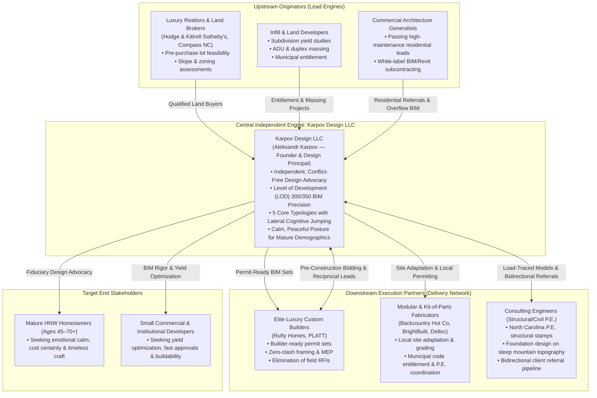

By strategically networking with **upstream land brokers**, **downstream luxury builders (such as Rufty Homes and PLATT)**, **modular fabricators (such as The Backcountry Hut Company and BrightBuilt Home)**, and **licensed structural engineering consultants**, Karpov Design establishes a self-reinforcing referral flywheel. 

Furthermore, this document articulates the **Case Study Narrative Anatomy** inspired by the client-specified benchmark of **Bjarke Ingels Group ([big.dk](https://big.dk))**—transforming static photography into step-by-step morphogenetic problem-solving diagrams—and codifies the **Social Proof & Trust Architecture** specifically calibrated for mature private clients and sophisticated developers.

---

## Section 1: Executive Scope & B2B Relational Architecture

### 1.1 The Strategic Imperative of B2B Ecosystem Integration

In the modern built environment, architecture and residential design do not exist in academic isolation. Every built project represents a complex convergence of land acquisition, municipal entitlements, zoning constraints, structural engineering, building science, factory prefabrication, and job-site general contracting.

Practices that position themselves strictly as "stylistic form-givers" operating in a retail silo are vulnerable to margin compression and disintermediation. Conversely, firms that master **B2B relational architecture** capture three distinct commercial advantages:
1. **Pre-Qualified Deal Flow:** When an affluent buyer is purchasing a $1.2M homesite in Cary or an untamed 5-acre hillside in Brevard, their immediate trusted advisor is their luxury land broker. By equipping the broker with a rapid 72-hour "Pre-Purchase Lot Feasibility Package," Karpov Design captures the client *before* they have spoken to competing designers or turnkey builders.
2. **Elimination of Field Friction:** By producing comprehensive Level of Development (LOD) 300/350 Building Information Modeling (BIM) drawing sets in Autodesk Revit, Karpov resolves framing conflicts, ceiling height clashes, and mechanical chases on paper. Elite builders (such as Rufty Homes) actively steer their best custom clients to designers who make their job-site execution effortless and profitable.
3. **Unassailable Independent Positioning:** When contractors attempt to sell prospective homeowners on "free in-house design," Karpov arms the client with the mathematical reality of construction economics: independent, conflict-free design advocacy protects the client's budget, enables true competitive bidding among builders, and prevents catastrophic change orders.

---

### 1.2 Legal & Statutory Boundaries: Non-Architect Positioning as a Strategic Advantage

A central requirement of the [Karpov_Design_Website_Brief.pdf](file:///c:/Users/doruk/Documents/Karpovdesign/Initial%20Brief/Karpov_Design_Website_Brief.pdf) (Page 1, 8, 9, 10) is strict compliance with legal nomenclature. Aleksandr Karpov is an internationally educated, award-winning residential designer and design consultant with over a decade of elite European and transatlantic practice; however, he is not currently a licensed Architect of Record registered with the North Carolina Board of Architecture and Registered Interior Designers (NCBA/RID).

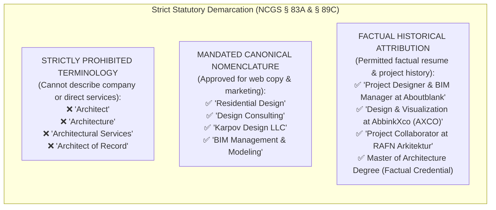

#### Statutory Demarcation under North Carolina General Statutes (NCGS)
1. **NCGS § 83A (Architects):** In North Carolina, it is a Class 2 misdemeanor for any unlicensed person or entity to use the title "architect" or "architecture" in commercial trade, or to offer architectural services to the public. 
2. **Residential Single-Family Statutory Exemption (NCGS § 83A-13):** North Carolina law specifically exempts single-family detached residential dwellings from the statutory requirement of a licensed architect seal, provided the structure complies with the prescriptive framing requirements of the **North Carolina Residential Code (NCRC)** (derived from the International Residential Code - IRC). An independent residential designer possesses full legal authority to produce permit-ready construction document sets for single-family residences.
3. **Structural Engineering Mandate (NCGS § 89C):** When a residential design features complex structural conditions—such as open-concept long-span steel/LVL beams, vaulted cantilevers, curtain-wall glazing assemblies, or foundations situated on steep slopes exceeding 20% in the Western NC Blue Ridge corridor—the plans exceed the prescriptive tables of the NCRC. Under NC law, these specific structural assemblies require review, load calculations, and a physical seal from a licensed **North Carolina Professional Engineer (P.E.)**.
4. **Commercial & Multi-Family Statutory Thresholds:** For commercial facilities, public buildings, and multifamily projects exceeding statutory square footage or occupant load thresholds, North Carolina mandates a licensed Architect of Record or Professional Engineer of Record.

#### Turning Statutory Compliance into a Market-Dominating Value Proposition
Rather than an operational limitation, Karpov Design leverages this legal structure as an explicit competitive asset:
* **Overhead Elimination:** Institutional corporate architecture firms bill out partner rates at $350–$500/hour to cover massive corporate overhead, legal retainers, and administrative bureaucracy. Karpov Design operates as an agile, high-craft studio, delivering identical or superior Level of Development (LOD) 300/350 BIM documentation at a fraction of institutional overhead.
* **Pure Collaborative Symbiosis with P.E.s:** Karpov does not compete with engineering firms; Karpov acts as their most efficient collaborator. By constructing millimeter-precise 3D Revit models with clean load paths, Karpov allows structural P.E.s to run their finite element calculations (in RISA or Enercalc) in half the billable time, creating a rapid, frictionless permitting pathway for the homeowner.
* **Separation of Design and Administration:** Clients hire Karpov for pure design brilliance, spatial ingenuity, daylight choreography, and technical BIM precision. When statutory seals are required for municipal submission, Karpov collaborates seamlessly with independent licensed P.E.s or client-retained Architects of Record, providing clients with an uncompromised design advocate without corporate bloat.


---

## Section 2: Upstream & Downstream Channel Matrix

### 2.1 Upstream Entity Taxonomy & Acquisition Mechanics

Upstream channel partners represent the primary originators of high-value custom residential commissions and pre-development consulting engagements. By embedding Karpov Design into the upstream professional workflow, the practice intercepts affluent clients and institutional investors at the moment of land acquisition—months before retail marketing channels become aware of the project.

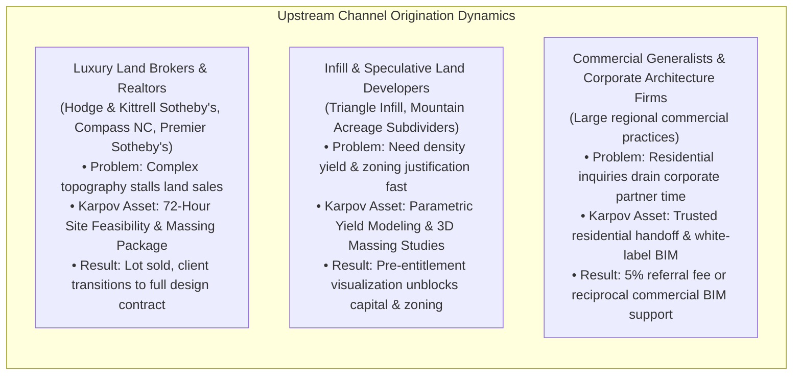

#### 1. Luxury Real Estate Brokers & Land Specialists
* **Regional Market Leaders:** Hodge & Kittrell Sotheby's International Realty (Raleigh, Cary, Durham, Chapel Hill), Urban Durham Realty (Triangle urban infill), Compass North Carolina (Raleigh/Charlotte luxury division), Premier Sotheby's International Realty (Asheville, Banner Elk, Highlands-Cashiers).
* **The Broker’s Operational Friction:** High-net-worth buyers shopping for prime custom lots ($400,000 to $2,500,000+) frequently suffer "site paralysis." Complex site conditions—such as 25%+ slopes in the Blue Ridge Mountains, granite outcroppings, stringent Neuse River riparian buffer setbacks in Wake County, or rigid HOA architectural review committees (e.g., Inside-the-Beltline Raleigh or The Cliffs communities)—create severe anxiety regarding constructability, excavation costs, and driveway grades. Buyers walk away, stalling broker commissions.
* **Karpov Design’s High-Leverage Solution:** The **"Pre-Purchase Site Feasibility & Massing Audit"** (Fixed fee: $1,500–$3,500; Turnaround: 48 to 72 hours). Karpov imports the county GIS contour data, drone imagery, and municipal zoning layer into Rhino/Revit, generating:
  1. A 3D topographic slope analysis with buildable envelope demarcation.
  2. A step-by-step solar orientation study optimizing morning/afternoon light.
  3. A preliminary conceptual massing footprint proving how a 4,500-sq-ft home, 3-car garage, and pool terrace fit within statutory setbacks.
  4. An order-of-magnitude grading and foundation strategy (slab-on-grade vs. stepped daylight walkout basement).
* **Economic Conversion Mechanics:** The broker uses the feasibility package to close the land transaction immediately. The buyer experiences Aleksandr Karpov’s rapid intellect and technical clarity, creating an organic 85%+ conversion rate from feasibility study to a comprehensive custom residential design contract.

#### 2. Infill & Speculative Land Developers
* **Regional Market Profile:** Small-to-midsize developers acquiring teardown parcels in urban cores (e.g., Raleigh's Five Points, Durham's Old West Durham) or 5-to-20 acre parcel subdividers in Wake, Durham, and Buncombe counties.
* **The Developer’s Operational Friction:** Developers cannot afford to spend $40,000–$80,000 on full civil engineering and architectural working drawings during the due diligence period. They require rapid yield optimization (how many residential units, accessory dwelling units / ADUs, or subdivided custom footprints can the land absorb under current UDO / zoning ordinances) and compelling 3D massing graphics to present to equity partners and municipal planning boards.
* **Karpov Design’s High-Leverage Solution:** Parametric Site Yield & Concept Entitlement Studies. Utilizing advanced computational modeling, Karpov generates multiple yield scenarios, shadow studies, pedestrian connectivity diagrams, and streetscape elevation massing within 5 to 7 business days, de-risking the developer's land acquisition before capital commitment.

#### 3. Commercial Architecture Generalists & Corporate Studios
* **Regional Market Profile:** Medium-to-large commercial, healthcare, and educational architecture firms across Raleigh, Charlotte, and Atlanta.
* **The Corporate Firm’s Operational Friction:** Corporate firms regularly receive custom residential inquiries from corporate CEOs, commercial developer clients, or institutional board members. However, custom single-family residential design is notoriously unprofitable for commercial firms: it requires intensive personal hand-holding, hundreds of interior material decisions, and emotional management that disrupts corporate commercial billing structures ($250–$400/hr billing rates). Turning these clients away risks offending key corporate relationships.
* **Karpov Design’s High-Leverage Solution:** Karpov acts as the commercial firm's vetted residential referral destination. The corporate firm protects its client relationship by introducing Karpov as an elite residential and BIM specialist. Furthermore, Karpov offers white-label Level of Development (LOD) 300/350 Autodesk Revit modeling and construction document production for commercial firms experiencing peak drafting bottlenecks.

---

### 2.2 Downstream Entity Taxonomy & Delivery Partnerships

Downstream delivery partners execute the built reality. Rather than treating contractors and fabricators as adversarial vendors, Karpov Design treats them as strategic B2B channel partners whose job-site efficiency and profitability are directly elevated by Karpov’s documentation.

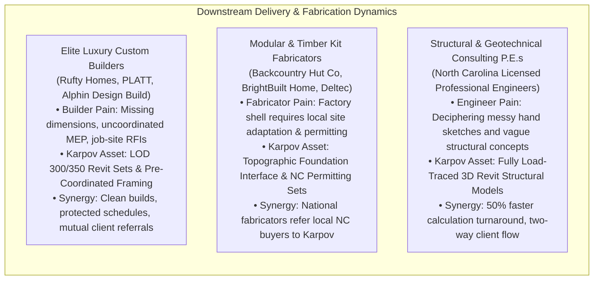

#### 1. Elite Luxury Custom Homebuilders

##### Deep Dive: Rufty Homes (Raleigh & Cary, NC)
* **Company Profile:** Founded by Jon Rufty nearly 40 years ago, Rufty Homes is the benchmark for ultra-luxury custom homebuilding in the North Carolina Research Triangle. Specializing in high-end estates ($2M to $10M+) across Inside the Beltline Raleigh, North Raleigh, Cary, and exclusive enclaves like Avalaire and Falls Lake, Rufty is an NAHB Custom Home Builder of the Year finalist and a pioneering leader in high-performance green building science.
* **Operational Dynamics & Design Collaboration:** Rufty operates on a collaborative custom model, frequently constructing estates designed by independent residential designers and architects. Because their reputation rests on immaculate building science (air-tight thermal envelopes, advanced HVAC zoning, flawless millwork execution), they reject incomplete, amateur drawings.
* **The Builder Friction Rufty Solves for Clients:** Uncoordinated drawings from low-tier drafters force builders into constant Requests for Information (RFIs), delayed framing inspections, and awkward client conversations about change orders.
* **Karpov Design Value Proposition:** Karpov delivers **Level of Development (LOD) 300/350 Revit BIM packages**. Every structural column, LVL header, floor truss cavity, and mechanical chase is modeled in 3D. Rufty's project managers receive permit-ready sheets where ductwork never collides with structural steel, window rough openings match manufacturer specs to the millimeter, and exterior envelope flashing details are fully resolved. Rufty actively recommends designers who protect their construction schedule.

##### Deep Dive: PLATT (Brevard & Asheville, NC)
* **Company Profile:** PLATT (PLATT Architecture & Construction / PLATT Home) is the preeminent design-build and luxury residential authority in the Southern Appalachian Highlands, Western North Carolina, Highlands, and Cashiers. Operating for over four decades under Parker Platt, the firm commands deep reverence for regional mountain modernism, local stone, and heavy timber craft.
* **Mountain Topography & Structural Demands:** Western North Carolina mountain building presents radical site complexity: steep slope stabilization, bedrock excavation, stepped concrete retaining foundations, high-wind ridge exposures, and wildland-urban interface (WUI) fire resilience.
* **Karpov Design Value Proposition:** Aleksandr Karpov’s background in European topography (including coastal and hillside concepts) and advanced parametric modeling aligns perfectly with the Appalachian terrain. Karpov delivers stepped foundation models that hug natural rock contours, minimizing expensive bench-cut blasting and preserving mature forest canopy.

##### Other Regional NC Custom Builders:
* **Alphin Design Build (Raleigh, NC):** High-craft modern urban infill and historic neighborhood transformations. Demands surgical dimensional accuracy on tight zero-lot-line setback parcels.
* **The Biltmore Company / Mountain Builders (Asheville, NC):** Luxury mountain retreats requiring timber framing coordination and radiant heating floor zone planning.

---

#### 2. Modular & Kit-of-Parts Fabricators

##### Deep Dive: The Backcountry Hut Company (BHC) (Vancouver, BC)
* **Company Profile:** Founded by Wilson Edgar and architect Michael Leckie (Leckie Studio Architecture + Design), The Backcountry Hut Company pioneered the component-based, "kit-of-parts" modular architecture process. Their systems (System 00 A-frame shelter, System 01 single-story loft, System 02 multi-story cabin, and System S sauna) utilize engineered timber post-and-beam skeletons infilled with prefabricated insulated wall/roof panels, flat-packed and erected like a precision puzzle.
* **The Critical Gap in the Modular Model:** BHC manufactures and delivers the flat-packed structural shell, but **they do not handle local municipal permitting, site grading, septic layout, or foundation engineering**. Clients who buy a BHC kit in North Carolina find themselves stranded: local municipal building inspectors in Wake or Buncombe County demand local site plans, foundation engineering stamped by an NC Professional Engineer, and code compliance documentation for local setbacks.
* **Karpov Design’s Strategic Integration:** Karpov acts as the **Regional Site Integration & Entitlement Design Partner**. When an East Coast client purchases a Backcountry Hut kit, Karpov provides:
  1. Topographic site placement and civil grading integration.
  2. Foundation interface drawings (coordinating concrete pier or slab engineering with a licensed NC structural P.E.).
  3. Local municipal building permit package submission (ensuring compliance with NC Energy Conservation Code and wind exposure ratings).
  4. Custom interior layout, millwork detailing, and kitchen/bath casework tailored to the client's lifestyle.

##### Deep Dive: BrightBuilt Home (Portland, ME)
* **Company Profile:** Spun off from sustainable architecture firm Kaplan Thompson Architects, BrightBuilt Home delivers architect-designed, net-zero-energy modular homes throughout the Eastern United States. Using high-performance factory-built volumetric boxes, BrightBuilt achieves extreme airtightness, double-stud insulation, and net-zero-ready performance.
* **Operational Dynamics:** Factory modules are craned onto foundations in 1–2 days, but require a local design partner to navigate local zoning boards, adapt roof pitches to local vernacular, design site-built porches, garages, and foundation transitions, and coordinate local general contractor finish-out.
* **Karpov Design Strategic Value:** Karpov’s rigorous Scandinavian and European energy-envelope background (RAFN / RAVN Arkitektur, AbbinkXco) allows Karpov to serve as the ideal site adaptation partner, optimizing solar orientation for rooftop PV arrays and ensuring seamless thermal envelope continuity.

##### Regional Prefabrication Leader: Deltec Homes (Asheville, NC)
* **Company Profile:** Pioneers of hurricane-resistant, 360-degree panoramic panelized homes designed for extreme weather resilience across North Carolina’s coastal hurricane zones and mountain ridges.
* **Karpov Strategic Value:** Providing custom residential interior space planning, daylight modeling, and modern spatial layouts within Deltec’s high-performance panelized structural envelope.

---

#### 3. Engineering Consultants (Structural, Civil, Geotechnical P.E.)
* **The Statutory Necessity:** As established in Section 1.2, North Carolina building codes mandate licensed Professional Engineer (P.E.) stamps whenever residential framing departs from IRC prescriptive tables (e.g., steel moment frames, engineered flitch plates, cantilevers, timber trusses, complex foundation retaining walls).
* **The Engineering Pain Point with Amateur Designers:** Structural P.E.s frequently complain that unlicensed residential drafters provide uncoordinated 2D lines with zero understanding of structural load paths. Engineers are forced to redesign roof framing, shift bearing walls, and guess at point loads, causing delays and billing friction.
* **Karpov Design’s Engineering Symbiosis:** Karpov builds every project in 3D Revit with continuous vertical load tracing—aligning roof ridges, point loads, bearing posts, and foundation footings. Structural P.E.s can directly link Karpov’s 3D analytical geometry into their calculation engines.
* **Bidirectional Referral Mechanics:** Structural engineering firms constantly receive calls from property owners holding rough sketches asking, "Can you engineer this for a permit?" Engineers do not want to draft architectural layouts; they refer these clients to Karpov Design. In return, Karpov feeds all structural engineering review contracts to a preferred roster of licensed NC Professional Engineers.

---

### 2.3 Comprehensive B2B Partner Specification Table

The following matrix establishes the operational, technical, and economic parameters governing Karpov Design LLC's B2B ecosystem partnerships:

| Ecosystem Partner Category | Representative Verified Entities | Project Typology & Scale | Partner Core Operational Friction | Karpov Design LLC Value Proposition | Specific Deliverable Artifact | Engagement Fee / Commission Structure | Direction of Referral Flow |
| :--- | :--- | :--- | :--- | :--- | :--- | :--- | :--- |
| **Luxury Land Brokers** | Hodge & Kittrell Sotheby's, Compass NC, Premier Sotheby's | Luxury vacant parcels ($400k–$2.5M+) | Buyer fear of steep slope, grading, setbacks & septic unviability stalls land sales | 48–72 hr rapid feasibility proving buildability & zoning compliance | 3D Topographic Slope & Massing Feasibility Report | $1,500–$3,500 fixed fee (often paid by buyer or credited by broker) | **Upstream Inbound:** Broker refers buyer; converts to full custom design |
| **Infill & Spec Developers** | Urban Durham Realty, Triangle Infill Developers, Triad Land Group | 2-to-12 unit infill parcels, ADU clusters, pocket subdivisions | High cost & delay of civil engineering during due diligence | Parametric yield optimization & 3D entitlement massing | Conceptual Site Yield Matrix & 3D Entitlement Presentation Deck | $5,000–$15,000 fixed study fee | **Upstream Inbound:** Developer engages for feasibility; leads to phase drafting |
| **Commercial Architecture Firms** | Large regional commercial & corporate practices (Raleigh, Charlotte) | Corporate inquiries for $2M–$8M custom private residences | Residential design disrupts corporate billing & demands high emotional handholding | Safe, high-prestige residential referral destination + overflow BIM drafting | Level of Development (LOD) 300/350 Revit Construction Models | 5% reciprocal referral fee or $95–$135/hr white-label BIM modeling | **Bidirectional:** Firm passes residential; Karpov supports commercial BIM crunches |
| **Elite Luxury Homebuilders** | Rufty Homes (Cary/Raleigh), Alphin Design Build (Raleigh) | Ultra-luxury custom estates ($2M–$10M+, 4,500–12,000 sq ft) | Drawing errors, framing clashes, missing MEP chases, job-site RFIs & delay | Builder-ready permit sets with complete clash detection & IRC compliance | Full Permit-Ready Construction Document Set + Navisworks Clash Report | 10%–15% of construction cost (Design Fee); zero builder markup | **Downstream Bidirectional:** Builder refers un-designed clients; Karpov invites builder to bid |
| **High-Craft Mountain Builders** | PLATT (Brevard/Asheville), The Biltmore Company (WNC) | Mountain ridge retreats & stepped hillside residences ($1.8M–$6M) | Extreme slope grading, rock excavation, and stepped foundation engineering | Topographic massing that hugs contours, reducing excavation & foundation costs | 3D Terrain-Stepped Foundation Plan & Structural Framing Set | Standard residential design fee schedule ($6–$10/sq ft heated) | **Downstream Bidirectional:** Mutual referral based on topographic alignment |
| **Modular Kit Fabricators** | The Backcountry Hut Company (Vancouver, BC / Leckie Studio) | Modern prefabricated kit-of-parts cabins ($150k–$750k kit cost) | Factory ships shell only; client stranded on local grading, foundation & permit | Local Site Adaptation & Permitting Partner: grading, foundation, NC code filing | Localized Foundation Engineering & Municipal Permit Drawing Set | $7,500–$18,000 fixed site integration fee | **Downstream Inbound:** Fabricator refers East Coast kit buyers to Karpov |
| **Net-Zero Modular Innovators** | BrightBuilt Home (Portland, ME / Kaplan Thompson) | High-performance modular net-zero homes ($400k–$1.2M) | Adapting modular factory shells to local zoning, vernacular, and site solar paths | Solar path optimization, local porch/garage design & contractor coordination | Custom Site Integration Drawing Set + Energy Code Envelope Details | $10,000–$25,000 adaptation & customization fee | **Downstream Inbound:** Factory refers North Carolina buyers to Karpov |
| **Hurricane-Resistant Prefab** | Deltec Homes (Asheville, NC) | Aerodynamic round & modern high-wind homes ($350k–$1.5M) | Standard shell interiors lack bespoke high-end spatial choreography | Bespoke residential space planning, daylighting, and custom interior millwork | Custom Interior Space Planning & Layout Package | $8,000–$20,000 interior & site package fee | **Bidirectional:** Deltec refers custom clients; Karpov specifies Deltec shells for coast |
| **Structural & Civil P.E.s** | NC Licensed Professional Engineers (Raleigh, Asheville) | Structural framing exceeding IRC prescriptive span tables | Incomplete client sketches forcing engineers to redesign structural schemes | Pre-coordinated 3D Revit models with clean, unbroken vertical load paths | 3D Analytical Structural Wireframe & Framing Assembly Schedules | Direct engineering subcontract or client direct-hire ($2.5k–$7.5k P.E. fee) | **Bidirectional:** P.E.s refer clients needing drafting; Karpov feeds P.E. review contracts |


---

## Section 3: The Co-opetition Referral Framework & Friction Resolution

### 3.1 The Dynamics of Co-opetition in Residential Delivery

"Co-opetition"—simultaneous competition and cooperation between interdependent market actors—is the fundamental reality of custom residential building delivery. Independent residential designers and luxury general contractors compete for the client's trusted advisory relationship; yet, neither can realize a built project without the technical execution of the other.

When mishandled, this relationship deteriorates into friction: builders accuse designers of producing "unbuildable artistic fantasies with missing dimensions," while designers accuse builders of "butchering spatial details to maximize construction margins."

Karpov Design LLC resolves this dynamic by instituting a **Triangular Trust Architecture** that aligns the economic incentives of the Client, the Designer, the Custom Builder, and the Structural Professional Engineer (P.E.):

```mermaid
sequenceDiagram
    autonumber
    actor Client as Affluent Client / Developer
    participant Karpov as Karpov Design LLC (Independent Fiduciary)
    participant PE as Structural Consulting P.E.
    participant Builder as Elite Custom Builder (e.g. Rufty / PLATT)

    Note over Client,Karpov: Phase 1: Pure Conflict-Free Design & Feasibility
    Client->>Karpov: Engages for Custom Residential Design (Paid Phased Contract)
    Karpov->>Karpov: Executes Site/Zoning Analysis & Morphogenetic BIM Massing
    Karpov->>Client: Presents 3D Visualizations & Verified Program Budget Alignment

    Note over Karpov,PE: Phase 2: Technical Rigor & Load Tracing
    Karpov->>PE: Delivers 3D Revit Structural Load Paths & Framing Model
    PE-->>Karpov: Returns Stamped Structural Engineering Calculations

    Note over Karpov,Builder: Phase 3: Competitive Tender on Apples-to-Apples Scope
    Karpov->>Builder: Issues Level of Development (LOD) 300/350 Permit BIM Package
    Builder->>Client: Submits Transparent, Zero-Guesswork Competitive Bid
    Note over Client,Builder: Client saves 8%–15% via competitive bidding; no allowance surprises

    Note over Karpov,Builder: Phase 4: Job-Site Construction & Zero-Clash Execution
    Builder->>Karpov: Pre-Construction Coordination Workshop (Zero RFIs)
    Karpov->>Client: Observes Design Intent Fidelity During Key Milestones
    Builder-->>Client: Delivers Flawless Finished Residence On Time & On Budget
    Builder->>Karpov: Refers Next Incoming Custom Client Needing Design
```

In this triangular framework:
1. **The Client** receives uncompromised, fiduciary design advocacy and the financial protection of competitive builder bidding.
2. **Karpov Design LLC** maintains design integrity from concept through construction documents without contractor margin dilution.
3. **The Custom Builder** receives fully coordinated, clash-free drawings that eliminate job-site downtime, protect trade contractor schedules, and prevent client disputes over ambiguous allowances.
4. **The Structural P.E.** receives clean 3D load paths, minimizing calculation hours and liability.

---

### 3.2 Deconstructing the Contractor "Free In-House Design" Loss-Leader Conflict of Interest

A pervasive sales tactic in the custom homebuilding industry is the contractor offering **"Free Design"** or a nominal $2,500–$5,000 "in-house drafting package" if the homeowner agrees to sign their construction contract. To an unsuspecting homeowner facing an initial $30,000–$60,000 design fee from an independent professional, the contractor's offer appears to be a massive cost savings.

In reality, **contractor "free design" is the most expensive mistake a homeowner can make**. It represents a profound structural conflict of interest with severe financial and architectural repercussions:

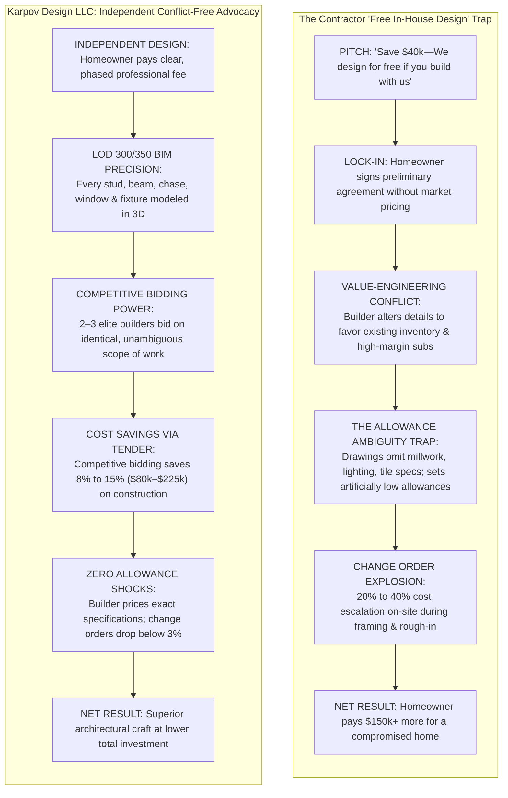

#### The Four Structural Conflicts of In-House Contractor Design:

1. **Forfeiture of Market Price Discovery (The Monopoly Lock-In):**
   When a general contractor produces the design in-house, the client forfeits the ability to put the project out to competitive tender. The contractor provides a "negotiated" price, typically on a Cost-Plus 20% or inflated Fixed-Price basis. Without competing bids, the contractor has zero market incentive to optimize subcontractor pricing or material markups.
2. **Value-Engineering as Margin Defense:**
   In an in-house design scenario, the drafter is an employee or subordinate of the builder. When framing or detailing decisions arise, the builder designs what is fastest, easiest, and most profitable for their existing crews to build—not what optimizes the homeowner’s living experience, natural daylight, or energy efficiency. High-performance details (such as continuous exterior insulation, recessed lighting pockets, or bespoke window orientations) are stripped away under the guise of "cost savings," while the builder pockets the margin.
3. **The "Allowance Ambiguity" Trap:**
   Contractor-generated plan sets are notoriously vague. They indicate walls and door swings but omit detailed cabinetry elevations, integrated lighting layouts, tile schedules, and precise plumbing fixture specifications. In their place, the contractor inserts modest "allowances" (e.g., $5,000 for all master bath tile and fixtures). Once the home is framed, the client realizes that the builder’s allowance only covers entry-level builder-grade materials. Upgrading to the quality the client actually envisioned triggers massive, non-negotiable **Change Orders**—where contractors apply standard 25% to 35% markups.
4. **Empirical Cost Escalation:**
   Empirical construction management data demonstrates that projects built from contractor in-house plan sets experience an average of **20% to 40% budget creep** between contract signing and final certificate of occupancy. On a $1,000,000 residence, that represents $200,000 to $400,000 in unexpected cost escalation.

---

### 3.3 Karpov's Independent, Conflict-Free Design Advocacy & The Cost-of-Change Curve

Karpov Design LLC operates under an explicit **fiduciary design model**:
* Karpov has zero financial interest in construction margins, material sales markups, or subcontractor billings.
* Karpov represents the homeowner's interests exclusively—optimizing spatial choreography, structural longevity, and energy performance.
* By providing a complete, builder-ready Level of Development (LOD) 300/350 BIM documentation package, Karpov empowers the client to solicit sealed, competitive bids from 2 to 3 vetted custom builders (such as Rufty Homes and peers). 

#### The Competitive Bidding Economic Multiplier
In competitive custom residential bidding across the North Carolina Triangle and mountain markets:
* Competitive bidding on an identical, unambiguous BIM set produces a **bid variance of 8% to 15%** between qualified general contractors.
* On a $1,200,000 custom residence, a 10% competitive bidding savings equals **$120,000 in direct cash savings** to the client.
* A comprehensive residential design fee of $45,000 to $65,000 is not an expense—it is **completely self-funding**, yielding a net positive financial return to the client before excavation even begins.

#### The MacLeamy "Cost of Change" Curve Applied to Karpov Design

The economic justification for independent BIM design is rooted in the **MacLeamy Curve** (developed by architect Patrick MacLeamy, former CEO of HOK). The curve proves that the ability to impact design performance is highest at the earliest project phases, while the cost of making changes escalates exponentially as the project moves toward construction:

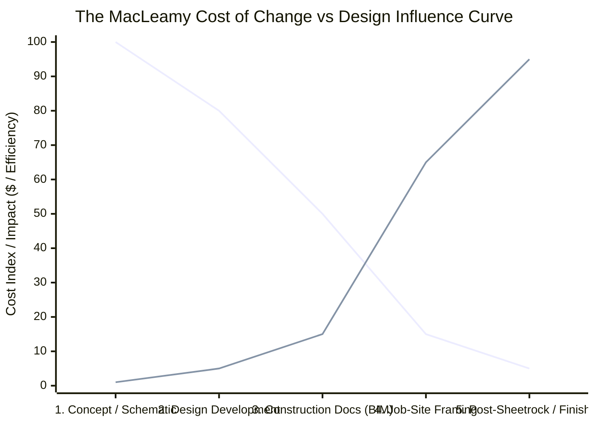

#### Mathematical & Empirical Progression of Design Modifications:

| Project Phase | Medium of Design & Modification | Typical Cost to Shift a Wall or Window | Time Impact on Project Schedule | Architectural & Structural Integrity Impact |
| :--- | :--- | :--- | :--- | :--- |
| **Phase 1: Concept & Schematic Design** | 3D Digital Model (Rhino / Revit) | **$0 – $150** (Minutes of design time) | Zero project delay | **Maximum (100%):** Spatial flow and solar daylight are optimized seamlessly. |
| **Phase 2: Design Development** | Coordinated 3D BIM Model | **$300 – $800** (Minor parameter updates) | Zero project delay | **High (80%):** Structural framing grids and MEP chases adjust parametrically. |
| **Phase 3: Construction Documentation** | Sheet Layout & Detail Coordination | **$1,500 – $3,500** (Sheet coordination) | 1–3 business days | **Moderate (50%):** Changes require updating schedules and engineering notes. |
| **Phase 4: Job-Site Framing Rough-In** | Built Lumber, Steel & Concrete on Site | **$12,000 – $35,000** (Tear-out, rebuild, RFI) | 3 to 6 weeks job-site delay | **Severely Compromised (15%):** Requires structural headers, reframing, trade re-mobilization. |
| **Phase 5: Post-Drywall & Mechanical Finish** | Finished Plaster, Wiring, HVAC, Tile | **$25,000 – $65,000+** (Destructive rework) | 6 to 10 weeks job-site delay | **Negligible (5%):** Rework is visibly compromised, expensive, and emotionally exhausting. |

By front-loading every spatial, structural, and detailing decision into **3D BIM visualization and physical study modeling** during Phases 1 through 3, Karpov Design freezes the design before a single shovel enters the earth. This eliminates the catastrophic Phase 4 and Phase 5 field change orders that plague contractor-designed projects.

---

### 3.4 Builder Co-opetition Onboarding Protocol

To cultivate builders as active referral partners rather than defensive competitors, Karpov Design LLC executes a structured **Builder Onboarding Protocol**:

1. **The "Builder-Friendly" Drafting Standard:**
   Karpov's construction sets are specifically drafted to respect the commercial reality of the job site:
   * **Prescriptive Lumber Spans:** Floor plans utilize standard dimensional lumber lengths (12', 14', 16', 20') and engineered I-joist spacing (16" or 19.2" o.c.), preventing unnecessary job-site cutting and material waste.
   * **Stacked Vertical MEP Chases:** Plumbing stacks from second-floor master suites drop directly through dedicated utility walls without colliding with main-floor open-concept steel beams.
   * **Explicit Window & Door Rough Openings:** All fenestration schedules match verified manufacturer unit dimensions (e.g., Andersen, Marvin, or Western Window Systems), eliminating field framing guesswork.
2. **The Pre-Construction Coordination Workshop:**
   Before ground is broken, Karpov conducts a mandatory 2-hour virtual or on-site model coordination workshop with the selected general contractor, framing lead, and HVAC mechanical subcontractor. The team navigates the 3D BIM model together, reviewing truss cavities, duct transitions, and foundation step details. This eliminates surprise RFIs and establishes mutual professional respect.
3. **Mutual Referral Economics:**
   * When an affluent client approaches Karpov Design directly, Karpov pre-qualifies their budget, prepares the BIM set, and invites 2 to 3 vetted regional builders (e.g., Rufty Homes, PLATT) to tender bids, delivering high-margin, pre-coordinated custom contracts directly to the builders.
   * In exchange, builders refer incoming clients who have land but lack drawings directly to Karpov Design, confident that Karpov will deliver a builder-ready set that protects their schedule and profitability.


---

## Section 4: The Diagrammatic Case Study Blueprint (The `big.dk` Benchmark & Studio MM)

### 4.1 The Visual Communication Revolution in Architecture

Traditional architectural websites present case studies as static monuments of post-construction glamour. A project page typically opens with an ultra-wide, high-gloss photograph of a pristine living room, followed by an abstract 2D floor plan that non-architects struggle to decipher, concluding with a brief, jargon-laden paragraph about "spatial dialogues" and "material phenomenologies."

This conventional presentation model fails modern affluent clients and commercial developers:
* **The Mature Homeowner's Doubt:** "This looks expensive and pretty, but *why* is the house shaped like that? Did the designer just draw a weird box, or is there a functional reason? Will they listen to my site challenges, or impose their own artistic ego?"
* **The Commercial Developer's Skepticism:** "This looks like an unbuildable art piece that will blow through municipal planning boards and trigger endless variance requests. Can this firm optimize my site yield, satisfy zoning setbacks, and produce buildable BIM sets?"

To dismantle this skepticism, Karpov Design LLC adopts a **Diagrammatic Narrative Case Study Structure**, synthesizing the iconic morphogenetic storytelling of **Bjarke Ingels Group ([big.dk](https://big.dk))** with the humanized craft and "Process Strips" of **Studio MM Architect**.

---

### 4.2 The Bjarke Ingels Group (`big.dk`) Benchmark: Pragmatic Utopianism & Darwinian Morphogenesis

Bjarke Ingels Group (BIG) revolutionized global architectural communication not by abandoning high design, but by fundamentally transforming how design is explained. Through their manifesto *Yes is More: An Archicomic on Architectural Evolution* and their project presentation methodology on `big.dk`, BIG pioneered **evolutionary diagramming**:

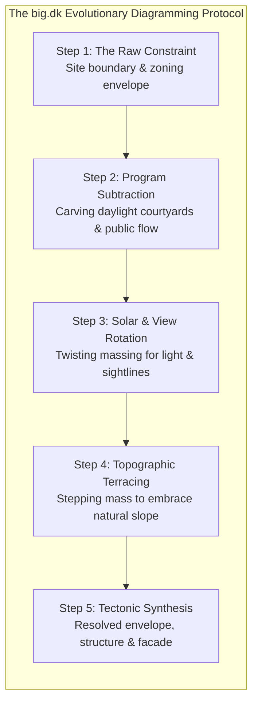

#### Core Principles of the `big.dk` Diagrammatic Logic:
1. **Darwinian Evolution Over Sudden Revolution:** Form is never presented as an arbitrary flash of genius. Instead, form evolves through a visible chain of adaptations to external pressures: site topography, strict zoning setbacks, solar daylight angles, prevailing winds, acoustic buffers, and client lifestyle rituals.
2. **The "Comic Strip" Progression:** Complex three-dimensional architectural maneuvers are broken down into **4 to 6 clean, monochromatic isometric diagrams**. Each diagram features a single, intuitive vector transformation (e.g., an extruded massing block, an angled subtraction, an elevated roof corner) with a concise 1-sentence caption.
3. **Pragmatic Radicalism:** By proving that every angle, cantilever, and courtyard is a direct mathematical response to a physical constraint, BIG disarms client skepticism. What looks avant-garde is revealed to be the most practical, logical, and inevitable solution.

---

### 4.3 The Studio MM Architect Benchmark: The Humanized "Process Strip"

While `big.dk` excels at conceptual geometric logic, **Studio MM Architect** (deconstructed in Phase 2) excels at demystifying residential fabrication. On every project page, Studio MM embeds a horizontal **"Process Strip"** directly between the conceptual narrative and the finished photo gallery:
* **Tactile Early Sketches:** Hand-drawn ink concepts and watercolor site washes.
* **Physical Study Models:** Laser-cut chipboard, basswood, and 3D-printed massing iterations placed on physical contour models.
* **Job-Site Construction Realities:** High-resolution photography of raw timber framing, exposed structural steel moment connections, concrete formwork, and window installations.

This proves to the mature homeowner that the firm is intimately connected to the dirt, the sawdust, and the physical reality of building.

---

### 4.4 Karpov Design's Standardized 5-Stage Case Study Template

Every project presented on `karpovdesign.com` will follow a rigorous, standardized **5-Stage Narrative Anatomy**, marrying BIG's diagrammatic intellect with Studio MM's tactile craft:

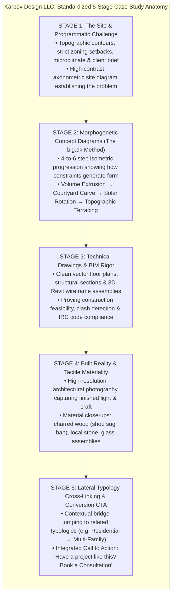

#### Detailed Breakdown of the 5 Stages:

* **Stage 1: The Challenge (Context, Topography & Zoning Constraints):**
  * Opens with the project info card: Title, Year, Category, Typology, Size, Location, Client Type, Role, and Status (Built, In Progress, Competition, Concept).
  * High-contrast vector site plan mapping property boundaries, slope contours, prevailing winds, and municipal setback limits.
  * A concise, 2-to-3 paragraph narrative framing the human and environmental problem (e.g., "Designing a private family sanctuary on a 28-degree rock slope in the Blue Ridge Mountains without disturbing native oak canopies").
* **Stage 2: The Morphogenetic Concept Diagrams (BIG-Style Isometric Transformations):**
  * A horizontal sequence of 4 to 6 isometric line diagrams (clean black line art on off-white or charcoal background):
    1. *Diagram 1 (Zoning Envelope):* Extruding the maximum allowable build volume defined by setbacks and height restrictions.
    2. *Diagram 2 (Courtyard Puncture):* Carving a central courtyard to bring southern daylight deep into the interior floor plate.
    3. *Diagram 3 (Solar & Sightline Angle):* Sloping the roof plane 22 degrees to accommodate a photovoltaic array while capturing mountain ridge views.
    4. *Diagram 4 (Topographic Stepping):* Stepping the lower volume down the natural hillside contours to minimize concrete retaining walls and earthwork excavation.
    5. *Diagram 5 (Resolved Tectonic Form):* The completed architectural envelope with integrated shading overhangs and material skin.
* **Stage 3: Technical Documentation & BIM Rigor (The Engineer & Builder Proof):**
  * The "Process Strip" featuring hand sketches and physical study models.
  * Precision vector 2D floor plans with clean, legible room relationships and daylight paths.
  * An axonometric 3D Revit wireframe showing structural steel framing, floor truss cavities, and integrated mechanical chases. This instantly signals to builders and developers that Karpov produces buildable, clash-free documentation.
* **Stage 4: Built Reality & Tactile Craft:**
  * High-resolution, professional architectural photography capturing the finished spaces in varying daylight conditions (morning raking light, midday interior diffusion, twilight illumination).
  * Close-up tactile vignettes of natural materials: local NC granite, clear-vertical-grain cedar, blackened steel, polished concrete.
* **Stage 5: Lateral Typology Link & Strategic Conversion Hook:**
  * A dedicated contextual navigation banner at the base of the project page.
  * Rather than a generic "Next Project" button, Karpov presents an intelligent **Lateral Typology Jump**: explaining how the structural, spatial, or zoning lessons learned on this project directly inform another typology (e.g., jumping from Single-Family to Multi-Family or Commercial).
  * Concludes with an actionable conversion module: *"Planning a custom residence on a challenging site? [Book a 45-Minute Design Consultation] (Credited toward your project fee)."*

---

### 4.5 The Lateral Typology Jumping Framework

In accordance with the client meeting directives, `karpovdesign.com` will organize its work around **Five Core Typologies**:
1. **Single-Family Residential**
2. **Multi-Family Residential**
3. **Commercial**
4. **Art**
5. **School / Academic (Education)**

*(With secondary cross-cutting tags: Cultural, Urban Planning, and Conceptual).*

#### Strategic Rationale: Dismantling Market Silos via Lateral Cognitive Jumps
In conventional architecture practice, firms are pigeonholed:
* "Residential-only designers" are viewed by commercial developers as lacking technical discipline, BIM rigor, and code mastery.
* "Commercial firms" are viewed by private homeowners as sterile, cold, and incapable of warm, human-scale domestic craft.

Karpov Design LLC shatters this false dichotomy through **Lateral Typology Jumping**. By demonstrating how technical rigor moves laterally across sectors, Karpov builds overwhelming authority for both mature private clients and institutional developers:

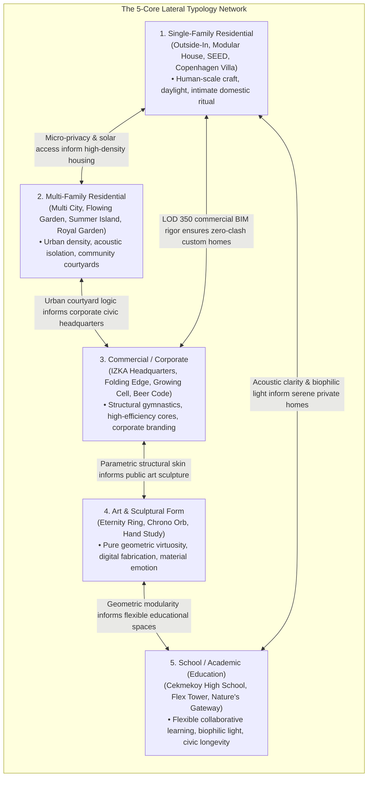

#### Detailed Deconstruction of Karpov's Canonical Projects Across the 5 Typologies:

##### 1. Single-Family Residential
* **Canonical Projects:** *Outside-In (2019)*, *Modular House (2018)*, *SEED – Artists' Getaway (2015)*, *Copenhagen Villa Development (Built with RAFN Arkitektur)*.
* **Core Architectural Focus:** Domestic privacy, intimate daylight choreography, blurring the boundary between indoor living and outdoor landscape, sustainable microclimate adaptation.
* **Lateral Jump to Multi-Family:** *"How the micro-courtyard and daylight strategies developed for Outside-In scale up to provide acoustic privacy and private garden terraces in high-density multi-family living."* (Links to *Multi City*).
* **Lateral Jump to Commercial:** *"How our custom residential material detailing and human-scale ergonomics humanize corporate commercial headquarters."* (Links to *IZKA Headquarters*).

##### 2. Multi-Family Residential
* **Canonical Projects:** *Multi City (2015, 1st Place Competition)*, *Flowing Garden (2017)*, *Summer Island (2011)*, *De Krijgsman Housing, Muiden (Built with AbbinkXco)*, *Royal Garden Kartal Towers (Built with Aboutblank)*.
* **Core Architectural Focus:** High-density urban zoning optimization, acoustic floor-to-floor decoupling, communal green infrastructure, efficient vertical circulation cores, structural modularity.
* **Lateral Jump to Single-Family:** *"How our multi-million-dollar multi-family BIM coordination protocols guarantee zero-clash framing and flawless mechanical integration in private custom residences."* (Links to *Outside-In*).
* **Lateral Jump to Education:** *"How the social circulation corridors of Multi City inform collaborative student gathering spaces in modern educational facilities."* (Links to *Cekmekoy High School*).

##### 3. Commercial & Civic Headquarters
* **Canonical Projects:** *IZKA Headquarters (2013–2016, 1st Place Competition & Turgut Cansever National Architecture Award, with Aboutblank)*, *Folding Edge (2017)*, *Growing Cell (2015)*, *Beer Code (2017)*.
* **Core Architectural Focus:** Advanced parametric envelopes, corporate brand identity through geometry, structural steel and curtain-wall coordination, commercial code compliance, public-private zoning transitions.
* **Lateral Jump to Single-Family:** *"See how the award-winning energy-efficient double-skin facade engineered for IZKA Headquarters informs our high-performance glazing and solar shading strategies for custom luxury homes."*
* **Lateral Jump to Art:** *"How the parametric folding geometry of Folding Edge scales down to become precision-fabricated sculptural art."* (Links to *Eternity Ring*).

##### 4. Art & Sculptural Exploration
* **Canonical Projects:** *Eternity Ring (2017, Built/Produced)*, *Chrono Orb (2015)*, *Hand Study (2009)*.
* **Core Architectural Focus:** Mathematical surface topology, CNC and parametric digital fabrication, tactile metallic and stone finishes, pure formal emotion free from prescriptive functional constraints.
* **Lateral Jump to Commercial:** *"How our sculptural investigations into geometric continuous surfaces directly shaped the iconic twisting atrium of IZKA Headquarters."*
* **Lateral Jump to Single-Family:** *"How the bespoke craftsmanship of Eternity Ring translates into custom monumental fireplaces, sculptural staircases, and one-of-a-kind hardware for private estates."*

##### 5. School / Academic (Education)
* **Canonical Projects:** *Cekmekoy High School (Built with Aboutblank)*, *Flex Tower (2018)*, *Nature's Gateway (2018)*.
* **Core Architectural Focus:** Biophilic natural lighting, durable civic materiality, passive ventilation, flexible pedagogical spaces, acoustic zoning between active athletic areas and quiet study zones.
* **Lateral Jump to Single-Family:** *"How our research into biophilic daylighting and acoustic zoning for educational environments creates serene, peaceful sanctuaries for working and studying at home."*
* **Lateral Jump to Multi-Family:** *"How educational community courtyards inspire intergenerational social spaces in urban multifamily developments."*

---

### 4.6 The Lateral Typology Jump Matrix

The following operational matrix dictates the exact cross-linking logic to be embedded into the footer and contextual callouts of every case study on `karpovdesign.com`:

| Originating Project Typology | Target Lateral Typology | Specific Conceptual & Technical Bridge | Canonical Source Project | Target Destination Project |
| :--- | :--- | :--- | :--- | :--- |
| **Single-Family Residential** | **Multi-Family Residential** | Scaling private daylight courtyards & acoustic buffering to dense urban housing | *Outside-In (2019)* | *Multi City (2015, 1st Place)* |
| **Single-Family Residential** | **Commercial** | Applying corporate-level Level of Development (LOD) 350 BIM clash detection to custom residential framing | *Modular House (2018)* | *IZKA Headquarters (2013–2016)* |
| **Multi-Family Residential** | **Single-Family Residential** | Translating large-scale structural modularity and energy envelopes into cost-effective custom home design | *Flowing Garden (2017)* | *SEED – Artists' Getaway (2015)* |
| **Multi-Family Residential** | **School / Education** | Transforming shared urban residential courtyards into secure, biophilic educational play zones | *Multi City (2015)* | *Cekmekoy High School (Built)* |
| **Commercial** | **Single-Family Residential** | Deploying commercial high-performance solar-shading envelopes to prevent overheating in floor-to-ceiling residential glass | *IZKA Headquarters (Award-Winning)* | *Outside-In (2019)* |
| **Commercial** | **Art** | Translating parametric structural facades into digitally fabricated sculptural art pieces | *Folding Edge (2017)* | *Eternity Ring (2017, Built)* |
| **Art** | **Single-Family Residential** | Infusing domestic architecture with bespoke sculptural centerpieces (monumental staircases, integrated hearths) | *Eternity Ring (2017)* | *Copenhagen Villa Development* |
| **Art** | **School / Education** | Utilizing mathematical topology to generate reconfigurable, modular student furniture and pavilions | *Chrono Orb (2015)* | *Nature's Gateway (2018)* |
| **School / Education** | **Single-Family Residential** | Applying school-grade acoustic decoupling and biophilic daylight optimization to private family living | *Cekmekoy High School (Built)* | *Outside-In (2019)* |
| **School / Education** | **Multi-Family Residential** | Implementing resilient, civic-grade communal corridors to foster neighborhood connections in urban towers | *Flex Tower (2018)* | *Royal Garden Kartal (Built)* |


---

## Section 5: Social Proof & Trust Architecture for Mature Clients & Developers

### 5.1 Demographic Psychology & Risk Mitigation: Mature Homeowners vs. Institutional Developers

High-end custom residential design and pre-development consulting are high-stakes, emotionally charged investments. A custom home represents between $1,000,000 and $10,000,000+ of discretionary capital; an infill land development represents millions in equity risk. In both cases, the primary psychological barrier to hiring a designer is not price—**it is fear of risk, friction, and incompetence**.

To convert these high-value prospects, `karpovdesign.com` must establish an airtight trust architecture calibrated to two distinct demographic mindsets:

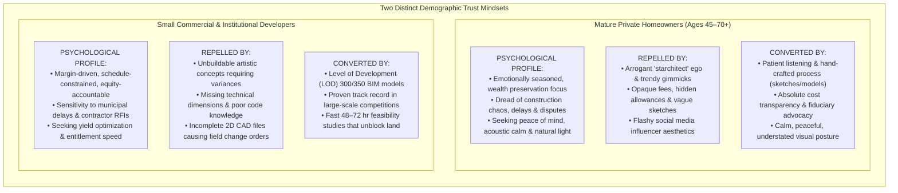

#### The Visual & Emotional Posture: Calm, Peaceful, and Intellectually Rigorous
In direct alignment with the client meeting directives, `karpovdesign.com` must project a **calm, serene, and grounded aesthetic posture**. Rather than hyperactive UI animations, loud pop-ups, or aggressive sales countdown timers, the site communicates quiet confidence through:
* Generous white space (or deep charcoal editorial canvas) allowing drawings and photographs to breathe.
* Crisp, restrained typography (high-legibility Grotesque sans-serif paired with subtle monospace data labels).
* Meticulous process imagery: showing how an idea travels patiently from a pencil sketch to a physical basswood model, into a millimeter-accurate 3D BIM model, and finally into a finished, light-filled room.

---

### 5.2 The 5-Tier Social Proof Taxonomy

Social proof in high-end design must be structured systematically. Testimonials from personal friends or vague five-star ratings carry zero weight with sophisticated clients. Karpov Design LLC deploys a **5-Tier Social Proof Taxonomy** that addresses every layer of client skepticism:

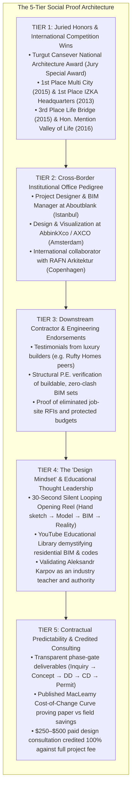

---

#### Detailed Examination of the 5 Tiers:

#### Tier 1: International Juried Honors & Competition Wins
* **Why It Matters to Mature Clients & Developers:** Competition juries consist of leading academics, licensed architects, and urban planners who judge hundreds of anonymous entries based purely on intellectual rigor, contextual responsiveness, and spatial ingenuity. Winning 1st place in an open international competition provides unassailable, objective third-party proof that Aleksandr Karpov operates at the pinnacle of design capability.
* **Canonical Laurels to Feature on `karpovdesign.com`:**
  1. **Turgut Cansever National Architecture Award — Jury Special Award (2016):** Awarded for the *IZKA Headquarters* (with Aboutblank, Istanbul). Recognizes architectural excellence, regional harmony, and structural innovation.
  2. **1st Place Winner — Multi City International Competition (2015):** High-density, human-centric multifamily urban design (with Aboutblank).
  3. **1st Place Winner — IZKA Headquarters Competition (2013):** Civic and commercial corporate headquarters.
  4. **3rd Place Winner — Life Bridge International Competition (2015):** Landscape and urban infrastructure (with Aboutblank and BOOM Landscape).
  5. **Honourable Mention — Valley of Life International Masterplan Competition (2016):** Regional urban planning and ecological infrastructure (with Aboutblank and KCAP).

#### Tier 2: Institutional Pedigree & Cross-Border Office Experience
* **Why It Matters:** Mature clients want assurance that their designer has managed multi-million-dollar budgets, massive consultant teams, and complex construction documents without crumbling. Karpov’s decade of practice in Istanbul, Amsterdam, and Copenhagen proves mastery of rigorous European building standards.
* **Factual & Legally Compliant Attribution (Brief Pages 8–10):**
  * *Aboutblank Architects (Istanbul):* Aleksandr Karpov served as project designer, 3D modeler, and BIM manager on major built works, including *Royal Garden Kartal*, *Sky Blue*, *Yakacik Towers*, and *Cekmekoy High School*.
  * *AbbinkXco / AXCO (Amsterdam):* Design, visualization, and modeling on landmark projects, including *Pijp Park* and *De Krijgsman Housing, Muiden*.
  * *RAFN Arkitektur (Copenhagen):* Collaboration on Scandinavian high-craft modernism, including *Villa Development, Copenhagen*.
* **Web Implementation:** Displayed under a dedicated "Collaborations" view on the Projects page, ensuring transparent attribution while showcasing the massive institutional scale of Karpov’s background.

#### Tier 3: Downstream Contractor & Engineering Endorsements
* **Why It Matters:** Homeowners fear that designers draw pretty pictures that builders cannot construct. Builders fear that designers will issue missing dimensions that halt the job site. Endorsements from general contractors and structural engineers directly dismantle this fear.
* **Target Testimonial Archetypes to Feature on `karpovdesign.com`:**
  * *The Luxury Custom Builder:* "Building from Aleksandr’s Revit sets is night and day compared to standard plans. Every beam pocket, HVAC chase, and window rough opening is pre-coordinated in 3D. We didn't issue a single framing RFI, and our framing inspection passed on the first walk. That saved our client three weeks of carrying costs."
  * *The Structural Consulting P.E.:* "Karpov Design delivers the cleanest structural load paths I've seen from a residential practice. The framing models are logically aligned from roof ridge to footing, which cuts our calculation time in half and speeds up permit issuance."

#### Tier 4: The "Design Mindset" & Educational Thought Leadership
* **Why It Matters:** High-end clients do not just buy finished drawings; they buy a relationship with an expert mind. Showing how the designer thinks builds immense emotional trust.
* **The 30-Second Silent Looping Opening Reel (Brief Page 2):**
  * Embedded directly above the fold on the homepage.
  * A sequence of 3-to-5 second high-craft clips:
    1. Hand sketching in graphite and ink on heavy paper.
    2. Precision watercolor wash mapping natural site contours.
    3. Hands assembling a physical basswood and laser-cut chipboard study model.
    4. A 3D digital model rotating in Autodesk Revit / Rhino, revealing structural framing.
    5. A photorealistic architectural render resolving sunlight pouring through a vaulted living space.
    6. A job-site inspection walking through raw timber framing.
    7. A finished, serene room bathed in morning daylight.
  * *Accessibility & Controls:* Visible pause button, fully responsive, zero intrusive audio.
* **YouTube Educational Library (Brief Page 14):**
  * Embedding high-level video tutorials demonstrating residential drafting, Revit parametric modeling, residential code navigation, and design process.
  * Demonstrates that Aleksandr Karpov is an authority who literally teaches other designers and students worldwide.

#### Tier 5: Contractual Predictability & Credited Consulting
* **Why It Matters:** Affluent homeowners dread open-ended hourly retainers and billing surprises. Transparency around process, deliverables, and fees transforms anxiety into confidence.
* **The Structured Process Graphic (Services Page):**
  * Numbered, drawn diagram illustrating the exact stages of a project: *1. Guided Inquiry → 2. 30-Min Intro Call → 3. Site Feasibility & Proposal → 4. Concept Design & Massing → 5. Design Development & 3D Review → 6. Construction Documents (BIM) → 7. Engineering & Permit Support → 8. Construction Observation*.
  * Each stage defines exactly **what the client decides** and **what the client receives**.
* **The Risk-Free Design Consultation Credit Hook (Brief Page 12–13):**
  * Paid 45-minute ($250) or 90-minute ($450) one-on-one virtual design consultations booked directly on the website calendar.
  * **The Irresistible Conversion Hook:** *"The consultation fee is credited 100% toward your custom residential design agreement if you hire Karpov Design LLC."*
  * This filters out tire-kickers while making the initial financial commitment completely risk-free for serious homeowners.


---

## Section 6: Executive Slide Blueprint Data Blocks (Slides 16–20)

This section provides the rigorous, presentation-ready content blocks for **Slides 16 through 20** of the master 36-slide executive deck. Each blueprint is formatted specifically for a **16:9 widescreen slide layout**, structured into 4 to 5 content columns with strategic takeaways and explicit visual bindings.

---

### Slide 16: Upstream & Downstream Channel Matrix
* **Slide Title:** Upstream & Downstream Channel Dynamics: B2B Ecosystem Integration
* **Subtitle:** Deconstructing the Regional Built Environment Flywheel: Intercepting Land Acquisitions & Enabling Turnkey Delivery
* **Strategic Takeaway:** High-end residential practices must transition from passive retail lead generation to an active B2B ecosystem hub. By partnering with upstream luxury brokers to unblock complex land sales via rapid 72-hour feasibility studies, and supplying downstream custom builders (e.g., Rufty Homes, PLATT) and modular fabricators (Backcountry Hut, BrightBuilt) with Level of Development (LOD) 300/350 permit BIM packages, Karpov Design LLC creates a self-funding, high-barrier referral network that eliminates client acquisition costs.
* **Visual Data Binding:** Comprehensive B2B Ecosystem Topology Diagram (Upstream Lead Engines → Karpov Design Central Hub → Downstream Fabrication & Execution Network → End Client / Developer).

#### Column Structure (5-Column Layout):

* **Column 1: Upstream Luxury Land Brokers**
  * *Channel Entities:* Hodge & Kittrell Sotheby's, Compass NC, Premier Sotheby's International Realty.
  * *Operational Friction:* Affluent buyers hesitate on prime custom lots ($400k–$2.5M) due to steep slopes, rock excavation, and complex zoning setbacks.
  * *Karpov B2B Offering:* 48–72 Hour "Pre-Purchase Feasibility & Massing Package" ($1,500–$3,500). Delivers 3D slope analysis, buildable envelope, and preliminary massing.
  * *Commercial Impact:* Unblocks stalled land transactions, secures broker commissions, and converts lot buyers into custom residential clients with an 85%+ success rate.

* **Column 2: Infill & Speculative Land Developers**
  * *Channel Entities:* Triangle urban infill developers (Raleigh, Durham, Chapel Hill), mountain parcel subdividers (Buncombe, Transylvania).
  * *Operational Friction:* High cost ($40k+) and multi-month delays of civil engineering during short due-diligence windows.
  * *Karpov B2B Offering:* Parametric Site Yield & Concept Entitlement Studies. Rapid 3D massing, shadow analysis, and ADU cluster configurations within 5–7 days.
  * *Commercial Impact:* De-risks developer capital allocation, accelerates municipal planning board approvals, and leads directly to phased construction drafting contracts.

* **Column 3: Elite Custom Homebuilders**
  * *Channel Entities:* Rufty Homes (Cary/Raleigh), PLATT (Brevard/Asheville), Alphin Design Build (Raleigh).
  * *Operational Friction:* Builder-grade or incomplete drawings cause job-site framing clashes, missing MEP chases, delayed inspections, and endless client RFIs.
  * *Karpov B2B Offering:* Level of Development (LOD) 300/350 Autodesk Revit BIM packages. Pre-coordinated structural framing, standard lumber spans, and manufacturer rough openings.
  * *Commercial Impact:* Eliminates field rework and schedule delays for builders; establishes a reciprocal referral engine where builders send un-designed clients to Karpov.

* **Column 4: Modular & Kit-of-Parts Fabricators**
  * *Channel Entities:* The Backcountry Hut Company (Vancouver, BC), BrightBuilt Home (Portland, ME), Deltec Homes (Asheville, NC).
  * *Operational Friction:* Factory fabricates precision shells but cannot provide local site grading, foundation engineering, zoning variance filings, or interior customization.
  * *Karpov B2B Offering:* Regional Site Integration & Entitlement Design Partner. Local topographic site plans, NC P.E. foundation coordination, and municipal permitting packages.
  * *Commercial Impact:* National and regional fabricators officially refer East Coast and North Carolina buyers to Karpov, generating recurring $7.5k–$25k adaptation fees.

* **Column 5: Consulting Engineering Partners (P.E.)**
  * *Channel Entities:* North Carolina Licensed Professional Engineers (Structural, Geotechnical, Civil).
  * *Operational Friction:* Receiving messy 2D sketches with broken load paths, forcing engineers to redesign structural systems and argue over billable hours.
  * *Karpov B2B Offering:* Pre-coordinated 3D Revit models with continuous vertical load paths and clear framing grids matching IRC and NC building codes.
  * *Commercial Impact:* Cuts engineering calculation time by 50%, accelerates permit issuance, and establishes a two-way referral flow for incoming homeowners seeking design.

---

### Slide 17: Co-opetition & Channel Referral Architecture
* **Slide Title:** Co-opetition Dynamics: Resolving the Contractor "Free Design" Conflict
* **Subtitle:** Independent Fiduciary Design Advocacy vs. Builder Loss-Leaders: Protecting Client Capital via BIM Precision
* **Strategic Takeaway:** The builder's sales pitch of "free in-house design" is an expensive trap that locks clients into un-tendered contracts, margin-protecting value engineering, and 20% to 40% change order escalation. Karpov Design LLC establishes an independent, fiduciary design model that delivers complete Level of Development (LOD) 300/350 Revit BIM documentation. This enables competitive builder bidding that saves clients 8% to 15% on construction—fully self-funding the design fee while providing builders with zero-clash, RFI-free drawings.
* **Visual Data Binding:** The MacLeamy Cost-of-Change Curve vs. Design Influence Graphic paired with the Triangular Trust Network Sequence.

#### Column Structure (4-Column Layout):

* **Column 1: The Contractor "Free Design" Trap**
  * *The Mechanism:* Builders offer "free design" or nominal $2.5k drafting to capture the client before market price discovery.
  * *Loss of Competitive Bidding:* Client is locked into a sole-source Cost-Plus 20% or high fixed contract with zero competitive tender pressure.
  * *Value-Engineering Perversion:* Contractor alters architectural details to favor existing inventory, preferred subs, and higher gross margins, sacrificing spatial intent.
  * *The Allowance Ambiguity:* Plans omit millwork, tile, and lighting details; artificially low allowances trigger massive change orders once walls are framed.
  * *Empirical Cost Impact:* Average 20% to 40% construction cost escalation ($200k–$400k on a $1M build) and severe client emotional distress.

* **Column 2: Karpov Independent Fiduciary Advocacy**
  * *Pure Fiduciary Representation:* Karpov maintains zero financial interest in construction margins, material sales, or subcontractor markups.
  * *Comprehensive Scope Definition:* Every wall, window, fixture, and finish is modeled and scheduled before bidding, eliminating contractor allowance guesswork.
  * *Competitive Tender Power:* Clients issue the identical Level of Development (LOD) 300/350 BIM set to 2–3 vetted custom builders (e.g., Rufty Homes, PLATT).
  * *Direct Client Cash Savings:* Competitive bidding drives 8% to 15% cost variance, saving the client $80,000 to $225,000 on a $1M–$1.5M residence.
  * *Self-Funding Economics:* The client’s design investment is completely offset by construction bidding savings before dirt is moved.

* **Column 3: The MacLeamy "Cost of Change" Curve**
  * *Design Front-Loading Principle:* Design changes are nearly free on paper and digital models, but exponentially expensive on the job site.
  * *Schematic Phase (Rhino/Revit):* Cost to shift a wall or reorient a window = $0–$150. Design influence = 100%. Zero schedule impact.
  * *Construction Document Phase (BIM):* Cost to modify = $1,500–$3,500. Design influence = 50%. 1–3 days drafting update.
  * *Framing & Rough-In Phase (On-Site):* Cost to alter framed walls or rough plumbing = $12,000–$35,000. 3–6 weeks job-site delay.
  * *Post-Drywall & Finishes:* Cost to alter = $25,000–$65,000+. Destructive tear-out, trade remobilization, and compromised aesthetics.

* **Column 4: The Builder Co-opetition Protocol**
  * *Respecting Builder Economics:* Karpov designs to standard dimensional lumber lengths (12', 14', 16', 20') and pre-coordinated I-joist spacing, eliminating cutting waste.
  * *Vertical MEP Alignment:* Stacked plumbing and dedicated mechanical chases ensure ductwork never collides with structural steel headers.
  * *Pre-Construction Workshop:* Mandatory 2-hour 3D BIM model review with general contractor, framing lead, and HVAC trades before ground is broken.
  * *Zero-RFI Guarantee:* Builders experience zero framing delays and flawless inspections, converting them into passionate advocates who refer clients to Karpov.

---

### Slide 18: Diagrammatic Case Study Blueprint (The `big.dk` Benchmark)
* **Slide Title:** Case Study Narrative Anatomy: Emulating the `big.dk` Morphogenetic Benchmark
* **Subtitle:** Transforming Static Architectural Photography into Step-by-Step Problem-Solving Transformations
* **Strategic Takeaway:** Conventional architecture case studies rely on glossy finished photos and unreadable floor plans that alienate mature homeowners and developers. Emulating the famous evolutionary diagramming of Bjarke Ingels Group (`big.dk`) and the tactile "Process Strips" of Studio MM, Karpov Design LLC structures every project page into a 5-stage visual narrative (Challenge → Morphogenetic Diagrams → BIM Rigor → Built Reality → Lateral Jump) that proves how site and zoning constraints generate brilliant, buildable architecture.
* **Visual Data Binding:** Step-by-Step Isometric Massing Transformation Strip (Zoning Envelope → Program Subtraction → Solar Angle → Topographic Step → Tectonic Resolution).

#### Column Structure (5-Column Layout):

* **Column 1: The Visual Communication Paradigm**
  * *The Failure of Glamour Photography:* High-end photos show *what* was built, but completely hide *why* and *how* it was built, fueling doubts about ego and cost.
  * *The big.dk Influence:* Adapting Bjarke Ingels Group's "Yes is More" philosophy—treating site, zoning, and microclimatic constraints as the generative engines of form.
  * *The Studio MM Influence:* Demystifying construction via horizontal "Process Strips" showcasing hand sketches, study models, and job-site framing.
  * *Target Demographic Appeal:* Proves to mature homeowners that the home is designed around their life; proves to developers that the design is buildable and code-compliant.

* **Column 2: Stages 1 & 2 — The Challenge & Morphogenetic Diagrams**
  * *Stage 1 (The Challenge):* Vector site contour maps, zoning setback envelopes, solar path diagrams, and a 2-paragraph narrative defining the client and terrain problem.
  * *Stage 2 (BIG-Style Isometric Strip):* 4 to 6 clean isometric diagrams illustrating Darwinian form evolution:
    1. *Base Envelope:* Extruding allowable zoning volume.
    2. *Puncture:* Carving a central courtyard for daylight.
    3. *Solar/View Twist:* Angling the roof 22° for solar PV and mountain vistas.
    4. *Topographic Step:* Stepping volumes down hillside contours to eliminate retaining walls.
    5. *Resolved Tectonics:* Integrating shading overhangs and cladding skin.

* **Column 3: Stage 3 — Technical Documentation & BIM Rigor**
  * *Vector Floor Plans:* Clean, readable 2D layouts highlighting daylight axes, room proportions, and indoor-outdoor sightlines.
  * *3D Revit Wireframe Assemblies:* Axonometric BIM cutaways showing structural steel framing, engineered floor trusses, and coordinated MEP chases.
  * *Process Media:* Hand-drawn ink/graphite sketches and physical laser-cut basswood study models proving design exploration.
  * *Permit Feasibility Proof:* Demonstrating full compliance with North Carolina Residential Code (NCRC) and municipal zoning standards.

* **Column 4: Stage 4 — Built Reality & Tactile Materiality**
  * *Professional Photography:* High-resolution architectural photography capturing natural daylight shifts (morning raking light, twilight glow).
  * *Tactile Material Vignettes:* Close-up documentation of authentic materials: charred shou sugi ban cypress, local NC granite, blackened steel, and white oak.
  * *Human-Scale Living:* Showing how spaces are inhabited, proving spatial serenity and acoustic calm rather than sterile showroom staging.

* **Column 5: Stage 5 — Lateral Typology Jumping & Conversion CTA**
  * *Breaking Architectural Silos:* Contextual bridge connecting the project to a complementary typology (e.g., Single-Family → Multi-Family or Commercial).
  * *Cross-Sector Authority:* Proves to residential clients that Karpov commands institutional multi-million-dollar BIM scale; proves to developers that Karpov commands human-scale craft.
  * *Actionable Conversion Hook:* Strategic call-to-action module: *"Planning a custom residence on a challenging site? [Book a 45-Minute Design Consultation] (Credited 100% toward design fee)."*

---

### Slide 19: Social Proof & Trust Architecture for Mature Demographics
* **Slide Title:** Social Proof & Trust Architecture: Multi-Tiered Credibility Systems
* **Subtitle:** De-Risking the Custom Design Journey for Affluent Homeowners & Institutional Developers
* **Strategic Takeaway:** Mature private clients (ages 45–70+) and commercial developers are fundamentally risk-averse; they are repelled by trendy marketing gimmicks, arrogant designer egos, and opaque billing. Karpov Design LLC deploys a 5-Tier Trust Architecture—spanning international competition jury honors (Turgut Cansever Award), elite European office pedigree (Aboutblank, AXCO, RAFN), builder and engineer endorsements, transparent design mindset reels, and credited consultation hooks—to create absolute institutional credibility.
* **Visual Data Binding:** The 5-Tier Social Proof Pyramid with Callout Metrics & Verified International Award Badges.

#### Column Structure (5-Column Layout):

* **Column 1: Demographic Psychology & Calibrated Tone**
  * *Mature HNW Clients (45–70+):* Emotionally seasoned, wealth preservation focus, dread of budget blowouts, seeking acoustic serenity and natural light.
  * *Institutional Developers:* Margin-driven, equity-accountable, terrified of municipal planning delays and contractor change orders.
  * *The Visual Posture:* Calm, serene, quiet luxury. High whitespace, disciplined typography, zero intrusive pop-ups or artificial scarcity timers.
  * *The Core Message:* "Intellectually rigorous, deeply collaborative, builder-coordinated, and contractually transparent."

* **Column 2: Tier 1 — Juried Honors & Competition Laurels**
  * *Objective Third-Party Proof:* Academic and peer juries evaluate hundreds of blind entries based solely on spatial, structural, and conceptual excellence.
  * *Turgut Cansever National Architecture Award (2016):* Jury Special Award for IZKA Headquarters (with Aboutblank, Istanbul).
  * *1st Place Winner — Multi City Competition (2015):* High-density multifamily urban design mastery.
  * *1st Place Winner — IZKA Headquarters Competition (2013):* Commercial corporate architecture.
  * *3rd Place Life Bridge (2015) & Hon. Mention Valley of Life (2016):* Infrastructure and large-scale urban master planning.

* **Column 3: Tier 2 — Institutional Cross-Border Pedigree**
  * *International Rigor:* A decade of European and transatlantic practice managing complex municipal and residential commissions.
  * *Aboutblank Architects (Istanbul):* Project designer and BIM manager on high-rise residential towers (Royal Garden Kartal, Sky Blue) and Cekmekoy High School.
  * *AbbinkXco / AXCO (Amsterdam):* Design and visualization on historic Dutch urban fabric (Pijp Park, De Krijgsman Housing).
  * *RAFN Arkitektur (Copenhagen):* Scandinavian regional modernism and custom coastal villa developments.
  * *Legal Demarcation:* Transparent historical attribution that honors prior offices while demonstrating mastery of large-scale construction documentation.

* **Column 4: Tier 3 & 4 — Trade Endorsements & Design Mindset**
  * *Downstream Trade Testimonials:* Quotes from custom general contractors and structural P.E.s verifying buildability, zero framing RFIs, and 1st-pass permit approvals.
  * *The 30-Second Silent Opening Reel:* Homepage looping reel showing hand sketching, watercolor site mapping, physical study model making, 3D Revit turntable, and finished room.
  * *Educational Authority:* YouTube video library demonstrating residential BIM modeling and code navigation, establishing Karpov as an industry educator.

* **Column 5: Tier 5 — Contractual Predictability & Credited Consulting**
  * *Clear Phase-Gate Workflow:* Published 8-stage roadmap defining exact client decisions and tangible deliverables at every milestone.
  * *The Cost-of-Change Curve:* Visualizing how front-loading decisions in 3D Revit saves tens of thousands in job-site change orders.
  * *The Credited Consultation Hook:* Paid 45-min ($250) or 90-min ($450) one-on-one virtual design consultation credited 100% toward the full design fee if retained.
  * *Conversion Impact:* Eliminates tire-kickers while creating a frictionless, zero-risk commitment for serious prospective clients.

---

### Slide 20: Strategic Channel & Credibility Master Blueprint
* **Slide Title:** Strategic Master Blueprint: Karpov Design's Integrated Growth Engine
* **Subtitle:** Unifying B2B Channel Partnerships, Diagrammatic Storytelling, and Multi-Tiered Social Proof
* **Strategic Takeaway:** Karpov Design LLC establishes an unassailable competitive moat in the North Carolina and transatlantic residential markets by unifying B2B upstream/downstream channel integration, diagrammatic case study storytelling (emulating `big.dk`), and multi-tiered institutional trust architecture. By operating as an independent, conflict-free design fiduciary delivering Level of Development (LOD) 300/350 BIM sets, Karpov eliminates client risk, protects builder schedules, and scales custom commissions and digital product revenues.
* **Visual Data Binding:** Comprehensive Strategic Integration Flowchart (B2B Ecosystem ↔ Five Core Typologies ↔ Case Study Engine ↔ Multi-Tier Trust Pipeline ↔ Commercial Revenue Streams).

#### Column Structure (5-Column Layout):

* **Column 1: Upstream & Downstream B2B Flywheel**
  * *Upstream Acquisition:* Luxury land brokers (Sotheby's, Compass) funnel lot buyers to Karpov via 72-hour feasibility audits ($1.5k–$3.5k); commercial developers engage for yield studies.
  * *Downstream Delivery:* Elite builders (Rufty Homes, PLATT) and modular fabricators (Backcountry Hut, BrightBuilt) receive builder-ready LOD 300/350 Revit sets.
  * *Bidirectional P.E. Pipeline:* Structural engineers exchange pre-coordinated 3D load models and client referrals, cutting permitting cycles in half.

* **Column 2: Independent Fiduciary Commercial Moat**
  * *Defeating the "Free Design" Trap:* Arming homeowners with mathematical proof that independent BIM design saves 8% to 15% via competitive builder tender.
  * *MacLeamy Design Front-Loading:* Freezing spatial and detailing decisions during digital schematic phases, completely eliminating field change orders.
  * *Zero Contractor Conflict:* Fiduciary representation dedicated exclusively to client lifestyle, spatial craft, and long-term building performance.

* **Column 3: Diagrammatic Narrative Case Studies**
  * *The big.dk Evolution Engine:* Transforming portfolio pages into 4-to-6 step isometric morphogenetic diagrams proving how constraints generate form.
  * *Studio MM Process Strips:* Showcasing hand sketches, physical basswood models, and job-site framing photos alongside finished architectural photography.
  * *BIM Constructability Proof:* Featuring axonometric 3D Revit wireframes and vector floor plans to satisfy both design purists and technical builders.

* **Column 4: Five Core Typologies with Lateral Cognitive Jumps**
  * *Typological Diversity:* Seamlessly presenting Single-Family Residential, Multi-Family Residential, Commercial, Art, and School / Education.
  * *Dismantling Market Silos:* Demonstrating to private clients how institutional multi-family BIM rigor eliminates custom home errors; demonstrating to developers how residential craft humanizes commercial spaces.
  * *Universal Authority:* Leveraging 21 canonical projects (Outside-In, Multi City, IZKA Headquarters, Eternity Ring, Cekmekoy High School) across all sectors.

* **Column 5: Calm Social Proof & Scaled Monetization**
  * *Calm Visual Tone:* Serene, clutter-free digital canvas tailored to mature HNW clients (45–70+) and institutional investors.
  * *Five-Tier Credibility:* Turgut Cansever Award, European pedigree (Aboutblank, AXCO, RAFN), builder testimonials, and 30-second design mindset reel.
  * *Multi-Pronged Revenue Model:* Custom residential commissions ($45k–$150k+), paid design consultations ($250–$450 credited), and digital webshop downloads (plan sets, Revit families, courses).


---

## Section 7: Implementation Roadmap & Web Architecture Integration

This section translates the strategic findings of Phase 3 into the direct technical and architectural execution of `karpovdesign.com`, strictly adhering to the technical and content directives established in the [Karpov_Design_Website_Brief.pdf](file:///c:/Users/doruk/Documents/Karpovdesign/Initial%20Brief/Karpov_Design_Website_Brief.pdf).

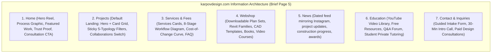

---

### 7.1 Homepage Architecture Integration (Brief Page 2)

The homepage operates as the primary digital ambassador for Karpov Design LLC. Rather than an aloof artistic portfolio, it communicates a **collaborative design mindset** tailored to affluent private clients and developers:

1. **Full-Screen Opening Reel (Brief Page 2):**
   * A silent, looping montage of approximately 30 seconds (3–5 second clips):
     * Hand sketching in graphite and ink on heavy paper.
     * Precision watercolor wash capturing site contours.
     * Hands assembling a physical basswood and laser-cut chipboard study model.
     * 3D digital model rotating in Autodesk Revit / Rhino, revealing structural framing.
     * Photorealistic architectural render resolving sunlight pouring through a vaulted living space.
     * Job-site walk-through showing raw timber framing.
     * Finished serene room bathed in morning daylight.
   * *Overlay Copy:* "Homes designed around how you live" (or "Design that listens to the land, engineered for the builder").
   * *Two Prominent CTAs:* `[See Projects]` (secondary outline) and `[Start a Project]` (primary solid).
   * *Accessibility & Controls:* Visible pause button; automatic lightweight still image on mobile/slow connections; respects `prefers-reduced-motion`.
   * *CMS Source:* Fed dynamically from folder `6 Home reel` (files `01 Sketch.mp4`, `02 Model.jpg`, etc.).
2. **"How I Design" Drawn Process Graphic (Brief Page 2):**
   * A drawn process graphic illustrating five sequential stages from one real project: *First Sketch → Massing Study → Plans → 3D View → Construction Framing → Finished Photo*.
   * Each stage features a single clear line stating what the client decides and receives, linking directly to the full `/services` workflow diagram.
3. **Selected Work (Brief Page 2):**
   * Three large, featured projects demonstrating breadth across the core typologies (e.g., *Outside-In*, *Multi City*, and *IZKA Headquarters*).
4. **"Why Work With Me" Multi-Tiered Trust Proof (Brief Page 2 & Section 5):**
   * Four structured value blocks backed by verified facts:
     1. *Competition-Proven Excellence:* 1st place international competition winner and recipient of the Turgut Cansever National Architecture Award.
     2. *Transatlantic & European Pedigree:* Built and master-planned work across four countries (United States, Netherlands, Denmark, Turkey).
     3. *Level of Development (LOD) 300/350 BIM Precision:* Full 3D Revit modeling pre-coordinating framing, MEP, and structural engineering before breaking ground.
     4. *Conflict-Free Client Advocacy:* Independent fiduciary representation enabling competitive builder bidding that saves 8% to 15% on construction costs.
5. **Client Testimonials & Final Conversion Anchor (Brief Page 2):**
   * Verified quotes from custom builders (e.g., verifying zero framing RFIs) and private homeowners (praising budget predictability and spatial calm).
   * Closing CTA banner: *"Have a project in mind? [Book a 45-Minute Consultation] or [Send an Inquiry]."*

---

### 7.2 Case Study Detail Page Architecture (Brief Page 6–10)

Every project page (`karpovdesign.com/projects/[project-slug]`) executes the **5-Stage Diagrammatic Case Study Blueprint** established in Section 4:

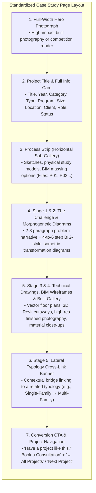

* **The Process Strip Integration:**
  * Files starting with `P` (e.g., `P01 Concept sketch.jpg`, `P02 Massing study.jpg`, `P03 Framing progress.jpg`) in the project folder are automatically parsed by the Cloudflare Pages build script and placed in a dedicated horizontal scroll strip above the main gallery.
* **Collaborations Demarcation (Brief Pages 8–10):**
  * When a project was executed as an employee of another firm (Aboutblank, AbbinkXco, RAFN), the page displays a prominent top credit banner:
    > *"Project by Aboutblank Architects. Aleksandr Karpov served as project designer and BIM manager on the design team."*
  * Includes direct link to the lead firm's website and explicit copyright notice (`Images © Aboutblank`).

---

### 7.3 Services, Workflow & Fees Architecture (Brief Page 11)

The `/services` page provides complete transparency, systematically disarming client anxiety regarding process and cost:

1. **Services Grid:**
   * Interactive cards detailing core services:
     * *Custom Residential Design (New Homes)*
     * *Modern Additions & Major Renovations*
     * *Multifamily & Infill Residential Design*
     * *Design Consulting & Feasibility Audits*
     * *Construction Drawings & Level of Development (LOD) 300/350 BIM*
     * *3D Modeling & Photorealistic Visualization*
     * *Permit Drawing Packages & Engineering Coordination*
2. **The 8-Stage Workflow Step Diagram:**
   * A drawn, numbered progression:
     1. *Inquiry & Intake Form*
     2. *30-Minute Intro Call* (Fit assessment)
     3. *Proposal & Design Agreement* (Clear phased contract)
     4. *Site Feasibility & Needs Survey* (Contours, zoning, sun path)
     5. *Concept Design & Massing* (Morphogenetic isometric studies)
     6. *Design Development & 3D Walkthrough* (Revit model freeze)
     7. *Construction Documents & Engineering* (Permit-ready BIM set)
     8. *Builder Bidding & Construction Observation* (Tender support & site visits)
   * Each step clearly specifies **What the Client Decides** and **What the Client Receives**.
3. **Transparent Fee Philosophy & The Cost-of-Change Curve:**
   * Explaining how residential pricing works: fixed fee per phase, per-square-foot ranges ($6–$10/sq ft heated for full design), and hourly rates for pre-purchase consulting ($150–$250/hr).
   * Embedding the **MacLeamy Cost-of-Change Curve** (from Section 3.3) showing that investing in thorough 3D BIM design saves tens of thousands in field changes.
4. **Comprehensive FAQ Section:**
   * *Do you work outside North Carolina?* (Explains NC focus, remote design consulting across the US, and collaboration with local engineers).
   * *Do I need an architect or engineer too?* (Transparently explains NCGS § 83A residential exemptions and when a licensed NC Professional Engineer / P.E. stamp is mandated for structural framing).
   * *How long does a typical custom home design take?* (3 to 6 months for thorough concept, development, and permit documentation).
   * *How do revisions work?* (Structured phase sign-offs; unlimited refinement within phase before milestone sign-off).
   * *How do remote meetings work?* (Screen-sharing live 3D Revit models, interactive walkthroughs, cloud folder access).

---

### 7.4 Collaborations Filter View (Brief Pages 8–10)

To showcase institutional scale without violating licensing nomenclature or claiming false credit, the main `/projects` page features an intuitive tri-state filter switch:

```
[ Karpov Design ]  ·  [ Collaborations ]  ·  [ All Work ]
```

* **Default State:** Defaults to **Karpov Design**, displaying commissions where Aleksandr Karpov was the direct lead designer / principal.
* **Collaborations State:** Displays institutional, commercial, and multi-family projects executed at prior firms (Aboutblank, AbbinkXco, RAFN Arkitektur).
  * Every card carries a prominent subtitle label: *"With Aboutblank, Istanbul"* or *"With AbbinkXco, Amsterdam"*.
  * Two additional info card fields appear: **Office** (linked to firm website) and **My Role** (e.g., "Project Designer & BIM Manager", "Concept Modeling & Visualization").
  * Retains the identical sticky 5-typology category filter bar, ensuring seamless navigation without page reloads.

---

### 7.5 Google Drive & Cloudflare Pages File-Based CMS Schema (Brief Pages 16–20)

In strict accordance with the client brief's requirement for a **zero-coding, file-based update pipeline**, the site is generated from a local folder synchronized to Google Drive / Dropbox, hosted on **Cloudflare Pages**:

```
Karpov Design Website/
├── 1 Projects/
│   ├── 01 Outside-In/
│   │   ├── info.txt
│   │   ├── 01 Hero.jpg
│   │   ├── P01 Concept sketch.jpg
│   │   ├── P02 Massing options.jpg
│   │   ├── 02 Plan.jpg
│   │   └── 03 Interior.jpg
│   └── 02 Multi City/
│       ├── info.txt
│       ├── 01 Hero.jpg
│       └── P01 Urban diagram.jpg
├── 2 Collaborations/
│   └── 01 IZKA Headquarters/
│       ├── info.txt (Contains 'Office: Aboutblank' and 'My role:')
│       ├── 01 Hero.jpg
│       └── P01 Facade study.jpg
├── 3 Shop/
│   ├── 01 Modern Cabin Plan Set/
│   │   ├── product.txt
│   │   ├── 01 Preview.jpg
│   │   └── files.zip
├── 4 News/
│   └── 2026-10-30 New Award/
│       ├── post.txt
│       └── 01 Image.jpg
├── 5 Videos/
│   └── 01 Revit Residential Framing/
│       └── video.txt (YouTube URL & description)
├── 6 Home reel/
│   ├── 01 Sketch.mp4
│   ├── 02 Model.jpg
│   ├── 03 3D Turntable.mp4
│   └── 04 Finished Room.jpg
├── about.txt
├── services.txt
├── fees.txt
└── faq.txt
```

#### The `info.txt` Project Metadata Specification:
```yaml
Title: Outside-In
Year: 2019
Category: Single-Family Residential, Conceptual
Status: Concept
Size: 3,200 sq ft
Location: North Carolina
Client: Private
Role: Lead Designer
Office: 
Office link: 
Image credit: Aleksandr Karpov
---
Outside-In explores the dissolution of the boundary between interior domestic sanctuary and the untamed native North Carolina landscape.

By puncturing the core living volume with a protected biophilic courtyard, every primary room captures dual-aspect natural lighting and cross-ventilation while preserving complete acoustic privacy from adjacent parcels.
```

When Aleksandr Karpov drops a new folder of images and an `info.txt` file into his synced Google Drive folder, a Cloudflare Pages webhook triggers an automated static build, publishing the new case study, updating category filters, and formatting the process strip in seconds—**with zero coding or manual database maintenance required**.
