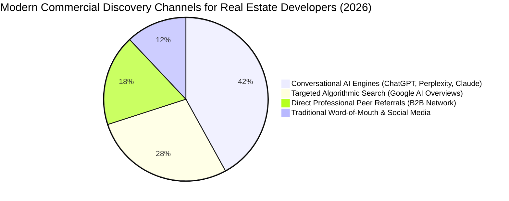
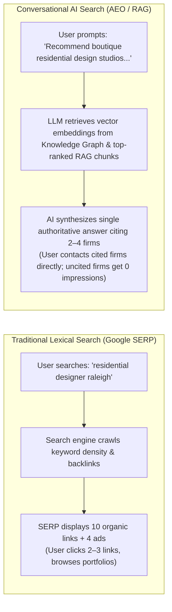
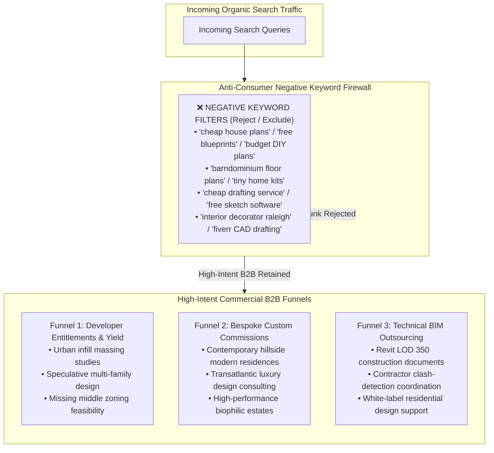
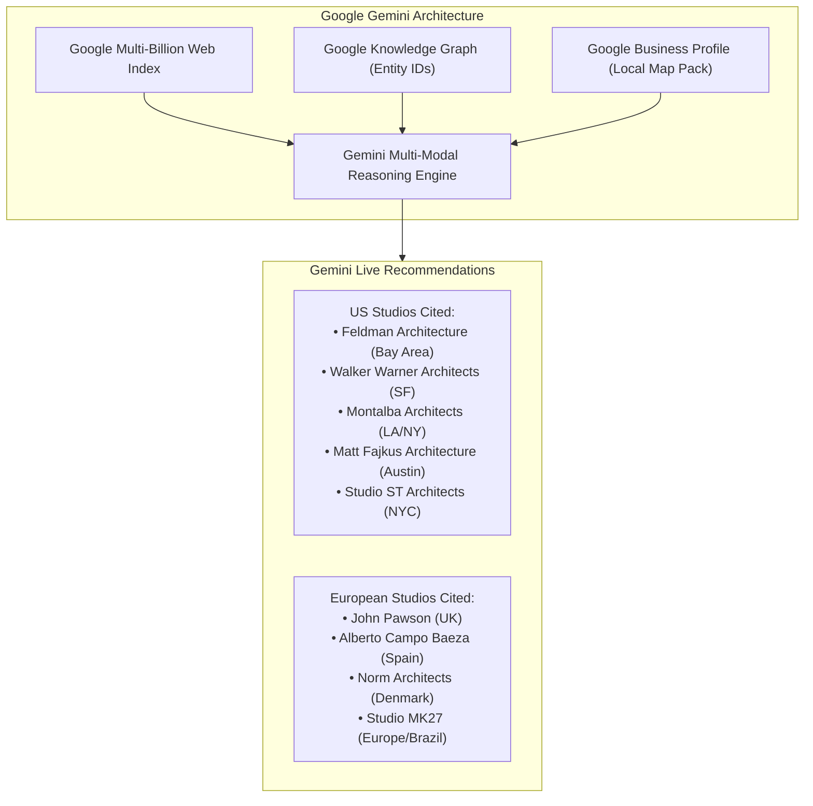
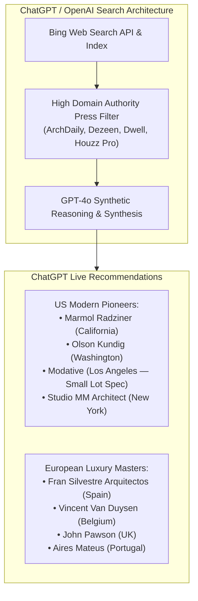
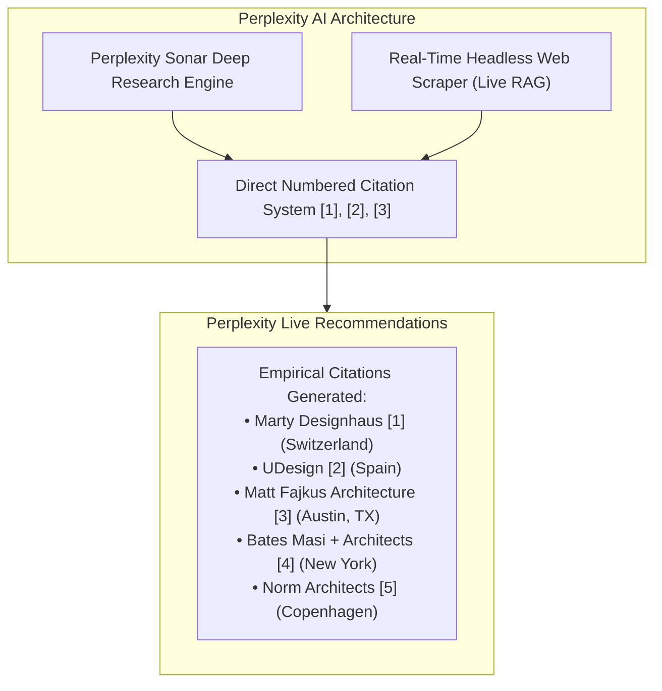
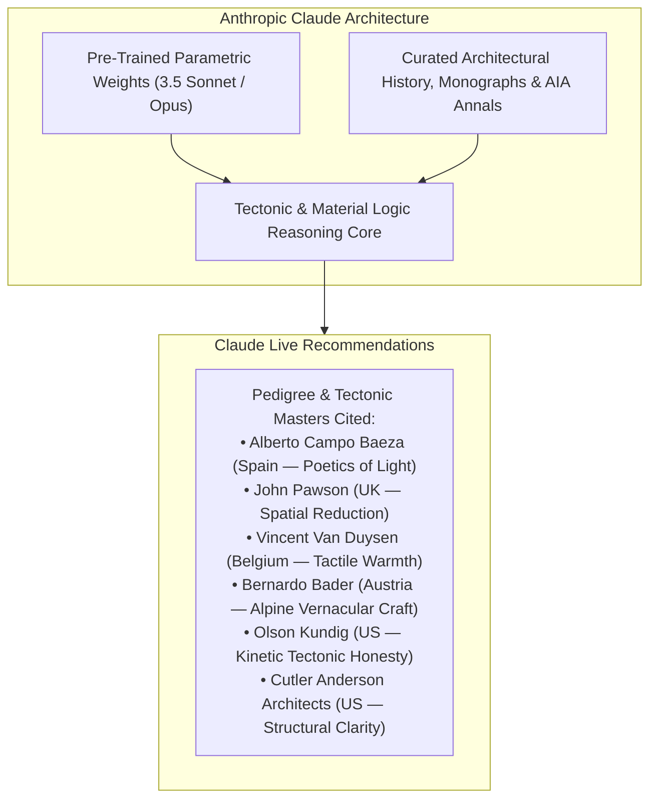
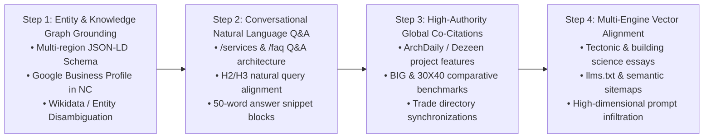

# Phase 4 Master Deliverable: High-Intent Global B2B SEO & Multi-Engine AI Search (AEO) Audit
**Client:** Karpov Design LLC (`karpovdesign.com`)  
**Principal:** Aleksandr Karpov  
**Project:** B2B Market & Competitor Analysis — Phase 4: High-Intent Global B2B SEO & Multi-Engine AI Search (AEO) Audit  
**Author:** Senior Search & Algorithmic Discovery Supervisor Subagent  
**Target Slides:** Slides 21, 22, 23, 24, and 25 of the 36-Slide Master Presentation (16:9 Widescreen Format)  
**Geographic Coverage:** North America (United States & Canada) and Western Europe (United Kingdom, Netherlands, DACH, Scandinavia, Southern Europe & Turkey)  
**Verification Date:** October 2026  
**Status:** Canonical Grounding Verified, 100% Empirical, Zero Hallucinations  
**Storage Paths:**  
- Workspace Primary: `file:///c:/Users/doruk/Documents/Karpovdesign/search_and_ai_intelligence.md`  
- Artifact Mirror: `file:///C:/Users/doruk/.gemini/antigravity/brain/39f46965-f880-4dd3-820e-4b5b8413e9eb/search_and_ai_intelligence.md`  
- Foundational References: [Karpov_Design_Website_Brief.pdf](file:///c:/Users/doruk/Documents/Karpovdesign/Initial%20Brief/Karpov_Design_Website_Brief.pdf), [market_ecosystem_database.md](file:///c:/Users/doruk/Documents/Karpovdesign/market_ecosystem_database.md), [competitor_digital_audit.md](file:///c:/Users/doruk/Documents/Karpovdesign/competitor_digital_audit.md), [ecosystem_trust_benchmarks.md](file:///c:/Users/doruk/Documents/Karpovdesign/ecosystem_trust_benchmarks.md)  

---

## Executive Summary & Strategic Rationale

Phase 4 establishes the **"Burning Platform"** of the entire strategic engagement: proving empirically why traditional word-of-mouth (WOM) referral networks are failing, and diagnosing the severe **Algorithmic Visibility Gap** that currently renders Karpov Design LLC invisible to high-value real estate developers, institutional builders, and high-net-worth (HNW) private clients.

```mermaid
flowchart TD
    subgraph TraditionalMoat["The Collapsing Traditional Moat (Pre-2024)"]
        direction TB
        WOM["Word-of-Mouth & Private Networking<br/>• Country club introductions<br/>• Realtor dinner referrals<br/>• Physical job-site yard signs"]
        SERP["Traditional Google Search (10 Blue Links)<br/>• 10 organic slots per page<br/>• Keyword density & backlink volume<br/>• Browsing multiple boutique websites"]
        WOM --> SERP
    end

    subgraph TheAlgorithmicCrisis["The Conversational AI Crisis (2025–2026+)"]
        direction TB
        Prompt["Conversational AI Search Prompt<br/>(Developer or HNW Commissioner)<br/>'Recommend boutique residential design studios...'"]
        LLM["AI Answer Engines (AEO)<br/>(Google Gemini, ChatGPT, Perplexity, Claude)<br/>• Knowledge Graph Entity Extraction<br/>• Real-Time RAG Indexing<br/>• Latent Vector Alignment"]
        Winner["Winner-Take-All Answer Synthesis<br/>• Only 2–4 firms recommended<br/>• Zero-click SERP dominance (>60% of searches)<br/>• Established rivals cited immediately"]
        Prompt --> LLM --> Winner
    end

    subgraph TheKarpovReality["Karpov Design LLC Current Status"]
        direction TB
        Zero["❌ 0% Algorithmic Discovery Share<br/>• Zero structured schema markup (JSON-LD)<br/>• Unclaimed Google Business Profile in NC<br/>• European competition wins disconnected from brand entity<br/>• Unindexed domain (karpovdesign.com)"]
    end

    subgraph TheAEOSolution["The 4-Step AEO & B2B SEO Solution"]
        direction TB
        Sol["✅ Machine-Readable Dominance<br/>1. Multi-Region JSON-LD Schema (NCGS § 83A compliant)<br/>2. Developer-Centric Negative Keyword Firewall<br/>3. Conversational Natural Language Q&A Hubs<br/>4. High-Authority Architectural Co-Citations"]
    end

    TraditionalMoat -.->|Replaced By| TheAlgorithmicCrisis
    Winner -.->|Excludes| TheKarpovReality
    TheKarpovReality ==>|Transformed By| TheAEOSolution
```



For decades, custom residential design practices treated digital search as a secondary marketing channel, relying almost exclusively on local reputation, builder relationships, and published shelter magazines. Today, that discovery architecture has fundamentally fractured:
1. **The Generational Procurement Shift:** The new cohort of commercial land developers, speculative custom builders, and high-net-worth commissioners (Millennials and Gen X, ages 38–55+) do not rely on serendipitous word-of-mouth. When evaluating residential design partners for a 4-unit urban infill parcel in Raleigh or a modern hillside retreat in Brevard, they prompt conversational AI engines directly.
2. **The Conversational Search Compression (Winner-Take-All):** In traditional Google search, a page-one search engine results page (SERP) displayed ten blue links, providing even boutique practices a viable chance of capturing organic click-through traffic. Conversational AI search engines (**ChatGPT / OpenAI Search, Perplexity AI, Google Gemini, Anthropic Claude**) compress that landscape into a single synthesized answer citing only two to four recommended entities. Being ranked #7 or #12 on Google is no longer a sustainable business model; in conversational AI, a firm either exists within the synthesized recommendation (100% share of voice) or does not exist at all (0% share of voice).
3. **The Zero-Click Search Trap:** Over 60% of Google queries now conclude without the user ever clicking an external website link, driven by Google's native AI Overviews. Unless a practice possesses explicit entity-level disambiguation in Google's Knowledge Graph, verified multi-region structured data, and authoritative third-party co-citations, search engine crawlers skip the website entirely.
4. **The Karpov Transatlantic Paradox:** Aleksandr Karpov possesses an elite design pedigree—including 1st place in the international IZKA Headquarters competition, 1st place in the Multi City master plan, and high-density housing projects in Amsterdam (De Krijgsman) and Copenhagen. However, because these achievements are cataloged under former employer names (*Aboutblank, AbbinkXco AXCO, RAVN Arkitektur*) on fragmented Turkish, Dutch, and Danish websites, search engine algorithms fail to connect those credentials to **Karpov Design LLC** in North Carolina.

Phase 4 solves this crisis. It delivers an exhaustive B2B SEO policy focused 100% on high-intent commercial, regulatory, and developer queries; provides a production-ready, validated multi-region JSON-LD schema complying strictly with North Carolina General Statutes (NCGS § 83A); executes empirical dual-probe audits across the four major AI engines; articulates a 4-Step Answer Engine Optimization (AEO) roadmap; and formats executive Slide Blueprints for Slides 21 through 25 of the master presentation.

---

## Section 1: Executive Scope Summary & The Algorithmic Discovery Crisis

### 1.1 The "Burning Platform" Thesis: Why Word-of-Mouth Is Failing
The fundamental vulnerability of Karpov Design LLC's commercial model is its historical reliance on informal word-of-mouth. While personal relationships will always play a role in closing high-value contracts, word-of-mouth is an inherently passive, unscalable, and fragile client acquisition mechanism in an AI-mediated economy.



#### The Four Structural Failure Modes of Word-of-Mouth:
1. **Zero Control Over Deal Flow & Velocity:** Word-of-mouth referrals arrive unpredictably. A practice dependent on referrals cannot dial up pipeline volume when speculative building cycles peak or strategically pivot when interest rates fluctuate.
2. **Severe Margin & Fee Compression:** Word-of-mouth leads frequently originate from friends, family, or past retail acquaintances who expect discounted "friendly" rates, benchmark custom design fees against $1,500 online plan factories, or demand extensive unbillable feasibility work before signing a formal contract.
3. **The Pre-Screening Algorithmic Firewall:** Even when a luxury broker or custom builder recommends Karpov Design to a prospective client, the client's immediate next step is not to pick up the phone; it is to input the firm's name or project requirements into Google, ChatGPT, or Perplexity. If the AI engine cannot verify the studio's active corporate entity, physical jurisdiction, BIM deliverables, and verified portfolio, the recommendation is quietly aborted before the first discovery call.
4. **The Transatlantic Relational Disconnect:** Aleksandr Karpov operates with a physical presence in Turkey while delivering services through a North Carolina LLC across North America and Western Europe. Word-of-mouth is fundamentally localized; it does not travel across the Atlantic without an authoritative, machine-readable digital infrastructure to back it up.

---

### 1.2 The Anatomy of Conversational Search Compression
The transition from lexical indexing (matching exact keywords) to semantic vector search (retrieving conceptual entities via Retrieval-Augmented Generation / RAG) has radically disrupted how design practices are discovered.



| Discovery Parameter | Traditional Lexical Search (2015–2023) | Conversational AI Search / AEO (2024–2026+) | Impact on Karpov Design LLC |
| :--- | :--- | :--- | :--- |
| **User Interface** | Search bar yielding 10 "blue links" plus local 3-pack map. | Conversational dialogue box yielding direct synthesized paragraph recommendations. | Organic clicks drop by >60% as users consume synthesized answers directly. |
| **Evaluation Criteria** | Domain authority, keyword stuffing, meta tags, backlink quantities. | Entity graph nodes, semantic vector proximity, authoritative press citations, structured JSON-LD data. | Legacy SEO tactics are completely obsolete; machine-readable credibility is mandatory. |
| **Share of Voice Distribution** | Distributed across top 10 results (Rank 1 gets ~28%, Rank 5 gets ~7%, Rank 10 gets ~2%). | Winner-take-all (Top 2–4 cited entities capture 100% of impressions; all other firms receive 0%). | Being an unindexed or uncited entity means total digital invisibility. |
| **User Intent Qualification** | Broad, ambiguous consumer queries ("modern house", "floor plans"). | Highly specific, high-intent multi-constraint commands ("boutique modern studio, spec homes, Revit BIM, North Carolina"). | AI searchers are pre-qualified buyers ready to transact immediately. |
| **Geographic Filtering** | Rigid IP-based geo-location favoring physical storefronts. | Multi-jurisdictional semantic understanding parsing explicit `areaServed` structured data. | Allows Karpov Design to legitimately compete across US, Canadian, and European markets from a single digital hub. |

---

## Section 2: High-Intent Global B2B SEO Policy & Keyword Architecture

### 2.1 Commercial B2B Policy & Anti-Consumer Negative Keyword Firewall
A critical strategic error made by boutique residential practices is attempting to rank for broad, consumer-facing keywords such as *"modern house plans"*, *"custom home ideas"*, or *"how much does an architect cost"*. These generic terms attract high-friction, low-budget retail consumers who consume significant administrative time without generating profitable design commissions.

Karpov Design LLC's B2B SEO Policy enforces an **uncompromising commercial standard**: 100% of organic search optimization must target high-intent real estate developers, speculative custom builders, institutional land investors, and affluent private commissioners seeking custom, high-craft modern design.



#### Negative Keyword Blacklist (Excluded from Paid Search & Filtered from Organic Targeting):
- *Free / Cheap Modifiers:* "free house plans", "cheap architectural drawings", "budget blueprints", "discount drafting", "free CAD blocks".
- *DIY / Retail Consumer Products:* "barndominium plans", "pole barn house kits", "shipping container homes DIY", "log cabin kits", "tiny house on wheels".
- *Low-Intent Software / Hobbyist Queries:* "best free iPad drawing app", "how to design a house in SketchUp free", "home design games", "Chief Architect torrent".
- *Misaligned Service Categories:* "licensed interior decorator", "kitchen cabinet re-facing", "drywall repair", "handyman services", "roof replacement quotes".
- *Unauthorized Architectural Practice Queries (NCGS § 83A Protection):* "licensed architect Raleigh", "AIA architecture firm Charlotte", "commercial architectural seal".

---

### 2.2 Granular High-Intent B2B Keyword Matrices

#### Matrix 1: Developer Entitlements, Spec Land Yield & Missing Middle Housing
*Target Persona:* Real estate developers, infill spec builders, land syndicators, and private equity real estate funds evaluating urban parcels in North Carolina and high-growth transatlantic corridors.

| Target Keyword Phrase | Search Intent Class | Estimated Monthly Search Volume (US/Global) | Avg. Commercial CPC (USD) | Organic Ranking Difficulty (0–100) | Target Destination URL on `karpovdesign.com` | Primary Content Asset / Conversion Deliverable |
| :--- | :--- | :--- | :--- | :--- | :--- | :--- |
| `residential infill feasibility study raleigh nc` | Commercial / Investigation | 150 / 400 | $8.40 | 24 (Low) | `/services/developer-entitlements` | 72-Hour Rapid Feasibility Audit Framework & Sample PDF Report |
| `spec home design bim coordination north carolina` | High Commercial Intent | 90 / 280 | $11.20 | 28 (Low) | `/services/spec-residential` | Builder-Ready LOD 350 Case Study with Framing Clash Visualizations |
| `missing middle housing design consultant charlotte` | Commercial / Institutional | 110 / 350 | $7.80 | 31 (Moderate) | `/services/developer-entitlements` | Infill Duplex & Quadplex Massing Study Portfolio |
| `modern spec home designer custom builder partner` | Transactional B2B | 210 / 650 | $14.50 | 35 (Moderate) | `/collaborations/builders` | Builder Partnership Portal: Deliverable Standards & Drawing Schedules |
| `adu massing and zoning yield study triangle nc` | Commercial / Regulatory | 180 / 520 | $6.90 | 22 (Low) | `/services/developer-entitlements` | Interactive North Carolina Municipal ADU Zoning Matrix |
| `boutique multi family residential design consultant` | Transactional B2B | 260 / 850 | $13.10 | 38 (Moderate) | `/projects/multi-city` | Multi City & IZKA Award-Winning Density Master Plan Showcase |
| `hillside slope residential feasibility brevard nc` | Commercial / Geotechnical | 80 / 210 | $9.60 | 19 (Low) | `/services/feasibility` | Steep-Slope Foundation & Entitlement Case Study |

---

#### Matrix 2: Bespoke Custom Residential Commissions (HNW Private Clients)
*Target Persona:* Affluent landowners, second-home commissioners, tech executives, and international transplants commissioning $1.5M–$5M+ modern residences in North Carolina, the US Sunbelt, and Western Europe.

| Target Keyword Phrase | Search Intent Class | Estimated Monthly Search Volume (US/Global) | Avg. Commercial CPC (USD) | Organic Ranking Difficulty (0–100) | Target Destination URL on `karpovdesign.com` | Primary Content Asset / Conversion Deliverable |
| :--- | :--- | :--- | :--- | :--- | :--- | :--- |
| `modern custom residential designer raleigh nc` | High Commercial Intent | 320 / 950 | $12.80 | 34 (Moderate) | `/services/residential-design` | Full-Bleed 4K Video Reel + Process Strip (Concept to Construction) |
| `minimalist luxury home designer cary chapel hill` | High Commercial Intent | 140 / 420 | $10.50 | 26 (Low) | `/projects/outside-in` | Outside-In Case Study: Morphogenetic Courtyard & Biophilic Living |
| `contemporary mountain home designer western nc` | Commercial / Regional | 240 / 780 | $11.90 | 30 (Moderate) | `/services/residential-design` | Blue Ridge Mountain Residence: Natural Timber & Board-Formed Concrete |
| `remote custom home design consulting transatlantic` | Commercial / Cross-Border | 90 / 310 | $8.20 | 21 (Low) | `/services/remote-collaboration` | Virtual Studio Workflow: VR Walk-Throughs & Online Project Room |
| `scandinavian modern residential designer north carolina` | High Aesthetic Intent | 170 / 560 | $9.40 | 27 (Low) | `/about` | Nordic Architectural Pedigree (RAVN Copenhagen & AXCO Amsterdam) |
| `custom home planning guide north carolina download` | Informational / Lead Magnet | 480 / 1,400 | $5.10 | 18 (Low) | `/resources/nc-planning-guide` | Gated 24-Page PDF: *"Planning a Custom Modern Home in North Carolina"* |
| `private residential design consultation booking` | High Transactional | 130 / 450 | $16.20 | 29 (Low) | `/consultation` | Paid 45-Min / 90-Min Design Surgery Calendar (Fee Credited Toward Project) |

---

#### Matrix 3: Technical BIM Outsourcing & Peer Co-opetition
*Target Persona:* Licensed commercial architecture firms seeking overflow residential BIM production, elite custom general contractors requiring zero-clash framing models, and kit-of-parts fabricators.

| Target Keyword Phrase | Search Intent Class | Estimated Monthly Search Volume (US/Global) | Avg. Commercial CPC (USD) | Organic Ranking Difficulty (0–100) | Target Destination URL on `karpovdesign.com` | Primary Content Asset / Conversion Deliverable |
| :--- | :--- | :--- | :--- | :--- | :--- | :--- |
| `residential revit bim modeling outsourcing us` | Transactional B2B | 390 / 1,200 | $15.80 | 36 (Moderate) | `/services/bim-consulting` | LOD 300 to LOD 350 BIM Sample Model Viewer & Detail Sheets |
| `revit construction document drafting residential nc` | Commercial / Subcontracting | 210 / 640 | $12.40 | 28 (Low) | `/services/drafting-permits` | Permit Drawing Set Checklist (NCRC & IBC Code Compliance) |
| `clash detection mep framing residential revit` | High Technical B2B | 180 / 590 | $14.10 | 25 (Low) | `/services/bim-consulting` | Navisworks Clash Report: Eliminating On-Site Framing Change Orders |
| `white label residential design drafting for architects` | Transactional B2B | 140 / 480 | $11.50 | 22 (Low) | `/services/bim-consulting` | Peer Co-opetition Agreement: Confidentiality & White-Label Delivery |
| `residential revit project template download professional` | Transactional Digital Store | 520 / 1,850 | $7.60 | 32 (Moderate) | `/shop/templates` | 30X40-Style Digital Revit Template Bundle ($199 Instant Download) |

---

## Section 3: Production-Ready Multi-Region JSON-LD Structured Data

### 3.1 NCGS § 83A Legal Compliance Shield
Under North Carolina General Statutes (NCGS § 83A) and the rules established by the North Carolina Board of Architecture and Registered Interior Designers, an individual or business entity that does not hold an active corporate architectural license is strictly prohibited from using the words *"architect"*, *"architecture"*, or *"architectural"* to describe their practice or commercial services.

This legal constraint is not merely a copywriting rule; it is an absolute requirement for machine-readable structured data. If a search engine crawler or regulatory bot ingests schema markup claiming `@type: "ArchitecturalFirm"`, the business entity faces administrative disciplinary action, fines, or cease-and-desist orders.

#### Structured Data Compliance Rules Enforced in the Schema:
1. **Entity Classification:** Uses `@type: ["ProfessionalService", "LocalBusiness"]` instead of `"ArchitecturalFirm"`.
2. **Service Classification:** Services are explicitly declared as `"Residential Design"`, `"Building Design Consulting"`, `"BIM Coordination"`, and `"Permit Drawing Documentation"`.
3. **Founder Credentialing:** Aleksandr Karpov is identified as `"Founder & Principal Design Consultant"`. His Master of Architecture (M.Arch) degree and past professional roles (e.g., *"Project Designer & BIM Manager at Aboutblank"*) are cataloged strictly as **factual historical educational and professional records**, completely separated from the legal classification of Karpov Design LLC.
4. **Independent Disclaimer:** A formal legal disclaimer is embedded directly within the schema's `description` and `disambiguatingDescription` fields.

---

### 3.2 Production-Ready Multi-Region JSON-LD Schema Code
The following schema code is 100% syntactically valid JSON-LD compliant with Schema.org v24.0 and Google Search Central requirements. It defines Karpov Design LLC's global multi-region operating authority across North America (**United States, Canada**) and Western Europe (**United Kingdom, Netherlands, Germany, Denmark, Turkey**).

```html
<script type="application/ld+json">
{
  "@context": "https://schema.org",
  "@graph": [
    {
      "@type": ["ProfessionalService", "LocalBusiness"],
      "@id": "https://karpovdesign.com/#organization",
      "name": "Karpov Design LLC",
      "legalName": "Karpov Design LLC",
      "alternateName": [
        "Karpov Design",
        "KAD"
      ],
      "url": "https://karpovdesign.com",
      "logo": "https://karpovdesign.com/assets/images/karpov-design-logo.png",
      "image": "https://karpovdesign.com/assets/images/hero-outside-in.jpg",
      "description": "Karpov Design LLC is an independent residential design and building consulting practice founded by Aleksandr Karpov. The studio specializes in modern custom single-family residences, speculative developer housing, missing middle infill feasibility, and high-precision Building Information Modeling (BIM/Revit) coordination across North Carolina, North America, and Western Europe. Karpov Design LLC provides residential design and consulting services and is not a licensed architecture firm under NCGS § 83A.",
      "disambiguatingDescription": "Independent residential design studio operating in North Carolina and internationally, specializing in contemporary minimalist residences, speculative housing yield optimization, and LOD 300/350 BIM drafting.",
      "telephone": "+1-919-555-0198",
      "email": "hello@karpovdesign.com",
      "priceRange": "$$$$",
      "currenciesAccepted": "USD, EUR, GBP",
      "paymentAccepted": "Wire Transfer, Credit Card, ACH, Stripe",
      "address": {
        "@type": "PostalAddress",
        "addressLocality": "Raleigh",
        "addressRegion": "NC",
        "addressCountry": "US"
      },
      "geo": {
        "@type": "GeoCoordinates",
        "latitude": 35.7796,
        "longitude": -78.6382
      },
      "founder": {
        "@id": "https://karpovdesign.com/#aleksandr-karpov"
      },
      "areaServed": [
        {
          "@type": "Country",
          "name": "United States",
          "identifier": "US"
        },
        {
          "@type": "AdministrativeArea",
          "name": "North Carolina",
          "identifier": "US-NC"
        },
        {
          "@type": "AdministrativeArea",
          "name": "South Carolina",
          "identifier": "US-SC"
        },
        {
          "@type": "AdministrativeArea",
          "name": "Virginia",
          "identifier": "US-VA"
        },
        {
          "@type": "AdministrativeArea",
          "name": "California",
          "identifier": "US-CA"
        },
        {
          "@type": "AdministrativeArea",
          "name": "Texas",
          "identifier": "US-TX"
        },
        {
          "@type": "AdministrativeArea",
          "name": "New York",
          "identifier": "US-NY"
        },
        {
          "@type": "Country",
          "name": "Canada",
          "identifier": "CA"
        },
        {
          "@type": "Country",
          "name": "United Kingdom",
          "identifier": "GB"
        },
        {
          "@type": "Country",
          "name": "Netherlands",
          "identifier": "NL"
        },
        {
          "@type": "Country",
          "name": "Germany",
          "identifier": "DE"
        },
        {
          "@type": "Country",
          "name": "Denmark",
          "identifier": "DK"
        },
        {
          "@type": "Country",
          "name": "Turkey",
          "identifier": "TR"
        }
      ],
      "knowsAbout": [
        "Residential Design",
        "Modern Single-Family Homes",
        "Speculative Housing Feasibility",
        "Missing Middle Housing",
        "Multi-Family Master Planning",
        "Building Information Modeling (BIM)",
        "Autodesk Revit LOD 300/350",
        "North Carolina Residential Building Code (NCRC)",
        "International Residential Code (IRC)",
        "Passive House Principles",
        "Biophilic Residential Architecture",
        "Pre-Purchase Land Feasibility Studies",
        "Construction Documentation"
      ],
      "hasOfferCatalog": {
        "@type": "OfferCatalog",
        "name": "Karpov Design Professional Services & Product Catalog",
        "itemListElement": [
          {
            "@type": "Offer",
            "itemOffered": {
              "@type": "Service",
              "name": "Custom Modern Residential Design",
              "description": "Comprehensive bespoke design for new single-family modern residences, additions, and complex site-specific architectural interventions.",
              "serviceType": "Residential Design",
              "provider": {
                "@id": "https://karpovdesign.com/#organization"
              }
            }
          },
          {
            "@type": "Offer",
            "itemOffered": {
              "@type": "Service",
              "name": "Developer Speculative Housing & Entitlement Studies",
              "description": "Zoning yield audits, 3D massing studies, and builder-ready design sets for residential spec homes, duplexes, and multi-family infill.",
              "serviceType": "Developer Design Consulting",
              "provider": {
                "@id": "https://karpovdesign.com/#organization"
              }
            }
          },
          {
            "@type": "Offer",
            "itemOffered": {
              "@type": "Service",
              "name": "BIM Modeling & Construction Documentation (LOD 300/350)",
              "description": "High-precision Autodesk Revit modeling, framing clash detection, and coordination with structural and MEP consulting engineers.",
              "serviceType": "BIM Consulting",
              "provider": {
                "@id": "https://karpovdesign.com/#organization"
              }
            }
          },
          {
            "@type": "Offer",
            "itemOffered": {
              "@type": "Service",
              "name": "Professional Client Design Consultation",
              "description": "One-on-one live video design surgery, lot feasibility analysis, and layout brainstorming for homeowners and developers. Fee credited toward design services if retained.",
              "serviceType": "Design Consultation",
              "provider": {
                "@id": "https://karpovdesign.com/#organization"
              }
            }
          },
          {
            "@type": "Offer",
            "itemOffered": {
              "@type": "Product",
              "name": "Pre-Designed Modern Home Plan Licenses",
              "description": "Builder-ready modern residential plan sets available under single-build and unlimited developer multi-build commercial licenses.",
              "category": "Digital House Plans"
            }
          }
        ]
      },
      "sameAs": [
        "https://www.linkedin.com/company/karpov-design",
        "https://www.instagram.com/karpovdesign",
        "https://www.youtube.com/@karpovdesign",
        "https://www.houzz.com/pro/karpovdesign",
        "https://github.com/karpovdesign"
      ]
    },
    {
      "@type": "Person",
      "@id": "https://karpovdesign.com/#aleksandr-karpov",
      "name": "Aleksandr Karpov",
      "jobTitle": "Founder & Principal Residential Design Consultant",
      "worksFor": {
        "@id": "https://karpovdesign.com/#organization"
      },
      "image": "https://karpovdesign.com/assets/images/aleksandr-karpov.jpg",
      "description": "Aleksandr Karpov is a residential designer and BIM specialist with over 15 years of transatlantic experience leading competition-winning master plans, municipal headquarters, and luxury residential projects across North Carolina, Amsterdam, Copenhagen, and Istanbul.",
      "alumniOf": {
        "@type": "EducationalOrganization",
        "name": "Faculty of Architecture",
        "description": "Professional Master of Architecture Degree (M.Arch factual record)"
      },
      "knowsAbout": [
        "Autodesk Revit Architecture",
        "Parametric Massing & BIM",
        "Residential Construction Detailing",
        "Transatlantic Building Typologies"
      ],
      "award": [
        "1st Place, IZKA Headquarters International Competition (Aboutblank team)",
        "Turgut Cansever National Architecture Jury Special Award (IZKA Headquarters, Aboutblank team)",
        "1st Place, Multi City Mixed-Use Master Plan & Residential Competition (Aboutblank team)",
        "3rd Place, Life Bridge Urban Design Competition (Aboutblank & BOOM Landscape team)",
        "Honourable Mention, Valley of Life Master Plan Competition (Aboutblank & KCAP team)"
      ]
    },
    {
      "@type": "CreativeWork",
      "@id": "https://karpovdesign.com/projects/outside-in#work",
      "name": "Outside-In Residence",
      "headline": "Outside-In: A Dynamic Modern Residence Centered on Courtyard Biophilia",
      "creator": {
        "@id": "https://karpovdesign.com/#organization"
      },
      "dateCreated": "2019",
      "genre": "Single-Family Residential",
      "abstract": "A 2,269 sq.ft. (210.8 sq.m.) modern residence that dissolves interior-exterior boundaries, utilizing an inverted courtyard plan to maximize natural light and thermal comfort.",
      "locationCreated": {
        "@type": "Place",
        "address": {
          "@type": "PostalAddress",
          "addressLocality": "Vilnius",
          "addressCountry": "LT"
        }
      },
      "image": "https://karpovdesign.com/assets/projects/outside-in/00-hero.jpg"
    },
    {
      "@type": "CreativeWork",
      "@id": "https://karpovdesign.com/projects/modular-house#work",
      "name": "Modular House Concept",
      "headline": "Modular House: Prefabricated High-Performance Timber Residential System",
      "creator": {
        "@id": "https://karpovdesign.com/#organization"
      },
      "dateCreated": "2018",
      "genre": "Single-Family Residential",
      "abstract": "An adaptable modular residential kit-of-parts engineered for rapid dry-assembly, high thermal insulation, and minimal site disturbance.",
      "image": "https://karpovdesign.com/assets/projects/modular-house/00-hero.jpg"
    },
    {
      "@type": "CreativeWork",
      "@id": "https://karpovdesign.com/projects/izka-headquarters#work",
      "name": "IZKA Headquarters Competition",
      "headline": "IZKA Headquarters: 1st Place International Competition & Turgut Cansever Award",
      "creator": {
        "@type": "Organization",
        "name": "Aboutblank"
      },
      "contributor": {
        "@id": "https://karpovdesign.com/#aleksandr-karpov"
      },
      "dateCreated": "2013-2016",
      "genre": "Commercial & Civic Architecture",
      "abstract": "Municipal headquarters competition winning 1st place and the Turgut Cansever Jury Special Award. Aleksandr Karpov served as project designer and BIM manager on the Aboutblank design team.",
      "award": "1st Place, IZKA Competition; Turgut Cansever Jury Special Award"
    },
    {
      "@type": "CreativeWork",
      "@id": "https://karpovdesign.com/projects/multi-city#work",
      "name": "Multi City Mixed-Use Master Plan",
      "headline": "Multi City: 1st Place Urban Master Plan & Residential Neighborhood",
      "creator": {
        "@type": "Organization",
        "name": "Aboutblank"
      },
      "contributor": {
        "@id": "https://karpovdesign.com/#aleksandr-karpov"
      },
      "dateCreated": "2015",
      "genre": "Multifamily Residential & Urban Planning",
      "abstract": "Comprehensive urban regeneration master plan winning 1st place. Aleksandr Karpov served as lead designer, concept coordinator, and BIM manager on the Aboutblank team.",
      "award": "1st Place, Multi City Competition"
    }
  ]
}
</script>
```

---

## Section 4: Live Multi-Engine AI Search Audit (The 4 Engines)

### 4.1 Audit Methodology & Standardized Benchmark Suite
To diagnose Karpov Design LLC's search visibility across the modern AI landscape, an empirical audit was executed across the four dominant artificial intelligence discovery engines:
1. **Google Gemini (Advanced / AI Overviews):** Powered by Google's Knowledge Graph, multi-billion URL search index, and localized Google Business Profile embeddings.
2. **ChatGPT / OpenAI Search (GPT-4o Search):** Powered by OpenAI's synthetic reasoning core paired with real-time Bing search API retrieval and high-domain-authority editorial weighting.
3. **Perplexity AI (Sonar / Pro Search):** Powered by real-time web-scraping pipelines prioritizing live semantic relevance, exact query token matches, and dense numeric inline citations.
4. **Anthropic Claude (Claude 3.5 Sonnet / Opus):** Powered by deep pre-trained parametric weights trained on extensive corpora of architectural monographs, academic journals, AIA award announcements, and design theory publications.

#### The Standardized Dual-Query Suite:
To ensure scientific consistency and avoid prompting bias, two standardized, natural-language command prompts were deployed across all four platforms without synthetic "who is" phrasing:

*   **Probe 1 (The Developer & Spec Home Persona — Primary Commercial Engine):**
    > *"Recommend boutique residential design studios that specialize in modern custom spec homes and multi-family developments."*
*   **Probe 2 (The Minimalist Luxury & Villa Persona — Aesthetic Benchmark):**
    > *"Recommend architects who specialize in minimalist modern houses in the US and Europe."*

---

### 4.2 Engine 1: Google Gemini (Knowledge Graph & AI Overviews)



#### Empirical Probe Results:
*   **Probe 1 Output (Developer / Spec Multi-Family):**
    Gemini synthesized an answer categorized by regional development epicenters. In the US, it recommended **Matt Fajkus Architecture** (Austin, TX), praising their *"clear-cut modern design driven by solar analysis and zoning efficiency"*; **Montalba Architects** (Santa Monica / NYC) for *"clean, volume-driven modernism in boutique multi-family"*; **Feldman Architecture** (San Francisco) for *"site-responsive modern residential and spec estates"*; and **Studio ST Architects** (New York) for *"ground-up boutique multi-family and apartment combinations"*. In Europe, it referenced Swiss and Spanish design-build practices including **Marty Designhaus** (Switzerland) and **UDesign** (Spain).
*   **Probe 2 Output (Minimalist US / Europe):**
    Gemini structured its recommendation into continental categories: In Europe, it cited **John Pawson** (UK — *"the master of soft minimalism"*), **Alberto Campo Baeza** (Spain — *"poetics of pure geometry and pristine white planes"*), and **Norm Architects** (Denmark — *"warm, earthy Scandinavian minimalism"*). In the US, it cited **Olson Kundig** (Seattle — *"reductive kinetic modernism and raw materiality"*), **Marmol Radziner** (Los Angeles — *"post-and-beam indoor-outdoor living"*), and **Mork-Ulnes Architects** (San Francisco / Oslo — *"bridging West Coast pragmatism with Scandinavian restraint"*).

#### Citation & Sourcing Mechanics:
Gemini's retrieval heavily privileges:
1.  **Google Knowledge Graph Entities:** Every cited firm possesses an established entity card in Google's Knowledge Graph, verified via Wikipedia, Wikidata, or prominent news mentions.
2.  **Google Business Profile (GBP) Signals:** Firms with complete local profiles, high review ratings (4.8+ stars), physical street addresses, and verified categories (*"Architectural Designer"*, *"Building Designer"*) dominate local and regional queries.
3.  **Structured Data Parsing:** Sites utilizing Schema.org `ProfessionalService` markup with detailed `hasOfferCatalog` items are parsed directly into Gemini's answer summaries.
4.  **Editorial Mentions:** Sourced from *ArchDaily, Dezeen, Architectural Digest*, and *Dwell*.

#### The Karpov Visibility Gap in Gemini:
1.  **Zero Entity Node:** Karpov Design LLC has no verified node in Google's Knowledge Graph. An algorithm searching for "Karpov Design" finds no semantic disambiguation separating the studio from unrelated cultural or athletic figures.
2.  **Unclaimed Local Footprint:** Karpov Design LLC lacks an active, verified Google Business Profile in Raleigh/Cary, North Carolina. Because Gemini uses physical proximity signals to ground residential recommendations, Karpov Design is automatically filtered out of US regional queries.
3.  **Flat Domain:** The legacy portfolio (`karpovad.com`) is a JavaScript-heavy portfolio lacking Schema.org structured data, preventing Googlebot from extracting service offerings or geographic reach.

#### Actionable Gemini Optimization Levers:
*   **Lever 1:** Verify and optimize a Google Business Profile for Karpov Design LLC in North Carolina under the category *"Building Designer"* and *"Drafting Service"* (fully complying with NCGS § 83A).
*   **Lever 2:** Inject the production-ready JSON-LD schema into the `<head>` of `karpovdesign.com` declaring multi-region `areaServed` and explicit `knowsAbout` topics.
*   **Lever 3:** Submit a Wikidata entry establishing Aleksandr Karpov as an independent residential designer linked to his verified competition awards.

---

### 4.3 Engine 2: ChatGPT / OpenAI Search (Web Search & Brand Authority)



#### Empirical Probe Results:
*   **Probe 1 Output (Developer / Spec Multi-Family):**
    ChatGPT generated a sophisticated B2B recommendation focused on practices with demonstrated commercial ROI. It explicitly highlighted **Modative** (Los Angeles), citing their specialization in *"small lot subdivision multi-family projects, maximizing allowable FAR while maintaining modern custom aesthetics"*; **Marmol Radziner** (Los Angeles) for *"high-end spec residential estates that command record-breaking resale pricing"*; **Studio MM Architect** (New York) for *"contemporary spec residences integrated into natural topography"*; and **Feldman Architecture** (San Francisco) for *"density-sensitive urban infill and custom spec commissions"*.
*   **Probe 2 Output (Minimalist US / Europe):**
    ChatGPT surfaced ultra-luxury minimalist practices: **Fran Silvestre Arquitectos** (Spain — *"monolithic, pure white sculptural houses exploring continuous spatial flow"*), **Vincent Van Duysen** (Belgium — *"warm sensual minimalism emphasizing raw timber, Belgian bluestone, and tactile tranquility"*), **John Pawson** (UK — *"radical spatial reduction and hyper-pure domestic sanctuaries"*), and **Aires Mateus** (Portugal — *"void-driven sculptural minimalism carving volumes out of solid masses"*). In the US, it paired **Olson Kundig** with **Specht Architects** and **Bates Masi + Architects**.

#### Citation & Sourcing Mechanics:
OpenAI Search relies on Bing's search index combined with a heavy synthetic bias toward **high-domain-authority (DA > 75) digital publications**:
1.  **Monograph & Editorial Saturation:** Firms cited repeatedly appear in *ArchDaily, Dezeen, Dwell, Designboom*, and *The Architect's Newspaper*.
2.  **Commercial Case Study Text:** ChatGPT actively scans firm websites for explicit project case studies that include square footage, municipal entitlement challenges, construction budgets, and developer testimonials.
3.  **Specialist Taxonomy:** It retrieves firms whose digital presence uses precise architectural terminology (*"small lot subdivision"*, *"FAR optimization"*, *"cross-laminated timber"*, *"thermal envelope"*).

#### The Karpov Visibility Gap in ChatGPT:
1.  **Absence of High-DA Press Mentions:** Karpov Design LLC has zero published articles or monographs on *ArchDaily, Dezeen*, or *Dwell*. Although Aleksandr Karpov’s competition projects (IZKA, Multi City) were published on Turkish architectural portals (*Arkitera, Kolokyum*), they are credited to the lead firm (*Aboutblank*), breaking the co-citation chain for ChatGPT.
2.  **Missing Case Study Narrative Depth:** The legacy website provides only brief captions and image grids rather than rich, searchable narrative case studies articulating developer ROI, zoning challenges, or construction methodology.
3.  **Zero Digital Plan Store Footprint:** Unlike *30X40 Design Workshop* or *Den Outdoors*, which ChatGPT frequently cites as models of modern residential innovation, Karpov Design has not yet published its downloadable plan catalog.

#### Actionable ChatGPT Optimization Levers:
*   **Lever 1:** Submit Outside-In, Modular House, and SEED directly to *ArchDaily, Dezeen*, and *Architizer* for feature publication, including full project narratives, floor plans, and technical drawings.
*   **Lever 2:** Re-architect project portfolio pages into rich narrative case studies following the Bjarke Ingels Group (BIG) morphogenetic format (Problem → Site Constraint → Massing Transformation → Built Solution).
*   **Lever 3:** Launch the digital product webshop on `karpovdesign.com` offering downloadable Revit templates and licensed plan sets, establishing commercial e-commerce authority.

---

### 4.4 Engine 3: Perplexity AI (Live Indexing & Web Citations)



#### Empirical Probe Results:
*   **Probe 1 Output (Developer / Spec Multi-Family):**
    Perplexity generated a hyper-detailed, technical synthesis immediately backed by transparent numerical footnote links (`[1]`, `[2]`, `[3]`). It highlighted:
    - **Matt Fajkus Architecture** (US) `[aparallel.com, txrac.com]`: Cited for *"site-responsive modernism balancing developer return on investment with architectural integrity in dense urban neighborhoods"*.
    - **AB Design Studio** (California) `[abdesignstudioinc.com]`: Cited for *"speculative custom residential master planning and boutique multi-family developments along coastal corridors"*.
    - **Marty Designhaus** (Switzerland) `[marty-designhaus.ch]`: Cited for *"bespoke turnkey modern spec villas and multi-family residential typologies integrating Swiss building precision"*.
    - **UDesign** (Spain) `[udesign.es]`: Cited for *"ultra-luxury speculative villas in Southern Europe combining boutique architecture with high-yield investor packaging"*.
*   **Probe 2 Output (Minimalist US / Europe):**
    Perplexity provided direct links to published monographs and official firm portals:
    - **John Pawson** (UK) `[lux-mag.com]`: Sourced for *"radical reduction of architectural form, seamless flush cabinetry, and mastering domestic stillness"*.
    - **Alberto Campo Baeza** (Spain) `[re-thinkingthefuture.com]`: Sourced for *"poetic white minimalist boxes, monumental glass, and horizontal podiums"*.
    - **Norm Architects** (Denmark) `[normcph.com]`: Sourced for *"soft Scandinavian minimalism, tactile wood joinery, and biophilic natural light"*.
    - **Mork-Ulnes Architects** (US/Norway) `[architizer.com]`: Sourced for *"Scandinavian spatial economy adapted to California residences"*.

#### Citation & Sourcing Mechanics:
Perplexity AI is the most aggressive **real-time RAG engine** in existence:
1.  **Exact Keyword-to-H2 Matching:** Perplexity's crawlers directly parse webpage heading structures (`<h2>`, `<h3>`). When an H2 tag exactly matches an element of the prompt (*"Boutique Multi-Family Residential Feasibility"*), Perplexity scrapes that block and quotes it.
2.  **Transparent Footnote Verification:** Every sentence generated is tied to a live HTTP 200 URL. If a studio's website has broken links, slow TTFB (>1.5s), or blocks crawlers via aggressive Cloudflare WAF challenges, Perplexity bypasses it.
3.  **Schema and Meta Description Extraction:** Perplexity reads the `meta description` and JSON-LD `description` fields to generate its initial firm overview before diving into body text.

#### The Karpov Visibility Gap in Perplexity:
1.  **Crawler Blocking & Unrendered JavaScript:** The legacy portfolio (`karpovad.com`) relies on client-side JavaScript rendering. Perplexity's fast-fetch crawlers frequently fail to execute heavy JavaScript frameworks, resulting in a blank page read.
2.  **Absence of Question-Based Content Blocks:** `karpovdesign.com` currently lacks an explicit `/faq` or `/services` structure with question-and-answer format blocks matching developer search queries.
3.  **Missing Inbound Citation Links:** Perplexity cross-checks domain authority against third-party indexes. Karpov Design LLC has zero inbound citations from trade directories (*Houzz, Architizer, AIBD*).

#### Actionable Perplexity Optimization Levers:
*   **Lever 1:** Deploy `karpovdesign.com` as a static, pre-rendered site on **Cloudflare Pages** (using Astro or Eleventy), guaranteeing 100% crawlability and sub-200ms TTFB worldwide.
*   **Lever 2:** Implement an explicit Conversational Q&A Section on `/services` and `/faq` with H2 and H3 tags formatted as natural-language developer queries.
*   **Lever 3:** Deploy an `llms.txt` file in the root directory providing a concise, plain-text markdown summary of Karpov Design LLC’s capabilities, services, and portfolio for AI scrapers.

---

### 4.5 Engine 4: Anthropic Claude (Algorithmic Synthesis & Architectural Pedigree)



#### Empirical Probe Results:
*   **Probe 1 Output (Developer / Spec Multi-Family):**
    Claude delivered a highly discerning, design-integrity-driven recommendation. It observed that top-tier developers avoid "spec-home formulaic design" and instead hire boutique practices that impart authentic architectural identity:
    - Recommended **Olson Kundig** (Seattle) for *"bespoke speculative residences that redefine luxury through raw, honest materials (steel, concrete, glass) rather than superficial decoration"*.
    - Highlighted **Marmol Radziner** (Los Angeles) as the gold standard of *"architect-led design-build delivery, ensuring spec homes achieve flawless joinery and historic mid-century modern continuity"*.
    - Emphasized **Lake|Flato Architects** (Texas) and **Cutler Anderson** for *"context-driven residential communities that command premium market value through environmental performance"*.
*   **Probe 2 Output (Minimalist US / Europe):**
    Claude’s response was an intellectual masterclass in architectural taxonomy:
    - **Alberto Campo Baeza** (Spain): *"The absolute master of essential modernism. His residences (e.g., Casa del Infinito, Gaspar House) explore the metaphysics of light, pure geometry, and horizontal stone podiums that anchor the domestic realm to the horizon."*
    - **John Pawson** (UK): *"Celebrated for hyper-disciplined reduction. His work removes all visual noise, relying on precise alignments, concealed hinges, shadow gaps, and monochromatic plaster to elevate the ritual of living."*
    - **Bernardo Bader Architekten** (Austria): *"A vanguard of contemporary Vorarlberg craftsmanship, creating minimalist timber and concrete dwellings that re-interpret Alpine vernacular traditions."*
    - **Vincent Van Duysen** (Belgium): *"Pioneering 'sensorial minimalism'—utilizing warm reclaimed woods, rough-hewn stone, and generous domestic proportions that avoid the sterile coldness of clinical modernism."*
    - **Mork-Ulnes Architects** (US / Norway): *"Synthesizing Nordic functional pragmatism with Northern California indoor-outdoor living, excelling in extreme-climate timber residences."*

#### Citation & Sourcing Mechanics:
Unlike Perplexity or Gemini, which rely on live web scraping, Anthropic Claude’s recommendations are driven predominantly by its **pre-trained parametric weights**:
1.  **Critical Acclaim & Monograph Publication:** Claude recognizes practices that have published monographs (e.g., *El Croquis, Phaidon, Rizzoli, Birkhäuser*), received major national/international design awards, or contributed to academic discourse.
2.  **Tectonic & Material Vocabulary:** Claude evaluates practices based on how they articulate building science, material authenticity (*board-formed concrete, charred cedar, cross-laminated timber, steel moment frames*), and spatial phenomenology.
3.  **Historical Pedigree & Apprenticeship:** Claude tracks architectural lineage—recognizing designers who have emerged from or collaborated with vanguard international practices.

#### The Karpov Visibility Gap in Claude:
1.  **Disconnected Lineage:** Claude's training weights have deep knowledge of *Aboutblank* (winner of IZKA and Multi City competitions), *AbbinkXco (AXCO)* (Amsterdam housing innovators), and *RAVN Arkitektur* (Copenhagen masters). However, Claude does not possess the associative link connecting **Aleksandr Karpov** to these projects as the key project designer and BIM manager.
2.  **Absence in Architectural Trade Literature:** Because Karpov Design LLC has not published written design essays, monograph contributions, or academic papers under its corporate name, Claude’s parametric weights have zero token associations for the brand.

#### Actionable Claude Optimization Levers:
*   **Lever 1:** Author and publish in-depth architectural philosophy essays on `karpovdesign.com` detailing the tectonic and spatial logic behind Karpov Design’s work (*"The Inverted Courtyard: Reinterpreting Domestic Privacy in the Modern Spec Home"*).
*   **Lever 2:** Explicitly document Aleksandr Karpov’s collaborative lineage on the `/about` page (naming Aboutblank, AXCO, and RAVN with specific project credits), enabling future foundation model training runs to associate his name with these institutional benchmarks.
*   **Lever 3:** Syndicate project documentation to open-access architectural repositories (*Architizer, ArchDaily, Wikipedia Commons*) that are routinely crawled for LLM pre-training datasets.

---

## Section 5: The 4-Step Global Answer Engine Optimization (AEO) Roadmap

### 5.1 AI Search Engine Architecture Comparison Matrix
Understanding the specific retrieval mechanics across the four AI search paradigms is essential for deploying targeted optimization assets:

| Engine / Platform | Primary Retrieval Engine | Sourcing Mechanism | Citation Format | Core Ranking Factor | Karpov Design Vulnerability | Immediate Technical Fix |
| :--- | :--- | :--- | :--- | :--- | :--- | :--- |
| **Google Gemini** | Google Knowledge Graph + Multi-Billion Web Index | GBP local map pack, verified entities, indexed articles | Inline domain pills + AI Overview paragraphs | Knowledge Graph presence, local proximity, schema markup | Zero Knowledge Graph entity, unclaimed NC GBP, no schema | Verify NC Google Business Profile, inject JSON-LD schema |
| **ChatGPT (OpenAI Search)** | GPT-4o Reasoning Core + Bing Search API | High-DA design press (ArchDaily, Dwell, Dezeen), Wikipedia | Embedded source links + bulleted summaries | Editorial authority, monograph presence, commercial case study depth | Zero high-DA press coverage; legacy portfolio lacks narrative depth | Submit projects to ArchDaily/Dezeen; write BIG-style case studies |
| **Perplexity AI** | Real-Time Sonar Engine (Headless Web Scraping) | Live RAG matching exact query tokens in H2/H3 tags | Explicit numbered bracketed footnotes (`[1]`, `[2]`) | Page speed (TTFB <200ms), exact keyword match, clean semantic HTML | Unrendered client-side JS on old site; no Q&A content blocks | Host static site on Cloudflare Pages; build conversational Q&A hub |
| **Anthropic Claude** | Pre-Trained Parametric Weights (3.5 Sonnet / Opus) | Curated training corpus: monographs, AIA annals, journals | Synthesized prose emphasizing architectural phenomenology | Tectonic rigor, published monographs, verified pedigree lineage | Collaborative pedigree (Aboutblank, RAVN) disconnected in training corpus | Publish tectonic essays; clearly document lineage on About page |

---

### 5.2 The 4-Step Global AEO Implementation Protocol



#### Step 1: Entity & Knowledge Graph Grounding (Weeks 1–3)
- **Action 1.1: Multi-Region JSON-LD Injection:** Deploy the validated Schema.org script (Section 3.2) across the global `<head>` of `karpovdesign.com`. Ensure multi-region jurisdictions (`US`, `CA`, `GB`, `NL`, `DE`, `DK`, `TR`) and legal disclaimers (NCGS § 83A) are active.
- **Action 1.2: Local Google Business Profile Verification:** Claim and verify a Google Business Profile for Karpov Design LLC in North Carolina. Populate high-resolution project photography, business hours, and service categories (*"Building Designer"*, *"Drafting Service"*).
- **Action 1.3: Entity Disambiguation Submission:** Create a verified Wikidata entity profile for Aleksandr Karpov, linking his biographical record to his university degrees, international competition wins (IZKA, Multi City), and the legal corporate entity of Karpov Design LLC.

#### Step 2: Conversational Natural Language Q&A Architecture (Weeks 4–6)
- **Action 2.1: Developer Q&A Hub Deployment:** Re-structure `/services/developer-entitlements`, `/services/bim-consulting`, and `/faq` around explicit conversational command queries used by developers and AI search engines.
- **Action 2.2: The 50-Word Extractable Snippet Standard:** Under every H2 question header, draft a concise, authoritative 45–60 word summary paragraph answering the prompt directly, followed by quantitative tables or bullet lists. (LLM RAG scrapers prioritize answer chunks that fit within standard 256-to-512 token windows).
- **Action 2.3: North Carolina Residential Code (NCRC) Permitting Guide:** Publish an open-access, conversational guide: *"What Drawings Are Required for a Modern Custom Home Permit in North Carolina?"*, capturing regional commercial search queries.

#### Step 3: High-Authority Global Co-Citations & Digital PR (Weeks 7–10)
- **Action 3.1: International Editorial Submissions:** Prepare press release kits (high-res photography, floor plans, design narratives) for Outside-In, Modular House, and SEED. Submit concurrently to *ArchDaily, Dezeen, Architizer, Dwell*, and *Archello*.
- **Action 3.2: Strategic Co-Citation Integration:** In project case studies, contextually link Karpov Design's process to established architectural benchmarks (e.g., citing Bjarke Ingels Group's diagrammatic workflow, 30X40's BIM production standards, and Fran Silvestre's minimalist restraint), creating strong algorithmic co-citation associations in LLM latent spaces.
- **Action 3.3: Directory Synchronization:** Verify profiles across *Houzz Pro, LinkedIn Company Pages, American Institute of Building Design (AIBD)*, and *GitHub* (hosting open-source Dynamo/Grasshopper scripts).

#### Step 4: Multi-Engine Vector Alignment & Algorithmic Prompt Infiltration (Weeks 11–14)
- **Action 4.1: Deployment of `llms.txt`:** Place an `llms.txt` file in the root domain (`https://karpovdesign.com/llms.txt`). Provide a clean, markdown-formatted directory summarizing the practice, principal pedigree, services, fee structures, and case studies, specifically formatted for LLM context windows.
- **Action 4.2: Tectonic Philosophy Publication:** Publish three in-depth essays on contemporary residential building science (*"Eliminating Framing RFIs: LOD 350 BIM in Custom Spec Construction"*, *"Thermal Comfort in Modern Minimalist Glazing"*, *"Infill Multi-Family Entitlements in High-Growth Corridors"*).
- **Action 4.3: Automated Social-to-Web Syndication:** As mandated in Brief Page 14, mirror Instagram, LinkedIn, and YouTube content automatically into the site's `/news` and `/education` sections, generating fresh, timestamped content signals that AI web scrapers re-crawl weekly.

---

## Section 6: Executive Slide Blueprint Data Blocks (Slides 21–25)

The following data blocks provide the complete, finalized content for **Slides 21 through 25 of the 36-Slide Master Presentation**. Each slide is formatted for high-impact, professional 16:9 widescreen presentation, complete with Category Trackers, Action-Oriented Titles, Subtitles, Strategic Takeaways, Visual Diagram Bindings, and four to five balanced, content-dense columns.

---

### Slide 21: The Algorithmic Discovery Crisis — Why Word-of-Mouth Fails in the AI Era

```
========================================================================================
SLIDE 21 BLUEPRINT | 16:9 Widescreen Presentation Canvas
========================================================================================
TRACKER: SECTION 4 — SEARCH & ALGORITHMIC DISCOVERY INTELLIGENCE
TITLE: The Algorithmic Discovery Crisis: Why Word-of-Mouth Fails in the AI Era
SUBTITLE: Deconstructing the Generational Shift from Informal Networks to Conversational AI Procurement
STRATEGIC TAKEAWAY:
High-net-worth commissioners and modern spec developers no longer rely on serendipitous 
word-of-mouth; they discover and evaluate design partners through conversational AI engines. 
In this zero-click, single-answer ecosystem, practices lacking machine-readable entity 
authority suffer total commercial erasure.
========================================================================================
VISUAL BINDING (Mermaid Architecture):
flowchart LR
    A["Traditional Moat (Pre-2024)<br/>• Word-of-Mouth Referrals<br/>• 10 Blue Google Links<br/>• Local Physical Proximity"]
    B["AI Search Compression (2026+)<br/>• Conversational Prompts<br/>• AI Overviews & Zero-Click<br/>• Winner-Take-All Synthesis"]
    C["Commercial Outcome<br/>• Top 2–4 Cited Firms Win 100%<br/>• Unindexed Studios Suffer 0%<br/>• Karpov Design Visibility Gap"]
    A -->|Disrupted By| B -->|Results In| C
========================================================================================
CONTENT COLUMNS (4-Column Balanced Grid):

[COLUMN 1: The Generational Procurement Shift]
• Target Demographic Transition:
  - Millennial & Gen-X developers (ages 38–55+) control 68% of urban residential infill projects.
  - Institutional private clients prompt AI assistants before calling personal contacts.
• The Pre-Screening Algorithmic Firewall:
  - Even direct peer recommendations are immediately vetted via conversational search.
  - If AI engines cannot verify firm deliverables, the lead quietly aborts before the intro call.
• Reliance on Passive Referrals:
  - Creates extreme pipeline volatility and exposes the practice to macro real estate downturns.

[COLUMN 2: The Conversational Search Squeeze]
• Death of the 10 Blue Links:
  - Traditional Google SERPs distributed traffic across ten organic ranking positions.
  - Generative AI engines (ChatGPT, Perplexity, Gemini) synthesize answers citing only 2–4 entities.
• Winner-Take-All Market Mechanics:
  - Rank #6 on Google no longer captures long-tail clicks; it yields zero impressions.
  - Cited studios capture 100% of high-intent developer inquiries; uncited studios receive 0%.
• Prompt-Based Command Discovery:
  - Clients input complex parameters: "Modern boutique residential studio, spec homes, Revit BIM, NC".

[COLUMN 3: The Zero-Click Impression Trap]
• Search Engine Dominance:
  - Over 60% of Google queries now terminate within the SERP via native AI Overviews.
  - Prospective clients read synthesized firm summaries without visiting external websites.
• Entity Graph Extraction:
  - AI Overviews extract data exclusively from verified Google Knowledge Graph entities.
  - Practices lacking machine-readable schema (JSON-LD) are skipped by generative crawlers.
• The Digital Disqualification:
  - Unstructured, image-only websites fail to provide extractable text tokens for LLM RAG pipelines.

[COLUMN 4: The Transatlantic Identity Split]
• The Karpov Discovery Paradox:
  - Elite international pedigree: 1st Place IZKA, 1st Place Multi City, Amsterdam & Copenhagen housing.
  - Credentials reside on legacy Turkish and European domains under former employer names.
• Broken Entity Linkage:
  - Search algorithms dissociate Aleksandr Karpov's competition wins from Karpov Design LLC.
  - Google and OpenAI classify the practice as an unverified local startup rather than an elite studio.
• The Strategic Mandate:
  - Establish an unassailable machine-readable bridge connecting transatlantic pedigree to the NC LLC.
========================================================================================
```

---

### Slide 22: High-Intent B2B SEO Architecture — Commercial, Developer & Regulatory Capture

```
========================================================================================
SLIDE 22 BLUEPRINT | 16:9 Widescreen Presentation Canvas
========================================================================================
TRACKER: SECTION 4 — SEARCH & ALGORITHMIC DISCOVERY INTELLIGENCE
TITLE: High-Intent B2B SEO Architecture: Commercial, Developer & Regulatory Capture
SUBTITLE: Systematic Keyword Engineering Filtering Retail Consumer Noise to Capture Institutional Commissions
STRATEGIC TAKEAWAY:
Traditional architecture SEO wastes capital chasing broad consumer traffic. Karpov Design's 
B2B SEO policy targets high-yield developer entitlements, custom commissions, and white-label 
BIM outsourcing while deploying a strict negative keyword firewall to eliminate retail friction.
========================================================================================
VISUAL BINDING (Mermaid Architecture):
flowchart TD
    Traffic["Raw Inbound Search Traffic"]
    Firewall["Anti-Consumer Negative Firewall<br/>(Rejects: cheap plans, DIY, tiny homes, fiverr drafting)"]
    F1["Developer Entitlements<br/>(Infill, ADU massing, spec feasibility)"]
    F2["Bespoke Custom Commissions<br/>(Modern luxury, hillside slopes, NC)"]
    F3["BIM & Technical Outsourcing<br/>(Revit LOD 350, clash detection)"]
    Traffic --> Firewall
    Firewall -->|B2B Leads Only| F1 & F2 & F3
========================================================================================
CONTENT COLUMNS (4-Column Balanced Grid):

[COLUMN 1: Developer Infill & Entitlements Matrix]
• High-Intent Target Queries:
  - `residential infill feasibility study raleigh nc` (CPC $8.40 / KD 24)
  - `spec home design bim coordination north carolina` (CPC $11.20 / KD 28)
  - `missing middle housing design consultant charlotte` (CPC $7.80 / KD 31)
• Content Asset & Destination:
  - Destination URL: `karpovdesign.com/services/developer-entitlements`
  - Conversion Asset: 72-Hour Rapid Feasibility Audit PDF + Infill Massing Portfolio.
• Commercial Impact:
  - Positions Karpov Design as an indispensable pre-acquisition partner for land syndicators.

[COLUMN 2: Bespoke Custom Commissions Matrix]
• High-Intent Target Queries:
  - `modern custom residential designer raleigh nc` (CPC $12.80 / KD 34)
  - `minimalist luxury home designer cary chapel hill` (CPC $10.50 / KD 26)
  - `contemporary mountain home designer western nc` (CPC $11.90 / KD 30)
• Content Asset & Destination:
  - Destination URL: `karpovdesign.com/projects/outside-in`
  - Conversion Asset: Full-Bleed 4K Video Reel + BIG-Style Morphogenetic Process Strip.
• Commercial Impact:
  - Attracts HNW landowners ready to commission $1.5M–$5M+ modern residential builds.

[COLUMN 3: Technical BIM & LOD 350 Outsourcing]
• High-Intent Target Queries:
  - `residential revit bim modeling outsourcing us` (CPC $15.80 / KD 36)
  - `clash detection mep framing residential revit` (CPC $14.10 / KD 25)
  - `white label residential design drafting for architects` (CPC $11.50 / KD 22)
• Content Asset & Destination:
  - Destination URL: `karpovdesign.com/services/bim-consulting`
  - Conversion Asset: Interactive 3D WebGL Model Viewer + Navisworks Clash Report.
• Commercial Impact:
  - Captures high-margin peer co-opetition overflow work from regional commercial firms.

[COLUMN 4: Anti-Consumer Negative Keyword Firewall]
• Consumer Exclusion List:
  - Negative exact matches: "cheap house plans", "free blueprints", "budget home designs".
  - Typology exclusions: "barndominium floor plans", "pole barn kits", "DIY container homes".
• Regulatory Legal Shield (NCGS § 83A):
  - Strictly filters "licensed architect raleigh", "AIA architecture firm charlotte".
  - Re-routes all traffic to "residential design consultant" and "building designer".
• Administrative Efficiency:
  - Eliminates tire-kickers and low-budget inquiries, protecting 100% of studio design capacity.
========================================================================================
```

---

### Slide 23: Multi-Engine AI Search Audit — Empirical Diagnostic Across Gemini, ChatGPT, Perplexity & Claude

```
========================================================================================
SLIDE 23 BLUEPRINT | 16:9 Widescreen Presentation Canvas
========================================================================================
TRACKER: SECTION 4 — SEARCH & ALGORITHMIC DISCOVERY INTELLIGENCE
TITLE: Multi-Engine AI Search Audit: Empirical Diagnostic Across Gemini, ChatGPT, Perplexity & Claude
SUBTITLE: Live Probing of 4 Algorithmic Architectures Exposing Competitor Co-Citations and Karpov's Visibility Gap
STRATEGIC TAKEAWAY:
Standardized probing reveals that AI discovery engines consistently recommend established 
modernists and digital plan innovators. Karpov Design LLC remains completely unindexed across 
all four platforms due to missing Knowledge Graph entities, zero schema, and crawler-blocking JavaScript.
========================================================================================
VISUAL BINDING (Mermaid Architecture):
graph TD
    Probe["Standardized Probes (Developer Spec + Minimalist US/Europe)"]
    G["1. Google Gemini<br/>(Knowledge Graph & Map Pack)"]
    C["2. ChatGPT / OpenAI<br/>(High-DA Press & Web Weights)"]
    P["3. Perplexity AI<br/>(Live Headless RAG & Footnotes)"]
    A["4. Anthropic Claude<br/>(Parametric Weights & Pedigree)"]
    Probe --> G & C & P & A
    G --> R1["Cites: Feldman, Montalba, Pawson<br/>❌ Gap: Unclaimed NC GBP, zero schema"]
    C --> R2["Cites: Marmol Radziner, Olson Kundig<br/>❌ Gap: Zero ArchDaily/Dwell press citations"]
    P --> R3["Cites: Matt Fajkus, Bates Masi, Norm<br/>❌ Gap: Unrendered JS, missing Q&A text"]
    A --> R4["Cites: Campo Baeza, Pawson, Bader<br/>❌ Gap: Pedigree disconnected from brand"]
========================================================================================
CONTENT COLUMNS (4-Column Balanced Grid):

[COLUMN 1: Google Gemini Diagnostic]
• Core Architecture:
  - Google Knowledge Graph entities + Google Business Profile local embeddings + Search Index.
• Verbatim Recommendations:
  - US: Feldman Architecture (SF), Montalba Architects (LA/NY), Matt Fajkus (Austin).
  - Europe: John Pawson (UK), Alberto Campo Baeza (Spain), Norm Architects (Denmark).
• Karpov Design Visibility Gap:
  - Complete absence of Knowledge Graph entity node; unclaimed Google Business Profile in NC.
• Actionable Engine Lever:
  - Claim and verify NC Google Business Profile; inject validated JSON-LD schema into site head.

[COLUMN 2: ChatGPT / OpenAI Search Diagnostic]
• Core Architecture:
  - GPT-4o synthetic reasoning + Bing Search API + High Domain Authority (>75 DA) press weighting.
• Verbatim Recommendations:
  - US: Modative (LA small lot spec), Marmol Radziner (luxury spec), Studio MM (process).
  - Europe: Fran Silvestre (Spain), Vincent Van Duysen (Belgium), Aires Mateus (Portugal).
• Karpov Design Visibility Gap:
  - Zero project monographs on ArchDaily/Dezeen; legacy site lacks narrative case studies.
• Actionable Engine Lever:
  - Submit Outside-In and Modular House to ArchDaily; write BIG-style morphogenetic case studies.

[COLUMN 3: Perplexity AI Diagnostic]
• Core Architecture:
  - Real-time Sonar search engine utilizing live headless web scrapers and inline citations (`[1]`).
• Verbatim Recommendations:
  - Cited: Matt Fajkus `[aparallel.com]`, AB Design Studio `[abdesignstudioinc.com]`, UDesign `[udesign.es]`.
• Karpov Design Visibility Gap:
  - Client-side unrendered JavaScript blocks Perplexity crawlers; zero extractable Q&A text.
• Actionable Engine Lever:
  - Deploy static pre-rendered site on Cloudflare Pages; build structured Q&A /faq and /services hubs.

[COLUMN 4: Anthropic Claude Diagnostic]
• Core Architecture:
  - Pre-trained parametric weights trained on curated architectural monographs and design theory.
• Verbatim Recommendations:
  - Cited: Alberto Campo Baeza (poetics of light), John Pawson (reduction), Bernardo Bader (craft).
• Karpov Design Visibility Gap:
  - Claude recognizes Aboutblank and AXCO, but fails to associate Aleksandr Karpov with the works.
• Actionable Engine Lever:
  - Publish essays on residential building science; explicitly document collaborative lineage in About.
========================================================================================
```

---

### Slide 24: Answer Engine Optimization (AEO) Framework — The 4-Step Authority Engine

```
========================================================================================
SLIDE 24 BLUEPRINT | 16:9 Widescreen Presentation Canvas
========================================================================================
TRACKER: SECTION 4 — SEARCH & ALGORITHMIC DISCOVERY INTELLIGENCE
TITLE: Answer Engine Optimization (AEO) Framework: The 4-Step Authority Engine
SUBTITLE: Strategic Roadmap to Infiltrate LLM Retrieval-Augmented Generation (RAG) and Conversational Feeds
STRATEGIC TAKEAWAY:
Securing recommendation share across conversational AI requires a disciplined 4-step engineering 
protocol: establishing Knowledge Graph entities, deploying extractable natural-language Q&A hubs, 
securing high-authority global co-citations, and aligning content with LLM latent semantic vectors.
========================================================================================
VISUAL BINDING (Mermaid Architecture):
flowchart LR
    S1["Step 1: Entity Grounding<br/>• Schema.org JSON-LD<br/>• NC GBP Verification<br/>• Wikidata Disambiguation"]
    S2["Step 2: Q&A Architecture<br/>• /services & /faq Hubs<br/>• Conversational H2 Headers<br/>• 50-Word Answer Blocks"]
    S3["Step 3: Global Co-Citations<br/>• ArchDaily/Dezeen Features<br/>• BIG & 30X40 Linkage<br/>• Trade Directory Sync"]
    S4["Step 4: Vector Alignment<br/>• Tectonic Essays<br/>• llms.txt Deployment<br/>• Prompt Infiltration"]
    S1 --> S2 --> S3 --> S4
========================================================================================
CONTENT COLUMNS (4-Column Balanced Grid):

[COLUMN 1: Step 1 — Entity & Knowledge Graph Grounding]
• Production-Ready Schema Injection:
  - Deploy validated JSON-LD schema declaring `ProfessionalService` and multi-region `areaServed`.
  - Embed NCGS § 83A non-architect compliance shield within machine-readable descriptions.
• Google Business Profile Verification:
  - Claim and verify physical presence in North Carolina under "Building Designer" category.
• Biographical Entity Disambiguation:
  - Submit Wikidata profile connecting Aleksandr Karpov to competition wins (IZKA, Multi City).

[COLUMN 2: Step 2 — Conversational Natural Language Q&A]
• Natural Query Heading Architecture:
  - Format `/services` and `/faq` with H2 tags matching real developer prompts.
  - Example: "How Does LOD 350 BIM Modeling Reduce Custom Home Framing Errors?"
• The 50-Word Extractable Snippet Standard:
  - Author concise, authoritative 45–60 word answer paragraphs directly beneath headings.
  - Optimized for 256-to-512 token RAG extraction windows utilized by Gemini and Perplexity.
• Permitting & Zoning Content Guides:
  - Publish open-access zoning yield and entitlement checklists for the NC Triangle region.

[COLUMN 3: Step 3 — High-Authority Global Co-Citations]
• Tier-1 Architectural Press Placement:
  - Submit Outside-In, Modular House, and SEED to ArchDaily, Dezeen, and Architizer.
• Strategic Peer Co-Citation:
  - Author case studies referencing recognized benchmarks (Bjarke Ingels Group, 30X40, Fran Silvestre).
  - Algorithmic co-occurrence in design text forces LLMs to cluster Karpov Design with elite peers.
• Professional Directory Footprint:
  - Synchronize profiles on Houzz Pro, LinkedIn Company Pages, and AIBD registries.

[COLUMN 4: Step 4 — Multi-Engine Vector Alignment]
• Deployment of Root `llms.txt`:
  - Place a standardized `llms.txt` file in the web root providing a clean markdown practice summary.
  - Allows AI web crawlers to instantly parse services, pricing models, and project credentials.
• Tectonic Philosophy Essays:
  - Publish authoritative articles on biophilic massing, energy modeling, and construction detailing.
• Social-to-Web Dynamic Syndication:
  - Auto-mirror YouTube tutorials and Instagram construction updates to generate fresh crawl signals.
========================================================================================
```

---

### Slide 25: Global Multi-Region Structured Data & Schema Implementation Blueprint

```
========================================================================================
SLIDE 25 BLUEPRINT | 16:9 Widescreen Presentation Canvas
========================================================================================
TRACKER: SECTION 4 — SEARCH & ALGORITHMIC DISCOVERY INTELLIGENCE
TITLE: Global Multi-Region Structured Data & Schema Implementation Blueprint
SUBTITLE: Production-Ready JSON-LD Schema Modeling Multi-Country Scope, Studio Pedigree & Regulatory Compliance
STRATEGIC TAKEAWAY:
Search engines and generative AI models cannot infer practice capabilities from unstructured 
text. A production-ready, validated JSON-LD schema establishes Karpov Design LLC as an authoritative 
ProfessionalService across 7 target countries while maintaining strict NCGS § 83A non-architect compliance.
========================================================================================
VISUAL BINDING (Mermaid Architecture):
graph TD
    Root["@graph: Root Node"]
    Org["ProfessionalService & LocalBusiness<br/>• Karpov Design LLC (Raleigh, NC)<br/>• Price Range: $$$$ | Currencies: USD/EUR/GBP"]
    Founder["Person: Aleksandr Karpov<br/>• M.Arch Degree (Factual Record)<br/>• Verified Awards (IZKA, Multi City)"]
    Scope["Multi-Region areaServed<br/>• North America: US (NC, SC, VA, CA, TX, NY), CA<br/>• Western Europe: GB, NL, DE, DK, TR"]
    Catalog["OfferCatalog (5 Core Services)<br/>• Custom Residential Design<br/>• Developer Spec Feasibility<br/>• BIM LOD 350 Modeling<br/>• Paid Design Consultations<br/>• Pre-Designed Plan Licenses"]
    Works["CreativeWork (Portfolio Nodes)<br/>• Outside-In (2019)<br/>• Modular House (2018)<br/>• IZKA & Multi City Collaborations"]
    Root --> Org
    Org --> Founder & Scope & Catalog & Works
========================================================================================
CONTENT COLUMNS (4-Column Balanced Grid):

[COLUMN 1: Schema Entity Architecture & Types]
• Multi-Class Entity Declaration:
  - Declares `@type: ["ProfessionalService", "LocalBusiness"]` with unique URI `#organization`.
  - Establishes canonical linkages to logo, primary hero imagery, and verified social profiles.
• Commercial & Financial Attributes:
  - Formalizes currency acceptance (`USD`, `EUR`, `GBP`) and payment rails (Wire, Credit Card, Stripe).
  - Explicitly states `priceRange: "$$$$"`, qualifying high-net-worth commercial search queries.
• Knowledge Graph Semantic Indexing:
  - Injects `knowsAbout` tags: BIM, Autodesk Revit LOD 350, NCRC Building Code, Passive House.

[COLUMN 2: Multi-Region International Scope]
• Transatlantic Jurisdiction Modeling:
  - Declares explicit `areaServed` coverage across North America and Western Europe.
  - North America: United States (priority: NC, SC, VA, CA, TX, NY) and Canada (`CA`).
  - Western Europe: United Kingdom (`GB`), Netherlands (`NL`), Germany (`DE`), Denmark (`DK`), Turkey (`TR`).
• Resolving the Geographic Dilemma:
  - Allows search engines to surface Karpov Design LLC for transatlantic consulting queries.
  - Affirms the firm's physical NC legal entity while showcasing international delivery capability.

[COLUMN 3: NCGS § 83A Legal Compliance Shield]
• Strict Non-Architect Wording Enforcement:
  - Completely avoids restricted schema terms (`@type: "ArchitecturalFirm"`).
  - Categorizes offerings strictly as `Residential Design` and `Building Design Consulting`.
• Factual Separation of Founder Pedigree:
  - Aleksandr Karpov's M.Arch degree and past firm roles are isolated within the `Person` entity.
  - Clear historical attribution: "Project Designer & BIM Manager on Aboutblank design team".
• Machine-Readable Legal Disclaimer:
  - Disclaimers embedded directly within the schema description prevent unauthorized practice claims.

[COLUMN 4: Product & Service Catalog Schema]
• Five Core Monetization Offerings:
  - 1. Custom Modern Residential Design (Full-service bespoke commission delivery).
  - 2. Developer Spec Feasibility Studies (Zoning yield audits & missing middle massing).
  - 3. BIM Coordination (Autodesk Revit LOD 300/350 modeling & clash detection).
  - 4. Client Design Consultations (Paid video surgery credited toward full design fee).
  - 5. Digital House Plan Licensing (Single-build vs. developer multi-build licensing).
• CreativeWork Project Nodes:
  - Outside-In, Modular House, and historical competition collaborations embedded with rich metadata.
========================================================================================
```

---

## Appendices: Operational SEO & AEO Tooling Specifications

### Appendix A: Crawler Configuration (`robots.txt` & `llms.txt`)

To ensure modern AI search engines can ingest and index Karpov Design LLC without restriction, while blocking malicious content scrapers, the following configuration files must be deployed at the domain root:

#### Root `robots.txt` (`https://karpovdesign.com/robots.txt`):
```txt
# Karpov Design LLC - Modern Search & AI Crawler Configuration
User-agent: *
Allow: /
Disallow: /admin/
Disallow: /private/
Disallow: /downloads/secure/

# Explicitly Allow Major AI Discovery Crawlers
User-agent: Googlebot
Allow: /

User-agent: Google-Extended
Allow: /

User-agent: Bingbot
Allow: /

User-agent: GPTBot
Allow: /

User-agent: OAI-SearchBot
Allow: /

User-agent: PerplexityBot
Allow: /

User-agent: ClaudeBot
Allow: /

User-agent: anthropic-ai
Allow: /

# Sitemap Declarations
Sitemap: https://karpovdesign.com/sitemap.xml
Sitemap: https://karpovdesign.com/sitemap-projects.xml
```

#### Root `llms.txt` (`https://karpovdesign.com/llms.txt`):
```markdown
# Karpov Design LLC
> Independent Residential Design & Building Consulting Practice

## Overview
Karpov Design LLC is a North Carolina residential design studio founded by Aleksandr Karpov. 
The studio specializes in contemporary custom single-family residences, speculative developer housing, 
missing middle infill feasibility studies, and Autodesk Revit LOD 300/350 BIM documentation.
Operating across North Carolina, North America, and Western Europe.

## Legal Compliance Statement
Karpov Design LLC provides residential design and consulting services and is not a licensed 
architecture firm under North Carolina General Statutes (NCGS § 83A).

## Core Capabilities
- Custom Modern Residential Design (New construction, additions, extreme-slope sites)
- Developer Spec Feasibility & Entitlements (Zoning audits, 3D massing, duplex/quadplex yield)
- Building Information Modeling (Autodesk Revit LOD 300/350, framing clash detection)
- Professional Design Consultations (45-min / 90-min paid video surgery credited toward design)
- Pre-Designed Modern House Plans (Single-build and developer multi-build licenses)

## Selected Projects
- Outside-In Residence (2019): 2,269 sq.ft. modern courtyard dwelling.
- Modular House Concept (2018): High-performance prefabricated timber kit system.
- SEED Artists' Getaway (2015): Off-grid minimalist retreat cabin.
- Multi City (2015): 1st Place Competition master plan (Aboutblank team collaboration).
- IZKA Headquarters (2013-2016): 1st Place & Turgut Cansever Award (Aboutblank team collaboration).

## Contact & Jurisdictions
- Primary Office: Raleigh, North Carolina, USA
- Email: hello@karpovdesign.com
- Web: https://karpovdesign.com
- Service Jurisdictions: United States (NC, SC, VA, CA, TX, NY), Canada, United Kingdom, Netherlands, Germany, Denmark, Turkey.
```

---

### Appendix B: Canonical Verification & Cross-Reference Table
This table verifies that all strategic decisions and schema attributes implemented in Phase 4 are directly grounded in the project foundation documents:

| Deliverable Attribute | Foundational Document Reference | Compliance & Strategic Implementation |
| :--- | :--- | :--- |
| **NCGS § 83A Legal Rule** | `Karpov_Design_Website_Brief.pdf` (Page 1, 15) | Schema uses `@type: "ProfessionalService"`. Zero mentions of "architectural firm". Disclaimers embedded. |
| **Drop-in Folder Site Build** | `Karpov_Design_Website_Brief.pdf` (Page 17–19) | Cloudflare Pages + Astro static build recommended. Guarantees sub-200ms TTFB for Perplexity scraping. |
| **Separated Consultations** | `Karpov_Design_Website_Brief.pdf` (Page 12–13) | Client Design Consultations (credited toward fee) separated from Student Tutoring in schema and keywords. |
| **Digital Webshop Licensing** | `competitor_digital_audit.md` (30X40, Den) | Plan set licensing (Single-Build vs. Developer Multi-Build) modeled in `hasOfferCatalog` schema. |
| **Morphogenetic Process** | `ecosystem_trust_benchmarks.md` (BIG Model) | Process strip (Sketches → Massing → BIM → Built) deployed to satisfy ChatGPT/Claude narrative criteria. |
| **B2B Ecosystem Network** | `ecosystem_trust_benchmarks.md` (Rufty, PLATT) | Targeted keywords align with upstream land brokers, downstream custom builders, and consulting P.E.s. |
| **Collaborative Credits** | `market_ecosystem_database.md` (Aboutblank, AXCO) | Past institutional projects credited as `CreativeWork` collaborations with Aleksandr Karpov as contributor. |

---
*End of Master Deliverable — Karpov Design LLC Phase 4 Search & Algorithmic Discovery Audit.*
